# ACT New Zealand — people

Profiles of 55 people associated with ACT New Zealand: MPs who served in the 50th–54th Parliaments (2011–2026) and every 2026 candidate listed on policy.nz. Status is as of 23 October 2026 (election day 7 November 2026). Each person sits under their current or most recent party. Click a name for the full profile.

## Current MPs (54th Parliament) (11)

| | Name | Status | 2026 electorate | 2026 list # | Roles / notes |
|---|---|---|---|---|---|
| 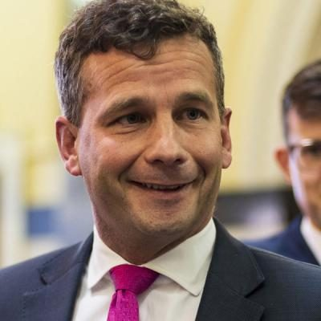 | [David Seymour](david-seymour/README.md) | MP (54th Parliament), standing in 2026 | Epsom | 1 | Leader of ACT (2014–); Deputy Prime Minister (2025–); Minister for Regulation (2023–) |
| 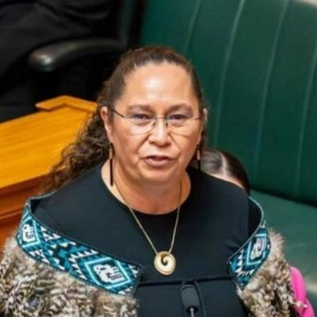 | [Nicole McKee](nicole-mckee/README.md) | MP (54th Parliament), standing in 2026 | Wellington Bays | 2 | Deputy Leader of ACT (2026–); Minister for Courts (2023–); Associate Minister of Justice (Firearms) (2023–) |
| 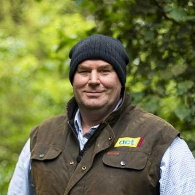 | [Andrew Hoggard](andrew-hoggard/README.md) | MP (54th Parliament), standing in 2026 | Rangitīkei | 3 | Minister for Biosecurity (2023–); Minister for Food Safety (2023–); Associate Minister of Agriculture (animal welfare, skills) and of the Environment (2023–) |
| 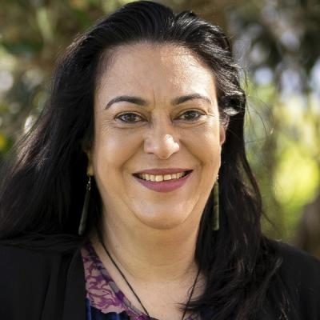 | [Karen Chhour](karen-chhour/README.md) | MP (54th Parliament), standing in 2026 | North Shore | 5 | Minister for Children (2023–); Minister for the Prevention of Family and Sexual Violence (2023–); ACT spokesperson on social development, children, child poverty (2020–2023) |
| 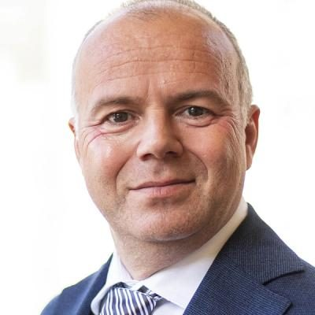 | [Todd Stephenson](todd-stephenson/README.md) | MP (54th Parliament), standing in 2026 | Southland | 6 | ACT whip (2023–); Parliamentary Private Secretary to the Associate Minister of Health (Pharmac, Medsafe) (2024–); ACT spokesperson on finance, health, justice, corrections, police, public service, arts, tourism |
| 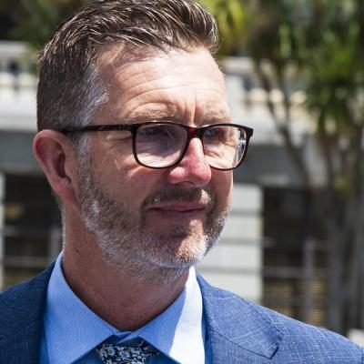 | [Simon Court](simon-court/README.md) | MP (54th Parliament), standing in 2026 | Kaipara ki Mahurangi | 8 | Parliamentary Under-Secretary to the Minister for Infrastructure and Minister for RMA Reform (2023–); ACT spokesperson on environment, climate change, infrastructure, transport, local government (2020–2023) |
| 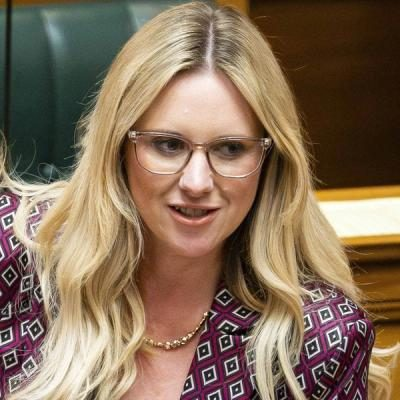 | [Laura McClure](laura-mcclure/README.md) | MP (54th Parliament), standing in 2026 | Wigram | 9 | ACT spokesperson on education, mental health, small business, seniors; Member, Social Services and Community Committee; Foreign Affairs, Defence and Trade Committee |
| 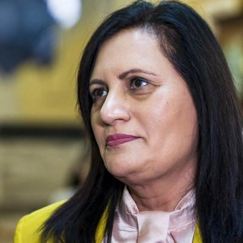 | [Parmjeet Parmar](parmjeet-parmar/README.md) | MP (54th Parliament), standing in 2026 | Pakuranga | 10 | ACT education spokesperson (2023–); Chair, Education and Workforce Committee (2018–2020, as National MP); National spokesperson on research, science and innovation (2017–2020) |
| 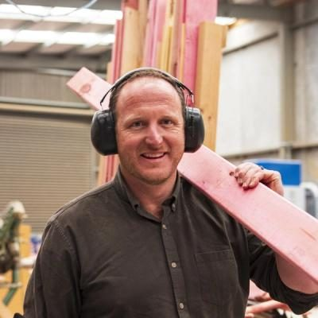 | [Cameron Luxton](cameron-luxton/README.md) | MP (54th Parliament), standing in 2026 | Mt Maunganui | 12 | ACT spokesperson on conservation, housing, building and construction, infrastructure, local government, transport; Member, Transport and Infrastructure Committee; Health Committee |
| 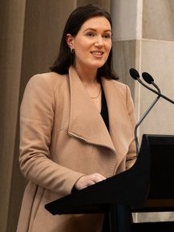 | [Brooke van Velden](brooke-van-velden/README.md) | MP (54th Parliament), retiring at 2026 election |  |  | Minister of Internal Affairs (2023–); Minister for Workplace Relations and Safety (2023–); Deputy Leader of ACT (2020–2026) |
| 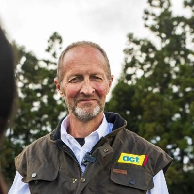 | [Mark Cameron](mark-cameron/README.md) | MP (54th Parliament), standing in 2026 | Northland |  | ACT spokesperson on primary industries, regional economic development, biosecurity (2020–2023) |

## 2026 candidates (41)

| | Name | Status | 2026 electorate | 2026 list # | Roles / notes |
|---|---|---|---|---|---|
| 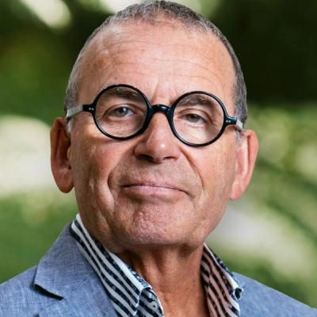 | [Paul Henry](paul-henry/README.md) | 2026 candidate |  | 4 | Broadcaster (TVNZ Breakfast 2004–2010; The Paul Henry Show; Paul Henry on TV3/Radio Live 2015–2016; host of The Traitors NZ and The Chase NZ); TVNZ board member (2025–2026); National candidate for Wairarapa (1999) |
| 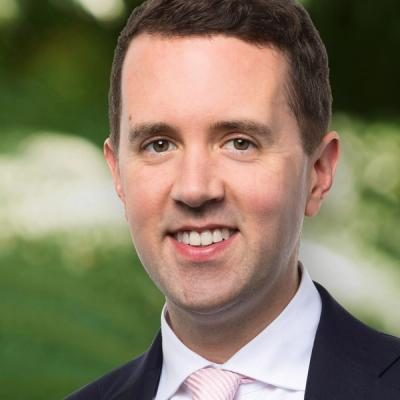 | [James Christmas](james-christmas/README.md) | 2026 candidate | Tāmaki | 7 | Before politics: Lawyer |
| 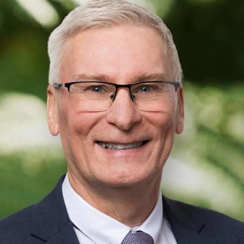 | [Iain Murray](iain-murray/README.md) | 2026 candidate | Selwyn | 11 |  |
|  | [Antonia Modkova](antonia-modkova/README.md) | 2026 candidate | Auckland Central | 13 | Before politics: Patent Attorney |
|  | [Alex Price](alex-price/README.md) | 2026 candidate | Mt Albert | 14 | Before politics: Chief Executive |
|  | [Janelle Hocking](janelle-hocking/README.md) | 2026 candidate | West Coast-Tasman | 15 | Before politics: Business owner |
| 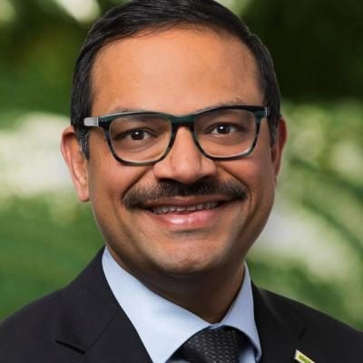 | [Ash Parmar](ash-parmar/README.md) | 2026 candidate | Waikato | 16 |  |
|  | [Yang Qu](yang-qu/README.md) | 2026 candidate | Mt Roskill | 17 | Before politics: Director/Investor |
| 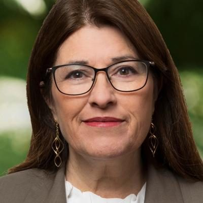 | [Davina Smolders](davina-smolders/README.md) | 2026 candidate |  | 18 | Before politics: Far North District Councillor |
|  | [Amanda Roberts](amanda-roberts/README.md) | 2026 candidate | Glendene | 19 | Before politics: Small Business Owner |
|  | [Callum Sheridan](callum-sheridan/README.md) | 2026 candidate | Waitākere | 20 | Before politics: Builder, NZDA President |
| 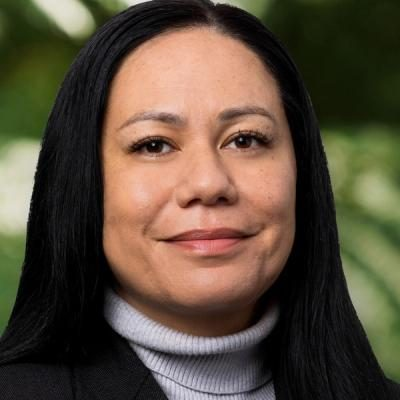 | [Henrietta Devoe](henrietta-devoe/README.md) | 2026 candidate | Ōtāhuhu | 21 | Before politics: Real Estate Agent |
|  | [Samuel MILLS](samuel-mills/README.md) | 2026 candidate | East Coast Bays | 22 | Before politics: Principal Corrections Officer |
| 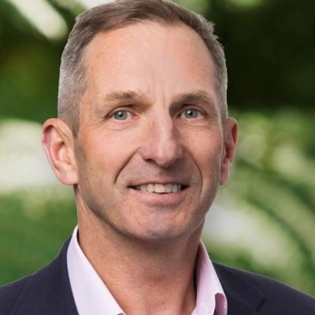 | [Nigel Elder](nigel-elder/README.md) | 2026 candidate | Remutaka | 23 |  |
|  | [Tom Spooner](tom-spooner/README.md) | 2026 candidate | Kaikōura | 24 | Before politics: Business owner - Engineer |
| 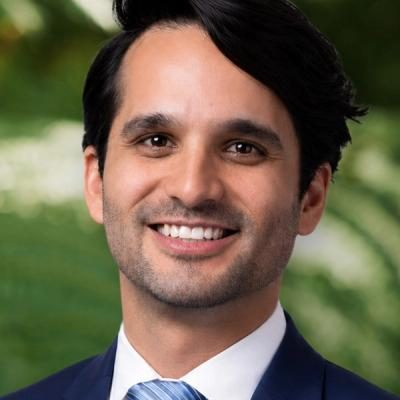 | [Juan Alvarez de Lugo](juan-alvarez-de-lugo/README.md) | 2026 candidate | Maungakiekie | 25 | Before politics: Engineer |
| 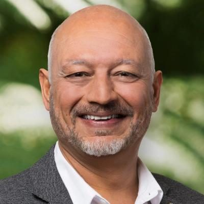 | [Manu Singh](manu-singh/README.md) | 2026 candidate | Māngere | 26 | Before politics: Owner Franchise Harcourts Ōtāhuhu |
|  | [Helena Roza](helena-roza/README.md) | 2026 candidate | Whangaparāoa | 27 | Before politics: Business owner/ Entrepreneur |
|  | [Ali Dahche](ali-dahche/README.md) | 2026 candidate | Botany | 28 | Before politics: Entrepreneur/ Businessman |
| 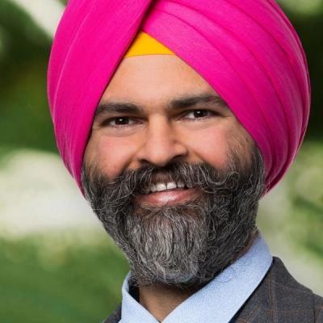 | [Malkiat Singh](malkiat-singh/README.md) | 2026 candidate | Papakura | 29 | Before politics: Engineer+Agile coach+Farmer |
| 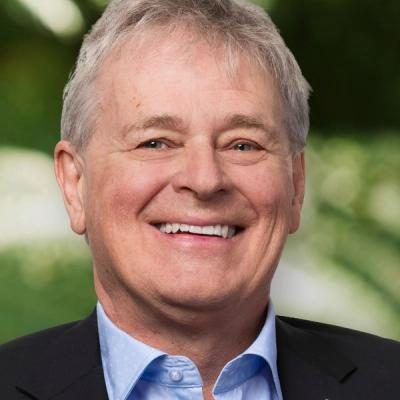 | [Ashley Bettridge](ashley-bettridge/README.md) | 2026 candidate | Waimakariri | 30 |  |
|  | [Zac WELLMAN](zac-wellman/README.md) | 2026 candidate | Banks Peninsula | 31 | Before politics: Electrician |
|  | [Robbie Byars](robbie-byars/README.md) | 2026 candidate | Taieri | 32 | Before politics: Dairy Farmer |
|  | [Matthew Hague](matthew-hague/README.md) | 2026 candidate | Wellington North | 33 | Before politics: Lawyer |
| 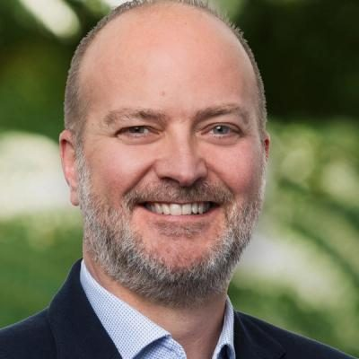 | [Nick Peirce](nick-peirce/README.md) | 2026 candidate | Henderson | 34 | Before politics: Revenue & Distribution Lead |
| 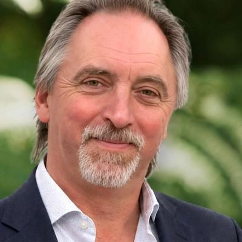 | [Darrin Hawkes](darrin-hawkes/README.md) | 2026 candidate | East Cape | 35 | Before politics: Mechanical Engineer/Director |
|  | [Panos Patros](panos-patros/README.md) | 2026 candidate | Upper Harbour | 36 | Before politics: Principal Software Engineer |
| 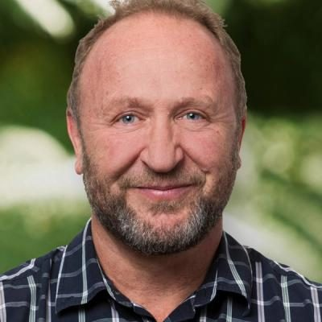 | [Aaron Allred](aaron-allred/README.md) | 2026 candidate | Rangitata | 37 | Before politics: Chartered Accountant |
| 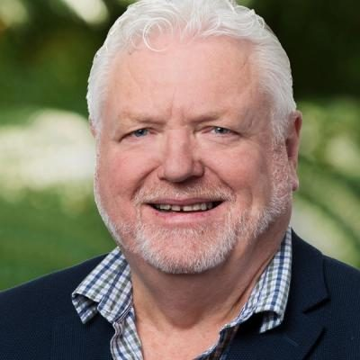 | [Doug Graham](doug-graham/README.md) | 2026 candidate | Whangārei | 38 |  |
| 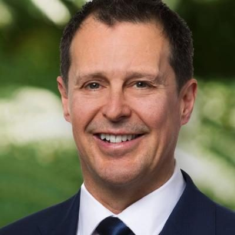 | [Bruce McGechan](bruce-mcgechan/README.md) | 2026 candidate | Palmerston North |  | Before politics: Businessperson |
| 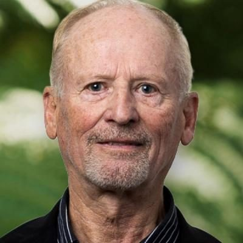 | [Bryan Norton](bryan-norton/README.md) | 2026 candidate | Tauranga |  | Before politics: Producer/Director |
| 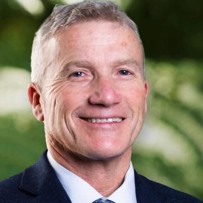 | [Chris Baillie](chris-baillie/README.md) | 2026 candidate | Nelson |  | ACT spokesperson on small business, workplace relations, education and police (2020–2023); Member, Education and Workforce Committee |
|  | [Ivana Jovicic](ivana-jovicic/README.md) | 2026 candidate | Taranaki-King Country |  | Before politics: Clinical Pharmacist |
| 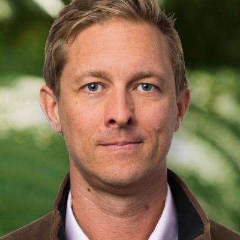 | [John Ormond](john-ormond/README.md) | 2026 candidate | Napier |  | Before politics: Business Development Executive |
| 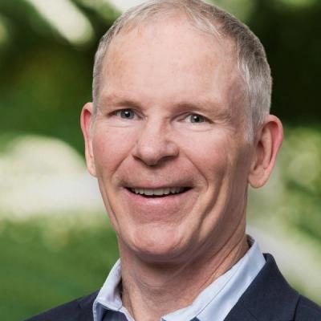 | [Ken Harpur](ken-harpur/README.md) | 2026 candidate | Ilam |  | Before politics: Supervisor, Confectionary Chef |
|  | [Martin Lundqvist](martin-lundqvist/README.md) | 2026 candidate | Northcote |  | Before politics: Registered Nurse |
| 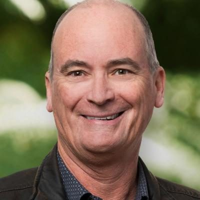 | [Mike McCormick](mike-mccormick/README.md) | 2026 candidate | Coromandel |  | Before politics: Truck Driver |
|  | [Rob Douglas](rob-douglas/README.md) | 2026 candidate | Tukituki |  | Before politics: Property Valuer |
| 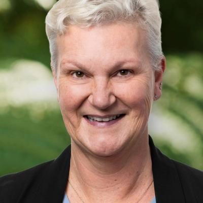 | [Sarah Jane Lochead-Macmillan](sarah-jane-lochead-macmillan/README.md) | 2026 candidate | Port Waikato |  | Before politics: Fractional GM |
| 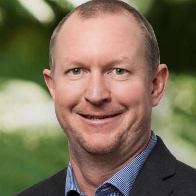 | [Sean Beamish](sean-beamish/README.md) | 2026 candidate | Waitaki |  | Before politics: Maintenance Engineer |
|  | [Toni Severin](toni-severin/README.md) | 2026 candidate | Christchurch East |  | ACT spokesperson on ACC, corrections and disability issues (2020–2023); Member, Health and Regulations Review Committees |

## Former MPs (3)

| | Name | Status | 2026 electorate | 2026 list # | Roles / notes |
|---|---|---|---|---|---|
|  | [Damien Smith](damien-smith/README.md) | Former MP |  |  | ACT spokesperson on commerce, SOEs, revenue, land information, arts, sport; associate finance (2020–2023); Member, Finance and Expenditure Committee — Did not stand for re-election in 2023 (gave no reason) |
|  | [James McDowall](james-mcdowall/README.md) | Former MP |  |  | ACT spokesperson on immigration, defence, economic development, science and innovation, tourism (2020–2023); Member, Transport and Infrastructure Committee — Did not seek re-election in 2023 |
|  | [John Banks](john-banks/README.md) | Former MP |  |  | Leader of ACT (2012–2014); Minister for Regulatory Reform and Minister for Small Business (2011–2013); Associate Minister of Commerce and of Education (2011–2013) — Left Parliament on 13 June 2014 after being found guilty of filing a false electoral return; the conviction was overturned by the Court of Appeal in late 2014 and no retrial was held (May 2015) |

_Built by `tools/people_others_index.py` from each profile's `person.json`. Candidate details come from policy.nz; MP histories from Wikipedia and the sources cited in each profile._
