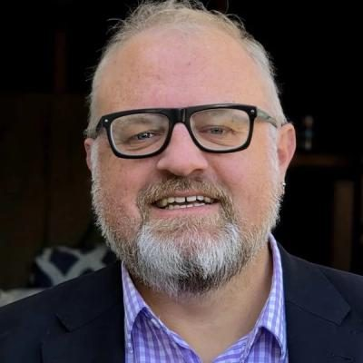
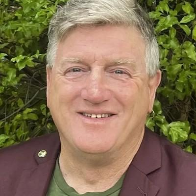
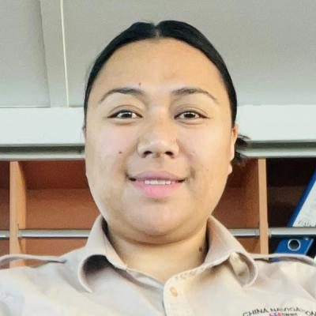

# Alliance — people

Profiles of 11 people associated with Alliance: MPs who served in the 50th–54th Parliaments (2011–2026) and every 2026 candidate listed on policy.nz. Status is as of 23 October 2026 (election day 7 November 2026). Each person sits under their current or most recent party. Click a name for the full profile.

## 2026 candidates (11)

| | Name | Status | 2026 electorate | 2026 list # | Roles / notes |
|---|---|---|---|---|---|
|  | [Victor Billot](victor-billot/README.md) | 2026 candidate | Dunedin | 1 | Leader of the Alliance (2026–; co-leader 2007–2008); Alliance president (2006, and later period); Communications officer, Maritime Union of NZ (2003–2016, again from c. 2022) |
|  | [Anna Knight](anna-knight/README.md) | 2026 candidate | Taieri |  | Before politics: Translator |
|  | [Courtney Fraser](courtney-fraser/README.md) | 2026 candidate | Ilam |  | Before politics: Group Sustainability Manager |
|  | [Ethan Gullery](ethan-gullery/README.md) | 2026 candidate | Christchurch East |  | Before politics: Senior Data Analyst & Dev |
|  | [Greg Byrnes](greg-byrnes/README.md) | 2026 candidate | Christchurch Central |  | Before politics: General Manager Environmental |
|  | [Jesse Luke](jesse-luke/README.md) | 2026 candidate | Selwyn |  | Before politics: Warehouse Operator |
|  | [Joshua HARFORD](joshua-harford/README.md) | 2026 candidate | Wellington North |  | Before politics: Hospitality Worker |
|  | [Joshua Moss](joshua-moss/README.md) | 2026 candidate | Palmerston North |  | Before politics: Student and part-time worker |
|  | [Kyle Turnbull](kyle-turnbull/README.md) | 2026 candidate | Banks Peninsula |  |  |
|  | [Sara Dyatlova–Murphy](sara-dyatlovamurphy/README.md) | 2026 candidate | West Coast-Tasman |  | Before politics: Software Developer/Parent |
|  | [Victoria Ale](victoria-ale/README.md) | 2026 candidate | Wairarapa |  | Before politics: Navigation Officer |

_Built by `tools/people_others_index.py` from each profile's `person.json`. Candidate details come from policy.nz; MP histories from Wikipedia and the sources cited in each profile._
