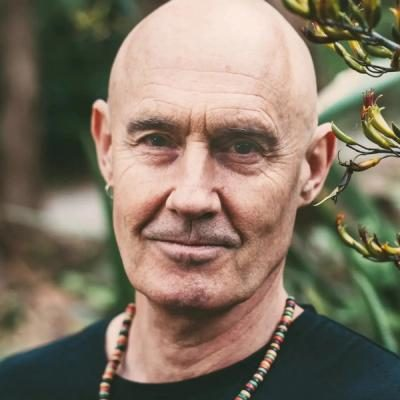
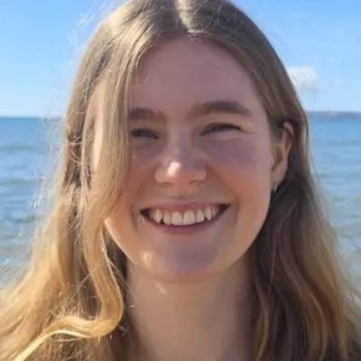
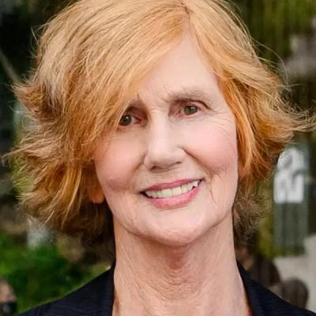

# Animal Justice Party — people

Profiles of 9 people associated with Animal Justice Party: MPs who served in the 50th–54th Parliaments (2011–2026) and every 2026 candidate listed on policy.nz. Status is as of 23 October 2026 (election day 7 November 2026). Each person sits under their current or most recent party. Click a name for the full profile.

## 2026 candidates (9)

| | Name | Status | 2026 electorate | 2026 list # | Roles / notes |
|---|---|---|---|---|---|
|  | [Avalua Tavui](avalua-tavui/README.md) | 2026 candidate | Manurewa |  | Before politics: Customer Care Team Leader |
|  | [Brian Baker](brian-baker/README.md) | 2026 candidate | Palmerston North |  |  |
|  | [Caitlin Grattan](caitlin-grattan/README.md) | 2026 candidate | Mt Maunganui |  |  |
|  | [Lily Carrington](lily-carrington/README.md) | 2026 candidate | Northcote |  |  |
|  | [Lynley Tulloch](lynley-tulloch/README.md) | 2026 candidate | Takanini |  |  |
|  | [Priyanka Deo](priyanka-deo/README.md) | 2026 candidate | Mt Roskill |  |  |
|  | [Rob McNEIL](rob-mcneil/README.md) | 2026 candidate | Glendene |  |  |
|  | [Sam Connely](sam-connely/README.md) | 2026 candidate | Tauranga |  |  |
|  | [Sandra Kyle](sandra-kyle/README.md) | 2026 candidate | Whanganui |  |  |

_Built by `tools/people_others_index.py` from each profile's `person.json`. Candidate details come from policy.nz; MP histories from Wikipedia and the sources cited in each profile._
