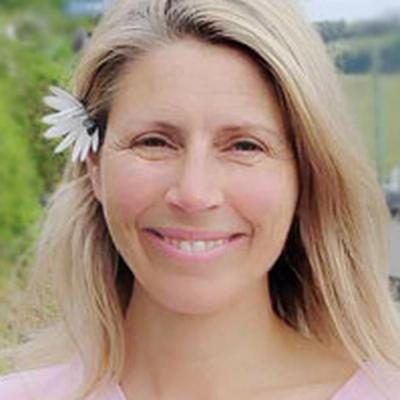
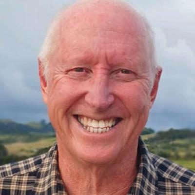
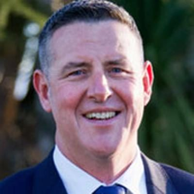
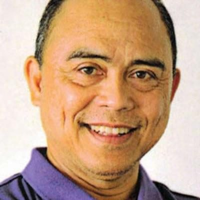

# Conservative Party — people

Profiles of 6 people associated with Conservative Party: MPs who served in the 50th–54th Parliaments (2011–2026) and every 2026 candidate listed on policy.nz. Status is as of 23 October 2026 (election day 7 November 2026). Each person sits under their current or most recent party. Click a name for the full profile.

## 2026 candidates (6)

| | Name | Status | 2026 electorate | 2026 list # | Roles / notes |
|---|---|---|---|---|---|
|  | [AmyLorraine TURNER](amylorraine-turner/README.md) | 2026 candidate | Banks Peninsula |  |  |
|  | [Douglas Robert LYELL](douglas-robert-lyell/README.md) | 2026 candidate | Northland |  |  |
|  | [Helen Houghton](helen-houghton/README.md) | 2026 candidate | Christchurch East |  | Before politics: A school teacher for 16 years |
|  | [Karl Thomas](karl-thomas/README.md) | 2026 candidate | Rangitata |  |  |
|  | [Marie Drury](marie-drury/README.md) | 2026 candidate | Northcote |  | Before politics: Clinical Education Manager |
|  | [Mel Libre](mel-libre/README.md) | 2026 candidate |  |  |  |

_Built by `tools/people_others_index.py` from each profile's `person.json`. Candidate details come from policy.nz; MP histories from Wikipedia and the sources cited in each profile._
