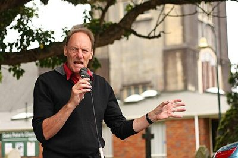

# Free Palestine — people

Profiles of 2 people associated with Free Palestine: MPs who served in the 50th–54th Parliaments (2011–2026) and every 2026 candidate listed on policy.nz. Status is as of 23 October 2026 (election day 7 November 2026). Each person sits under their current or most recent party. Click a name for the full profile.

## 2026 candidates (2)

| | Name | Status | 2026 electorate | 2026 list # | Roles / notes |
|---|---|---|---|---|---|
|  | [John Minto](john-minto/README.md) | 2026 candidate |  | 1 | National chair, Halt All Racist Tours (from 1980); Chair/co-chair, Palestine Solidarity Network Aotearoa; Co-vice-president, Mana Movement |
|  | [William Donald Alexander](william-donald-alexander/README.md) | 2026 candidate | Wigram |  |  |

_Built by `tools/people_others_index.py` from each profile's `person.json`. Candidate details come from policy.nz; MP histories from Wikipedia and the sources cited in each profile._
