# Green Party — people

Profiles of 76 people associated with Green Party: MPs who served in the 50th–54th Parliaments (2011–2026) and every 2026 candidate listed on policy.nz. Status is as of 23 October 2026 (election day 7 November 2026). Each person sits under their current or most recent party. Click a name for the full profile.

## Current MPs (54th Parliament) (15)

| | Name | Status | 2026 electorate | 2026 list # | Roles / notes |
|---|---|---|---|---|---|
|  | [Marama Davidson](marama-davidson/README.md) | MP (54th Parliament), standing in 2026 |  | 1 | Green Party co-leader (2018–); Minister for the Prevention of Family and Sexual Violence (2020–2023); Associate Minister of Housing (Homelessness) (2020–2023) |
|  | [Chlöe Swarbrick](chloe-swarbrick/README.md) | MP (54th Parliament), standing in 2026 | Auckland Central | 2 | Green Party co-leader (2024–); Green spokesperson on finance, climate change, mental health, drug law reform, revenue (various); Co-founder, Cross-Party Group on Mental Health and Addictions (2019) |
| 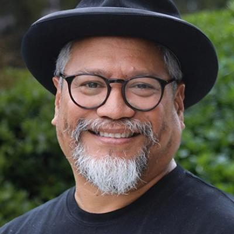 | [Teanau Tuiono](teanau-tuiono/README.md) | MP (54th Parliament), standing in 2026 | Palmerston North | 3 | Third Assistant Speaker (2023–); Green spokesperson on Pacific region, education, workplace relations, national security, agriculture (various) |
|  | [Tamatha Paul](tamatha-paul/README.md) | MP (54th Parliament), standing in 2026 | Wellington North | 4 | Green spokesperson on justice, housing, police, courts, corrections, youth, Wellington issues; Wellington City Councillor, Pukehīnau/Lambton Ward (2019–2023); President, Victoria University of Wellington Students' Association (2019) |
|  | [Julie Anne Genter](julie-anne-genter/README.md) | MP (54th Parliament), standing in 2026 | Wellington Bays | 5 | Minister for Women (2017–2020); Associate Minister of Health (2017–2020); Associate Minister of Transport (2017–2020) |
|  | [Lan Pham](lan-pham/README.md) | MP (54th Parliament), standing in 2026 | Kenepuru | 6 | Green spokesperson on environment, water services, biosecurity, emergency management, land information, tourism; Environment Canterbury regional councillor (2016–2022); Freshwater commissioner |
|  | [Hūhana Lyndon](huhana-lyndon/README.md) | MP (54th Parliament), standing in 2026 | Te Tai Tokerau | 7 | Green spokesperson on health, Whānau Ora, Māori development, forestry; CEO, Ngātiwai Trust Board (2021–2023); CEO, Ngāti Hine Forestry Trust (2019–2021) |
|  | [Lawrence Xu-Nan](lawrence-xu-nan/README.md) | MP (54th Parliament), standing in 2026 | Epsom | 8 | Green spokesperson on courts, education, ethnic communities, justice, seniors, trade; Member, Justice Committee (2025–); Green Party male policy co-convenor (2020–2023) and party co-convenor (2023–) |
|  | [Ricardo Menéndez March](ricardo-menendez-march/README.md) | MP (54th Parliament), standing in 2026 | Mt Albert | 9 | Green Party musterer (whip) (2023–); Green spokesperson on social development, employment, immigration, associate health (primary health); Coordinator, Auckland Action Against Poverty (2017–2020) |
| 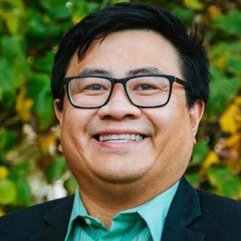 | [Francisco Hernandez](francisco-hernandez/README.md) | MP (54th Parliament), standing in 2026 | Dunedin | 10 | Green spokesperson on public services, tertiary education, regulation, statistics, science and technology; President, Otago University Students' Association (2013); Chief climate change adviser, Otago Regional Council |
|  | [Kahurangi Carter](kahu-carter/README.md) | MP (54th Parliament), standing in 2026 | Christchurch Central | 11 | Green deputy musterer (whip) (2023–); Green spokesperson on zero waste, children, disability issues, rainbow communities, arts, Christchurch issues |
|  | [Steve Abel](steve-abel/README.md) | MP (54th Parliament), standing in 2026 | Waitākere | 12 | Green spokesperson on agriculture, animal welfare, food safety, Māori-Crown relations, just transitions, resources; Greenpeace campaigner (2002–2006, 2010–2023) |
|  | [Scott Willis](scott-willis/README.md) | MP (54th Parliament), standing in 2026 | Taieri | 15 | Green spokesperson on energy, regional development, rural communities, Dunedin issues; General manager, Blueskin Energy Ltd |
|  | [Mike Davidson](mike-davidson/README.md) | MP (54th Parliament), standing in 2026 | Ilam | 20 | Christchurch City Councillor, Papanui ward (2016–2022); Chair, CCC Urban Development and Transport Committee; Shirley-Papanui Community Board (2013–2016) |
| 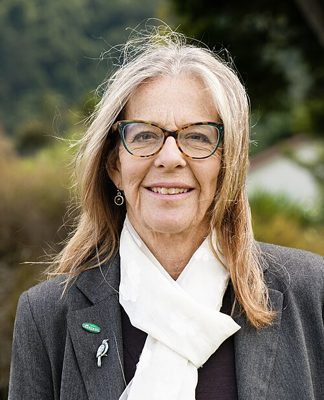 | [Celia Wade-Brown](celia-wade-brown/README.md) | MP (54th Parliament), retiring at 2026 election |  |  | Mayor of Wellington (2010–2016); Wellington City Councillor, Southern Ward (1994–1998, 2001–2010); Green spokesperson on democracy and electoral reform, local government, digitising government, tourism |

## 2026 candidates (43)

| | Name | Status | 2026 electorate | 2026 list # | Roles / notes |
|---|---|---|---|---|---|
| 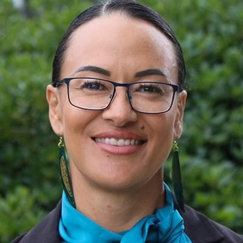 | [Tania Waikato](tania-waikato/README.md) | 2026 candidate | Waiariki | 13 |  |
| 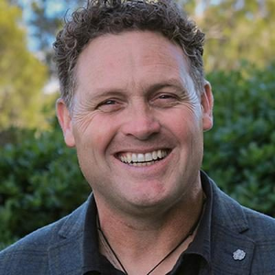 | [Craig Pauling](craig-pauling/README.md) | 2026 candidate | Banks Peninsula | 14 | Chair, Environment Canterbury (Oct 2024 – Oct 2025); Deputy chair, Environment Canterbury (2022–2024); Environment Canterbury councillor, Christchurch West/Ōpuna (2019–2025) |
|  | [Rohan O'Neill-Stevens](rohan-oneill-stevens/README.md) | 2026 candidate | Nelson | 16 | Deputy Mayor of Nelson (2022–2025); Nelson City Councillor (2019–2025); Green Party 2023 campaign convenor; former Young Greens co-convenor |
|  | [Bhen Goodsir](bhen-goodsir/README.md) | 2026 candidate | Northcote | 17 | Before politics: Banking regulator |
| 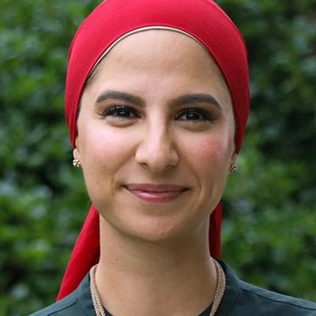 | [Yasmine Serhan](yasmine-serhan/README.md) | 2026 candidate | Glendene | 18 | Before politics: Union Organiser, ECE Teacher |
|  | [Louise Hutt](louise-hutt/README.md) | 2026 candidate | Hamilton West | 19 |  |
| 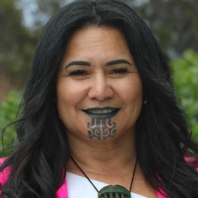 | [Heather Te Au-Skipworth](heather-te-au-skipworth/README.md) | 2026 candidate | Ikaroa-Rāwhiti | 21 |  |
| 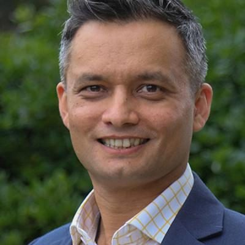 | [Shreejan Pandey](shreejan-pandey/README.md) | 2026 candidate | Wigram | 22 |  |
| 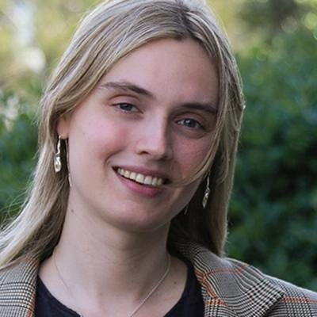 | [Lauren Craig](lauren-craig/README.md) | 2026 candidate | Wairarapa | 23 | Before politics: Policy Advisor |
|  | [Zephyr Brown](zephyr-brown/README.md) | 2026 candidate | Kaipara ki Mahurangi | 24 | Before politics: Operations Manager |
|  | [Josh Jacobsen](josh-jacobsen/README.md) | 2026 candidate | North Shore | 25 | Before politics: Head of Software Engineering |
|  | [Angela Dalton](angela-dalton/README.md) | 2026 candidate | Papakura | 26 | Auckland Councillor, Manurewa-Papakura ward (2019–2025); Manurewa Local Board member (2010–2019); Manurewa Community Board member (2007–2010) |
|  | [Alika Wells](alika-wells/README.md) | 2026 candidate | Henderson | 27 |  |
|  | [Carl Morgan](carl-morgan/README.md) | 2026 candidate | Port Waikato | 28 | Before politics: Conservation Advocate |
|  | [Courtney White](courtney-white/README.md) | 2026 candidate | Hutt South | 29 | Before politics: Communications specialist |
| 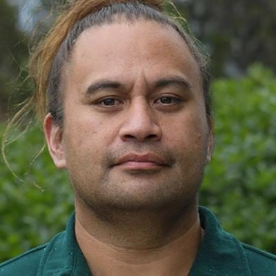 | [Te Whatanui Skipwith](te-whatanui-skipwith/README.md) | 2026 candidate | Ōtāhuhu | 30 | Before politics: Community support/youth worker |
|  | [Melody Willis](melody-willis/README.md) | 2026 candidate | Kapiti | 31 | Before politics: Public Servant and Student |
|  | [Pamela Grealey](pamela-grealey/README.md) | 2026 candidate | Coromandel | 33 | Before politics: Self-employed advocate/mentor |
| 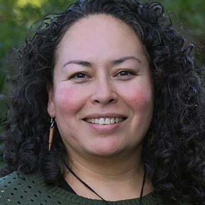 | [Alma de Anda](alma-de-anda/README.md) | 2026 candidate | Selwyn | 34 | Before politics: FT Mum & PT health advocate |
|  | [Chris Norton](chris-norton/README.md) | 2026 candidate | Remutaka | 35 | Before politics: Senior Advisor (Tertiary Educ) |
|  | [Lisa Te Morenga](lisa-te-morenga/README.md) | 2026 candidate | Te Tai Tonga | 46 | Professor, Research Centre for Hauora and Health, Massey University (2024–); Rutherford Discovery Fellow (2021) |
|  | [Michel Mulipola](michel-mulipola/README.md) | 2026 candidate | Māngere | 49 | Comic book artist ('Bloody Samoan'); Professional wrestler; Story artist and cultural consultant, Disney's Moana 2 (2023) |
|  | [Abe McKee](abe-mckee/README.md) | 2026 candidate | East Coast Bays |  | Before politics: Sales Manager |
|  | [Adam Powell](adam-powell/README.md) | 2026 candidate | Maungakiekie |  | Before politics: Primary School Teacher |
| 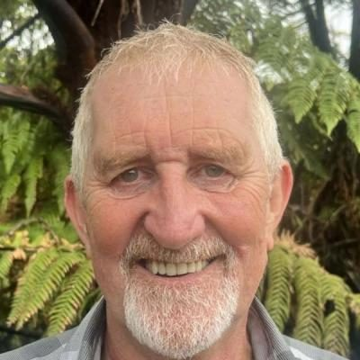 | [Andrew Beaumont](andrew-beaumont/README.md) | 2026 candidate | West Coast-Tasman |  | Before politics: Self employed coffee and food |
|  | [Anjana Iyer](anjana-iyer/README.md) | 2026 candidate | Mt Roskill |  |  |
| 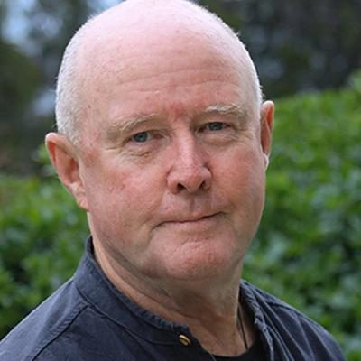 | [Bernard Long](bernard-long/README.md) | 2026 candidate | Rangitīkei |  | Before politics: Authorised Financial Adviser |
|  | [Celine Kearney](celine-kearney/README.md) | 2026 candidate | Taupō |  | Before politics: English Language Teacher |
|  | [Daniël Oosthuizen](daniel-oosthuizen/README.md) | 2026 candidate | Tauranga |  |  |
|  | [Dave Kennedy](dave-kennedy/README.md) | 2026 candidate | Invercargill |  | Before politics: Not for profit governnance |
| 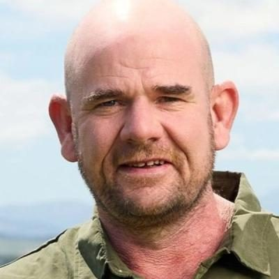 | [Dave Richards](dave-richards/README.md) | 2026 candidate | Rangitata |  |  |
|  | [Donald Mackenzie-Mayo](donald-mackenzie-mayo/README.md) | 2026 candidate | Tāmaki |  | Before politics: Medical Graduate and TV Writer |
| 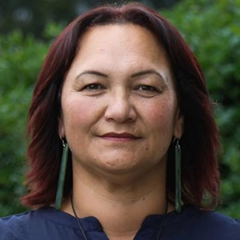 | [Florence Te Ohaere](florence-te-ohaere/README.md) | 2026 candidate | Tāmaki Makaurau |  |  |
| 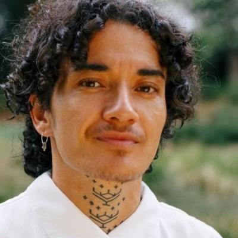 | [Jordan Walker](jordan-walker/README.md) | 2026 candidate | East Cape |  |  |
|  | [Lucian Plaumann](lucian-plaumann/README.md) | 2026 candidate |  |  |  |
|  | [Mark Longworth](mark-longworth/README.md) | 2026 candidate | Tukituki |  |  |
|  | [Mike FINLAYSON](mike-finlayson/README.md) | 2026 candidate | Northland |  | Before politics: Small business owner |
| 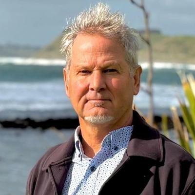 | [Phil McCabe](phil-mccabe/README.md) | 2026 candidate | Taranaki-King Country |  |  |
| 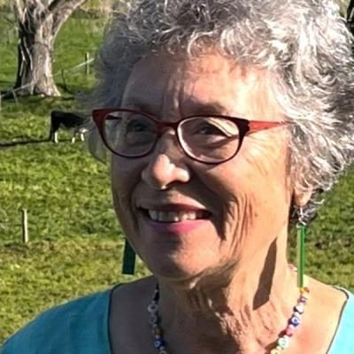 | [Pualele Westhead](pualele-westhead/README.md) | 2026 candidate | Mt Maunganui |  |  |
| 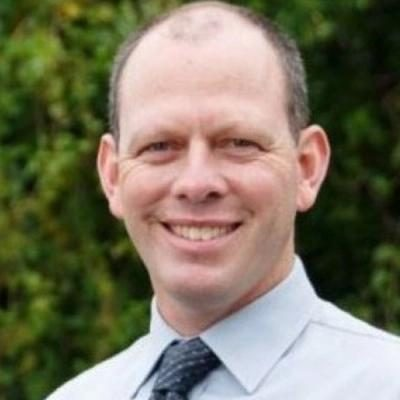 | [Richard Wesley](richard-wesley/README.md) | 2026 candidate | Waimakariri |  |  |
|  | [Roy Boonen](roy-boonen/README.md) | 2026 candidate | Napier |  | Before politics: Businessperson |
| 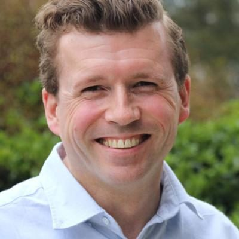 | [Ryan Richards](ryan-richards/README.md) | 2026 candidate | Upper Harbour |  | Before politics: Partnerships Manager |
| 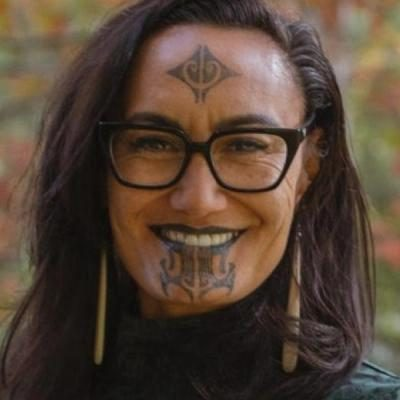 | [Teresa Butler](teresa-butler/README.md) | 2026 candidate | Christchurch East |  | Before politics: No |

## Former MPs (18)

| | Name | Status | 2026 electorate | 2026 list # | Roles / notes |
|---|---|---|---|---|---|
| 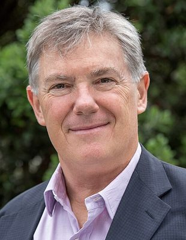 | [Barry Coates](barry-coates/README.md) | Former MP |  |  | Executive Director, Oxfam New Zealand (2003–2014); Executive Director, World Development Movement (1996–2003); Coordinator, It's Our Future (anti-TPPA campaign) — Not re-elected in 2017 |
| 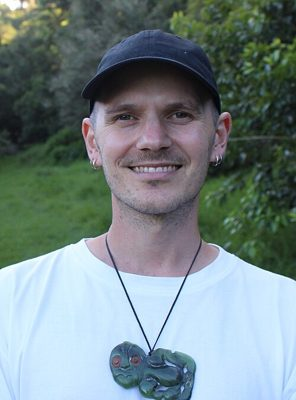 | [Benjamin Doyle](benjamin-doyle/README.md) | Former MP |  |  | Green spokesperson on ACC, internal affairs, takatāpui and rainbow communities (2024–2025); Member, Māori Affairs Committee — Resigned from Parliament effective 3 October 2025, citing threats to their safety and their family's |
|  | [Catherine Delahunty](catherine-delahunty/README.md) | Former MP |  |  | Green Party female co-convenor (2003–2005); Green spokesperson on Education, Water, Toxics, Te Tiriti o Waitangi, Mining, Forestry, Disability Issues, Women's Affairs and others — Retired from Parliament at the 2017 election |
|  | [David Clendon](david-clendon/README.md) | Former MP |  |  | Green Party co-convenor (2001–2004); Green Party musterer (whip) (2014–2017); deputy musterer (2010–2011); Green spokesperson on corrections (2009–2017), police, courts — Left Parliament at the 2017 election after withdrawing as a Green candidate |
| 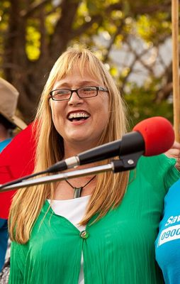 | [Denise Roche](denise-roche/README.md) | Former MP |  |  | Auckland City Councillor, Hauraki Gulf Islands (2007–2010); Waiheke Local Board member (2010–2011); Waitematā Local Board member (from 2018) — Not re-elected in 2017 |
| 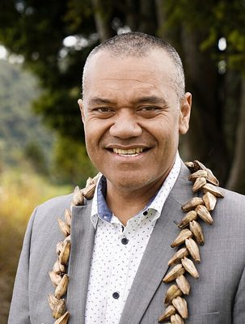 | [Efeso Collins](efeso-collins/README.md) | Deceased |  |  | Auckland Councillor, Manukau ward (2016–2022); Chair, Ōtara-Papatoetoe Local Board (2013–2016); President, Auckland University Students' Association (1999) — Died on 21 February 2024, aged 49, after collapsing at a ChildFund charity fun run in Auckland, less than a week after his maiden speech |
|  | [Eugenie Sage](eugenie-sage/README.md) | Former MP |  |  | Minister of Conservation (2017–2020); Minister for Land Information (2017–2020); Associate Minister for the Environment (2017–2020) — Retired from Parliament at the October 2023 election after 12 years |
| 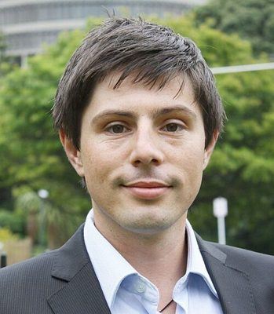 | [Gareth Hughes](gareth-hughes/README.md) | Former MP |  |  | Green Party musterer (whip) (2017–2020); Green spokesperson on transport, energy, oceans, ICT, tertiary education and others — Retired at the 2020 election |
| 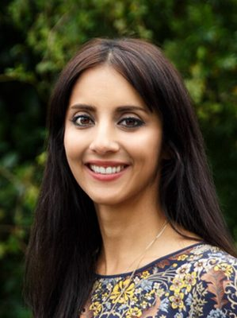 | [Golriz Ghahraman](golriz-ghahraman/README.md) | Former MP |  |  | Green spokesperson on foreign affairs, defence and justice (2017–2024); Green spokesperson on immigration (2017–2020), ethnic communities and refugees (2020–2024); Member, Foreign Affairs, Defence and Trade Committee (2017–2024) — Resigned from Parliament effective 18 January 2024 amid shoplifting allegations; convicted on four shoplifting charges in June 2024 and fined $1,600; appealed in October 2024 seeking a discharge without conviction (outcome not confirmed in sources consulted) |
| 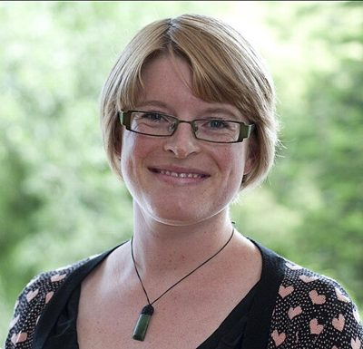 | [Holly Walker](holly-walker/README.md) | Former MP |  |  | Green spokesperson on housing, electoral reform, children, open government, arts and students (2011–2014); Deputy executive director, Helen Clark Foundation (2020–2022) — Left Parliament in 2014 |
| 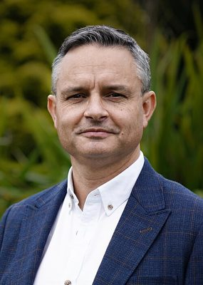 | [James Shaw](james-shaw/README.md) | Former MP |  |  | Green Party co-leader (2015–2024); Minister for Climate Change (2017–2023); Minister of Statistics (2017–2020) — Retired from Parliament on 5 May 2024 |
| 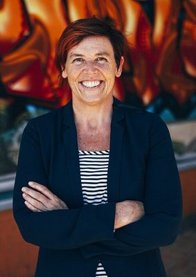 | [Jan Logie](jan-logie/README.md) | Former MP |  |  | Parliamentary Under-Secretary to the Minister of Justice (domestic and sexual violence) (2017–2020); Chair, Social Services and Community Committee; Green Party musterer (whip) — Retired from Parliament at the 2023 election (announced December 2022) |
|  | [Kennedy Graham](kennedy-graham/README.md) | Former MP |  |  | Green Party whip/musterer (2008–2011); Green spokesperson on foreign affairs, climate change, defence, disarmament, justice; Founder and chair of GLOBE-NZ cross-party climate group (2015) — Retired from Parliament in 2017 after withdrawing as a Green candidate; no longer a Green member (party rejected his return in 2017) |
|  | [Kevin Hague](kevin-hague/README.md) | Party official |  |  | Green spokesperson on health, conservation, biosecurity, rural affairs, rainbow issues and sport (2008–2016); Chief executive, Forest & Bird (2016–2022); Green Party chief of staff (2025–) — Green Party chief of staff since November 2025 (announced) |
| 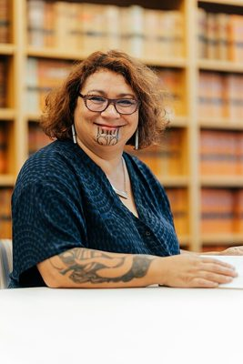 | [Metiria Turei](metiria-turei/README.md) | Former MP |  |  | Green Party co-leader (2009–2017); Green spokesperson on Inequality, Justice, Building and Housing — Retired from politics after losing Te Tai Tonga in 2017 |
|  | [Mojo Mathers](mojo-mathers/README.md) | Former MP |  |  | Green spokesperson on animal welfare, disability issues, commerce and consumer affairs, civil defence, food (2011–2017); Chief executive, Disabled Persons Assembly NZ (2023–) — Lost her seat in 2017 |
|  | [Russel Norman](russel-norman/README.md) | Former MP |  |  | Green Party co-leader (2006–2015); Member of the Intelligence and Security Committee (as co-leader) — Left Parliament and the Green Party in October 2015 to become Executive Director of Greenpeace Aotearoa New Zealand |
| 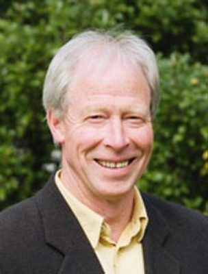 | [Steffan Browning](steffan-browning/README.md) | Former MP |  |  | Green spokesperson on organics, food safety and (until Nov 2014) natural health products; Soil & Health Association spokesperson (from 2003) — Retired from Parliament at the 2017 election (announced 15 December 2016) |

_Built by `tools/people_others_index.py` from each profile's `person.json`. Candidate details come from policy.nz; MP histories from Wikipedia and the sources cited in each profile._
