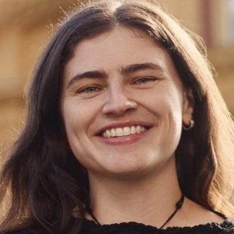

# Chlöe Swarbrick

| | |
|---|---|
| **Party (current/most recent)** | Green Party |
| **Status** | MP (54th Parliament), standing in 2026 |
| **Party history** | Green Party (2016–present) |
| **Parliaments (50th–54th)** | 52, 53, 54 |
| **First elected** | 2017 |
| **Electorates held** | Auckland Central (2020–2026) |
| **Key roles** | Green Party co-leader (2024–) Green spokesperson on finance, climate change, mental health, drug law reform, revenue (various) Co-founder, Cross-Party Group on Mental Health and Addictions (2019) |
| **Born** | 1994-06-26, Auckland |
| **2026 election** | contesting Auckland Central, list #2 |
| **Wikipedia** | [Chlöe Swarbrick](https://en.wikipedia.org/wiki/Chl%C3%B6e_Swarbrick) |

Photo: Supplied to policy.nz by the candidate/party — [source](https://cdn.sanity.io/images/ubdwo62y/production/36dbabec999a7dd83352030dd1b9c079b7b3d6cd-1024x1024.jpg)

## Current status

Green Party co-leader (with Marama Davidson) and MP for Auckland Central since 2020. Standing again in **Auckland Central** and ranked **#2** on the Green list for the 7 November 2026 election.

## Biography

Born in Auckland on 26 June 1994; educated at Epsom Girls' Grammar and the University of Auckland (LLB and BA in philosophy, 2016). Before politics she co-founded the fashion label The Lucid Collective, worked as a newsreader, producer and host at student radio 95bFM, edited and co-owned *What's Good* magazine, and co-ran a digital consultancy and a café-gallery. Recipient of a New Zealander of the Year Local Hero award, the Jane Goodall Trailblazer Award (2019) and Fortune's "40 Under 40" (2020). She has spoken publicly about depression, anxiety and an adult ADHD diagnosis.

## Political career

- Third in the 2016 Auckland mayoral election (29,098 votes) aged 22; joined the Greens afterwards.
- Elected a list MP in 2017 (list #7, Maungakiekie candidate) at 23 — the youngest MP since Marilyn Waring in 1975.
- Won **Auckland Central** in 2020 (12,631 votes to Labour's 11,563), the first Green electorate win since 1999 and the first by a minor-party MP without a tacit major-party deal since Winston Peters; held it in 2023 by 3,896 votes.
- Elected co-leader on 10 March 2024 with 169 delegate votes to none for Alex Foulkes, succeeding James Shaw.

## Record & notable actions

- **Election Access Fund Act 2020** (bill originally drafted by Mojo Mathers): funds disability-related costs for candidates and parties; the first Green bill to pass every stage unanimously.
- Drug law reform: campaigned for the 2020 cannabis referendum (lost 48.8–51.2); negotiated changes to the medicinal cannabis scheme (local strains, regulation timeline) and the 2019 amendment formalising police discretion not to prosecute drug users where a health approach is better.
- Co-founded the Cross-Party Group on Mental Health and Addictions (2019); secured funding extensions for community mental-health services.
- Sale and Supply of Alcohol (Harm Minimisation) Amendment Bill, letting councils control alcohol sales and banning alcohol sports sponsorship; defeated 89–30 at first reading in April 2023.
- Led the Greens' 2025 alternative budget (wealth tax, higher corporate and top income taxes, a Ministry of Green Works); PM Luxon called it "clown show economics".
- Member's bill to impose sanctions on Israel over the Gaza war (2024), backed by Greens, Labour and Te Pāti Māori.
- In April 2026 co-wrote to the EU Trade Commissioner suggesting the government's revised methane target could breach the NZ–EU FTA; Trade Minister Todd McClay said she was "acting against the best interest of every New Zealander".

## Controversies

- **"OK boomer" (November 2019):** her retort to National's Todd Muller during the Zero Carbon Bill debate went viral internationally.
- **Luxon "lying" remark (December 2023):** refused Speaker Gerry Brownlee's order to apologise, then apologised to the House on 21 December on advice from the Clerk.
- **Suspensions and ejections:** on 12–13 August 2025 she was removed for the week and "named" (pay docked) after saying "If we find 6 of 68 Government MPs with a spine..." during a debate on recognising Palestine and refusing to apologise. On 4 August 2026 she was ejected after accusing the Speaker of "double standards" towards Winston Peters.
- **Documentary funding:** NZ On Air's 2021 funding of the documentary *Being Chloe* was criticised by ACT and National as compromising its independence; the producer said no party had editorial control.

<!-- GENERATED:2026-candidacy START -->
## 2026 candidacy

- **Electorate:** Auckland Central
- **List ranking:** 2
- **Before politics:** Art/coffee/donut shop owner
- **Age:** 32
- **Public email:** chloe.swarbrick@parliament.govt.nz
- **Website:** https://chloeswarbrick.co.nz/
- **Facebook:** https://www.facebook.com/chloeNZgreens
- **Instagram:** https://www.instagram.com/chloe.swarbrick

_Source: candidate questionnaire answers published on [policy.nz](https://policy.nz/2026/party-vote/parties/green-party), retrieved Oct 2026._
<!-- GENERATED:2026-candidacy END -->

## Sources

- https://en.wikipedia.org/w/index.php?title=Chl%C3%B6e_Swarbrick&oldid=1381277959
- https://en.wikipedia.org/wiki/Party_lists_in_the_2026_New_Zealand_general_election
- https://www.nzherald.co.nz/nz/chloe-swarbrick-confirmed-new-co-leader-of-the-green-party/KZC24LFG6BH6ZB2I3ZZPEKOS7Y/
- https://www.legislation.govt.nz/act/public/2020/0011/latest/whole.html
- http://www.newshub.co.nz/home/politics/2016/11/chloe-swarbrick-auckland-mayoral-candidate-joins-the-greens.html
- https://fortune.com/40-under-40/2020/chloe-swarbrick/
- https://policy.nz/2026/party-vote/parties/green-party
