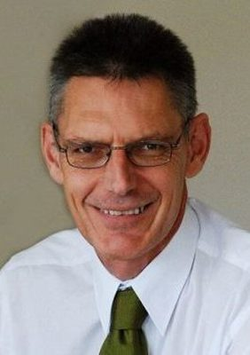

# David Clendon

| | |
|---|---|
| **Party (current/most recent)** | Green Party |
| **Status** | Former MP |
| **Party history** | Green Party (1990–2017) |
| **Parliaments (50th–54th)** | 50, 51 |
| **First elected** | 2009 |
| **Key roles** | Green Party co-convenor (2001–2004) Green Party musterer (whip) (2014–2017); deputy musterer (2010–2011) Green spokesperson on corrections (2009–2017), police, courts Far North District Councillor, Bay of Islands–Whangaroa ward (2019–2022) |
| **Born** | 1955-09-11 |
| **Wikipedia** | [David Clendon](https://en.wikipedia.org/wiki/David_Clendon) |

Photo: Green Party of Aotearoa New Zealand — CC BY-SA 4.0 — [source](https://commons.wikimedia.org/wiki/File:David_Clendon_%28cropped%29.jpg)

## Current status

Former MP (2009–2017). After a term on the Far North District Council (2019–2022) he became regional coordinator for the Tohu Whenua visitor programme in February 2024. Lives in Kerikeri. Not a 2026 candidate.

## Biography

Born 11 September 1955; of Ngāpuhi, Te Roroa and Pākehā descent and a descendant of James Reddy Clendon, the early US Consul in New Zealand. He left school at 15, worked in business (eventually managing an engineering supplies company), completed an MSc at Lincoln University in 1994 and lectured in environmental management at Unitec before working as a sustainable-business adviser.

## Political career

- Joined the Green Party in 1990; contested Waitakere in 1999 and 2005, and Helensville in 2008 (the highest-ranked Green not elected).
- Party co-convenor 2001–2004; stood for male co-leader in 2005–06 (won by Russel Norman), describing himself as a "left-wing conservative".
- Entered Parliament on 2 November 2009 on Sue Bradford's resignation; re-elected 2011 (Mount Albert) and 2014 (Northland).
- On 7–8 August 2017, with Kennedy Graham, withdrew as a candidate and left the caucus over co-leader Metiria Turei's handling of her benefit-fraud admission; left Parliament at the 23 September 2017 election without a valedictory.
- Elected to the Far North District Council in 2019 after losing a 2018 by-election; retired in 2022.

## Record & notable actions

- Smart Meters (Consumer Choice) Bill (2010), voted down by the government.
- As corrections spokesperson argued tough-on-crime policy led to overcrowded prisons, and in 2017 criticised Corrections for paying working inmates below the minimum wage.
- Voted against Easter trading liberalisation (2009, 2016), to keep the alcohol purchase age at 18 (2012) and for marriage equality (2013).
- On council, supported Māori wards and criticised Three Waters for not guaranteeing public ownership.

## Controversies

- His and Graham's August 2017 revolt against Turei split the Green caucus weeks before the election.

## Sources

- https://en.wikipedia.org/w/index.php?title=David_Clendon&oldid=1349846045
- https://www.parliament.nz/en/mps-and-electorates/former-members-of-parliament/clendon-david/
- https://www.rnz.co.nz/news/political/336717/the-dissenting-greens-who-exactly-are-they
- https://m.scoop.co.nz/stories/PA1708/S00139/james-shaw-on-kennedy-graham-and-david-clendon.htm
- https://www.parliament.nz/en/pb/bills-and-laws/bills-proposed-laws/document/00DBHOH_BILL9775_1/smart-meters-consumer-choice-bill
- https://www.teaonews.co.nz/2017/04/19/prison-training-incentive-should-match-minimum-wage-green-mp/
