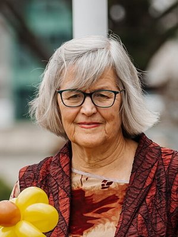

# Eugenie Sage

| | |
|---|---|
| **Party (current/most recent)** | Green Party |
| **Status** | Former MP |
| **Party history** | Green Party (c. 1990–present) |
| **Parliaments (50th–54th)** | 50, 51, 52, 53 |
| **First elected** | 2011 |
| **Key roles** | Minister of Conservation (2017–2020) Minister for Land Information (2017–2020) Associate Minister for the Environment (2017–2020) Acting Minister for Women (2018) Chair, Environment Committee (2020–2023) Environment Canterbury councillor (2007–2010) |
| **Born** | 1958, Auckland |
| **Wikipedia** | [Eugenie Sage](https://en.wikipedia.org/wiki/Eugenie_Sage) |

Photo: Access Matters — CC BY-SA 2.0 — [source](https://commons.wikimedia.org/wiki/File:Eugenie_Sage_2023_%28cropped%29.jpg)

## Current status

Former MP and former Minister of Conservation. Announced in December 2022 that she would not stand in 2023, and left Parliament at that election. Not a 2026 candidate.

## Biography

Born in Auckland in 1958 and educated at St Cuthbert's College and the University of Auckland (arts and law). She worked as a communications officer for the New Zealand Forest Service on the West Coast, then from 1984 to 1990 at Parliament as a Labour research officer and press secretary to Helen Clark. After moving to Christchurch she was a freelance journalist and, from 1993 to 2007, a field officer and spokesperson for Forest & Bird, campaigning on the environmental impacts of logging, mining and dairying. Her long-time partner is former DOC manager Richard Suggate.

## Political career

- Elected to Environment Canterbury for Selwyn–Banks Peninsula in 2007, defeating incumbent Bill Woods on a "pro-water" platform; the elected council was replaced by government-appointed commissioners in 2010, which she said prompted her to run for Parliament.
- Green list MP 2011–2023 (contested Selwyn 2011, Port Hills 2014 and 2017, Banks Peninsula 2020).
- In the first term of the Sixth Labour Government (2017–2020) she was Minister of Conservation, Minister for Land Information and Associate Minister for the Environment (Greens' ministers outside Cabinet under the confidence-and-supply deal).
- Chair of Parliament's Environment Committee 2020–2023.

## Record & notable actions

- Led development of Te Mana o te Taiao, the Aotearoa New Zealand Biodiversity Strategy; set up the $1.2 billion Jobs for Nature programme as part of COVID-19 recovery; opened the Paparoa Track Great Walk (2020).
- As Associate Environment Minister oversaw the phase-out of single-use plastic shopping bags (2019).
- Did not deliver a planned Mackenzie Basin drylands park or the promised ban on new mines on conservation land, the latter reportedly because the governing parties disagreed.
- Her 2022 member's bill, the Crown Minerals (Prohibition of Mining) Amendment Bill, sought to stop new mining permits on conservation land and all new coal-mining permits from 2025.
- In November 2022 persuaded Labour to back a Green amendment entrenching a 60% threshold against privatising water assets in the Water Services Entities Bill; after criticism (including from the Law Society) Labour removed it and the Greens withdrew support for the bill.
- Voted for marriage equality (2013), the End of Life Choice Act (2019) and the Abortion Legislation Act (2020).

## Controversies

- Her Himalayan tahr cull plan (2019–20) drew strong opposition from hunters, led to death threats against her, and was scaled back.
- As Land Information Minister she was criticised by former Green MP Sue Bradford for approving "nearly every" overseas land-purchase application despite Green policy; Sage said the law gave her little discretion. She also clashed with Labour ministers on joint Overseas Investment Act decisions (e.g. a Waihi gold mine expansion that she declined, which was later referred to other ministers).

## Sources

- https://en.wikipedia.org/w/index.php?title=Eugenie_Sage&oldid=1347557359
- https://www.parliament.nz/en/mps-and-electorates/former-members-of-parliament/sage-eugenie/
- https://www.stuff.co.nz/environment/105577646/national-portrait-long-apprenticeship-of-the-minister-with-her-hand-on-doc
- https://www.scoop.co.nz/stories/PA1202/S00179/maiden-speech-eugenie-sage-green-mp.htm
- https://www.nzherald.co.nz/nz/nz-wide-ban-on-all-single-use-plastic-bags-by-july-2019/N2MEL4MYYFO7UNEQBVTFJPOCD4/
- https://businessdesk.co.nz/article/public-sector-project/yes-minister-eugenie-sage-on-getting-things-done
