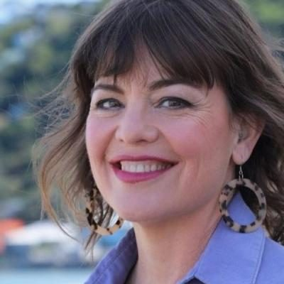

# Julie Anne Genter

| | |
|---|---|
| **Party (current/most recent)** | Green Party |
| **Status** | MP (54th Parliament), standing in 2026 |
| **Party history** | Green Party (c. 2008–present) |
| **Parliaments (50th–54th)** | 50, 51, 52, 53, 54 |
| **First elected** | 2011 |
| **Electorates held** | Rongotai (2023–2026) |
| **Key roles** | Minister for Women (2017–2020) Associate Minister of Health (2017–2020) Associate Minister of Transport (2017–2020) Green spokesperson on transport, infrastructure, urban development, finance (various periods) |
| **Born** | 1979-12-17, Rochester, Minnesota, USA |
| **2026 election** | contesting Wellington Bays, list #5 |
| **Wikipedia** | [Julie Anne Genter](https://en.wikipedia.org/wiki/Julie_Anne_Genter) |

Photo: Supplied to policy.nz by the candidate/party — [source](https://cdn.sanity.io/images/ubdwo62y/production/215b924207e18c49b3fb469e2a4ca4abf68151b2-1024x1024.jpg)

## Current status

Green MP for Rongotai since 2023 (list MP 2011–2023). Seeking re-election on 7 November 2026 in the redrawn **Wellington Bays** electorate and ranked **#5** on the Green Party list.

## Biography

Born 17 December 1979 in Rochester, Minnesota, and raised in Los Angeles; dual US–New Zealand citizen. BA in philosophy from UC Berkeley (2003), postgraduate certificate from Sciences Po, Paris (2005), and Master of Planning Practice from the University of Auckland (2008). Worked as a transport planner (Sinclair Knight Merz, then MRCagney) after moving to New Zealand in 2006. Her partner is Peter Nunns; they have two children (in 2018 she made international headlines for cycling to hospital to give birth).

## Political career

- Green list MP from 2011 (list #13). Became only the third woman to hold a finance portfolio for a party (2015) and took over health from Kevin Hague in 2016.
- Second in the February 2017 Mount Albert by-election behind Jacinda Ardern. Said she rebuffed an approach to defect to TOP in 2017.
- Minister for Women and Associate Minister of Health and of Transport (including civil aviation from 2018) in the first term of the Sixth Labour Government (2017–2020). Took her oath in te reo Māori.
- Returned to opposition benches in 2020 (Labour majority government) with retention of "The Honourable".
- Won Rongotai in 2023 — the first time the seat was held by a non-Labour MP — by 2,717 votes over Labour's Fleur Fitzsimons.

## Record & notable actions

- As Minister for Women worked to narrow the public-sector gender pay gap and increased maternity funding.
- As Associate Transport Minister introduced lower speed limits around schools; championed the clean-car "feebate" (blocked by NZ First in the first term, introduced later by Labour); negotiated removal of fringe-benefit tax on employer-paid public transport; e-bike subsidies; funding for tactical urbanism (pop-up cycleways) during the 2020 lockdown.
- As Associate Health Minister introduced funding for family members caring for disabled relatives.
- Long-standing advocate for regional passenger rail (Auckland–Hamilton–Tauranga); supported abortion decriminalisation and regulated cannabis legalisation.

## Controversies

- **Contempt of Parliament (2024).** On 1 May 2024 she crossed the chamber and shouted "Read the report!" at Minister Matt Doocey during a roading debate. She apologised the same day; the Privileges Committee found her in contempt and on 1 August 2024 she was censured and ordered to apologise. The Green Party called her conduct unacceptable. Two Wellington business owners and a city councillor subsequently publicised earlier heated exchanges over cycleways; she apologised to the business owners.
- In January 2017 she apologised to former Green issues director Laila Harré after disputing Harré's stated reasons for resigning.
- A 2021 tweet describing Ford Ranger marketing as aimed at "men who want to feel more masculine" drew criticism; she said she was commenting on marketing, not users.

<!-- GENERATED:2026-candidacy START -->
## 2026 candidacy

- **Electorate:** Wellington Bays
- **List ranking:** 5
- **Before politics:** transportation planner
- **Age:** 46
- **Public email:** julieanne.genter@parliament.govt.nz
- **Website:** https://rongotai.greens.org.nz/about_me
- **Facebook:** https://www.facebook.com/JulieAnneGenter
- **Instagram:** https://www.instagram/julieannegenter
- **Twitter:** https://x.com/julieannegenter

_Source: candidate questionnaire answers published on [policy.nz](https://policy.nz/2026/party-vote/parties/green-party), retrieved Oct 2026._
<!-- GENERATED:2026-candidacy END -->

## Sources

- https://en.wikipedia.org/w/index.php?title=Julie_Anne_Genter&oldid=1381122396
- https://en.wikipedia.org/wiki/Party_lists_in_the_2026_New_Zealand_general_election
- https://electionresults.govt.nz/2017_mt_albert_byelection/
- https://www.stuff.co.nz/national/politics/94508451/senior-green-mp-says-she-rebuffed-top-party-call-for-her-to-jump-ship
- https://www.dpmc.govt.nz/our-business-units/cabinet-office/ministers-and-their-portfolios/ministerial-list
- https://www.stuff.co.nz/national/politics/101725307/julie-anne-genter-minister-for-women-mothertobe-fulltime-feminist
- https://policy.nz/2026/party-vote/parties/green-party
