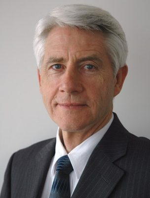

# Kennedy Graham

| | |
|---|---|
| **Party (current/most recent)** | Green Party |
| **Status** | Former MP |
| **Party history** | Green Party (c. 2008–2017) |
| **Parliaments (50th–54th)** | 50, 51 |
| **First elected** | 2008 |
| **Key roles** | Green Party whip/musterer (2008–2011) Green spokesperson on foreign affairs, climate change, defence, disarmament, justice Founder and chair of GLOBE-NZ cross-party climate group (2015) Deputy chair, Foreign Affairs, Defence and Trade Committee |
| **Born** | 1946 |
| **Wikipedia** | [Kennedy Graham](https://en.wikipedia.org/wiki/Kennedy_Graham) |

Photo: Green Party of Aotearoa New Zealand — CC BY-SA 4.0 — [source](https://commons.wikimedia.org/wiki/File:Kennedy_Graham.jpg)

## Current status

Former MP (2008–2017). Not a 2026 candidate. After his 2017 break with the party the Green Party declined to readmit him.

## Biography

Born in 1946; brother of former National cabinet minister Sir Douglas Graham and great-grandson of 19th-century MP Robert Graham. He holds a BCom (Auckland), an MA in international relations from the Fletcher School at Tufts University and a PhD from Victoria University of Wellington (thesis on nuclear-weapon-free zones, 1983). As a diplomat he worked on the South Pacific Nuclear Free Zone negotiations and represented New Zealand at the Conference on Disarmament in Geneva; he was secretary-general of Parliamentarians for Global Action (1989–1994), worked at International IDEA in Stockholm (1996–1998) and held UN posts including at the UN University Leadership Academy in Amman. He later lectured at Canterbury and Victoria universities.

## Political career

- Elected a Green list MP in 2008 after special votes were counted (stood in Ilam); re-elected 2011 (Ilam) and 2014 (Helensville, list #7).
- Party whip ("musterer") in his first term; long-time spokesperson on foreign affairs, climate change, defence and disarmament.
- On 7 August 2017, with whip David Clendon, withdrew as a Green candidate in protest at co-leader Metiria Turei's handling of her benefit-fraud admission; both left the caucus the next day. Gave his valedictory on 16 August 2017 ("If politics transgresses conscience, politics must cede").

## Record & notable actions

- International Non-Aggression and Lawful Use of Force Bill (2009), to criminalise aggression in domestic law and require a tabled legal opinion before overseas deployments.
- Organised a 2013 climate-change conference at Parliament and in 2015 founded GLOBE-NZ, a cross-party group of 35 MPs from all seven parties; it commissioned Vivid Economics' "Net Zero in New Zealand" report, which fed into the later Zero Carbon Act debate.
- Drafted the Public Finance (Sustainable Development Indicators) Amendment Bill, introduced by James Shaw; defeated 48–73 at first reading.

## Controversies

- The August 2017 withdrawal by Graham and Clendon publicly split the Green caucus weeks before the election; the party described them as having breached caucus solidarity.

## Sources

- https://en.wikipedia.org/w/index.php?title=Kennedy_Graham&oldid=1378178281
- https://www.parliament.nz/mi/mps-and-electorates/former-members-of-parliament/graham-kennedy/
- https://assets.documentcloud.org/documents/3914723/170807-KG-DC-Joint-Statement.pdf
- https://www.radionz.co.nz/news/political/336718/video-rogue-green-mps-withdraw-from-caucus
- http://www.nzherald.co.nz/politics/news/article.cfm?c_id=280&objectid=11902761
- https://www.parliament.nz/en/pb/hansard-debates/rhr/combined/HansDeb_20170816_20170816_20
- http://www.vivideconomics.com/publications/net-zero-in-new-zealand
