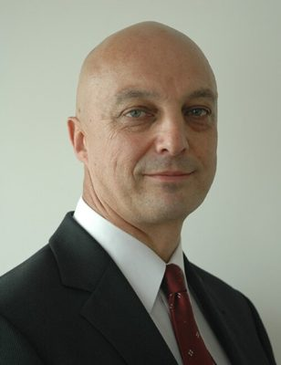

# Kevin Hague

| | |
|---|---|
| **Party (current/most recent)** | Green Party |
| **Status** | Party official |
| **Party history** | Green Party (c. 2008–present) |
| **Parliaments (50th–54th)** | 50, 51 |
| **First elected** | 2008 |
| **Key roles** | Green spokesperson on health, conservation, biosecurity, rural affairs, rainbow issues and sport (2008–2016) Chief executive, Forest & Bird (2016–2022) Green Party chief of staff (2025–) |
| **Born** | 1960-03-18, Aldershot, England |
| **Wikipedia** | [Kevin Hague](https://en.wikipedia.org/wiki/Kevin_Hague) |

Photo: Green Party of Aotearoa New Zealand — CC BY-SA 4.0 — [source](https://commons.wikimedia.org/wiki/File:Kevin_Hague.jpg)

## Current status

Not a candidate. Announced in November 2025 as chief of staff for the Green Party (per Wikipedia). Lives in Greymouth.

## Biography

Born in Aldershot, England, on 18 March 1960; his family moved to Hamilton in 1973 and he became a naturalised New Zealander in 1978. He studied mathematics and physics at the University of Auckland and was president of the Auckland University Students' Association in 1980. A prominent anti-apartheid activist, he was arrested five times during the 1981 Springbok tour protests. Openly gay, he joined the New Zealand AIDS Foundation in 1988 and was its executive director from 1998 to 2003, then worked at the West Coast District Health Board, becoming its chief executive in 2005.

## Political career

- Green candidate for West Coast-Tasman in 2008 (third); elected as a list MP in 2008, re-elected 2011 and 2014.
- Green health spokesperson and member of the Health Committee; also biosecurity, conservation, rural affairs, rainbow issues and sport.
- Contested the 2015 male co-leadership, losing to first-term MP James Shaw 69–56.
- Resigned from Parliament in October 2016 to become chief executive of Forest & Bird (replaced by Barry Coates). Led Forest & Bird until 2022.
- Later appointed by the Labour government to health bodies, including deputy chair of Te Hiringa Mahara (Mental Health and Wellbeing Commission) and chair of the Public Health Advisory Committee; West Coast Civil Defence controller (volunteer) from 2022.

## Record & notable actions

- Campaigned successfully against Meridian Energy's proposal to dam the Mōkihinui River (2009–2012).
- Spoke in favour of repealing the "gay panic"/provocation defence (2009); drafted bills on same-sex marriage and adoption law reform (2012) and organised cross-party support for Louisa Wall's marriage equality bill, which passed in 2013.
- Advocated for ACC reform in 2012.

## Controversies

None of significance found in the sources consulted.

## Sources

- https://en.wikipedia.org/w/index.php?title=Kevin_Hague&oldid=1350022802
- https://www.parliament.nz/en/mps-and-electorates/former-members-of-parliament/hague-kevin/
- https://www.rnz.co.nz/news/political/312597/green-mp-kevin-hague-resigns-from-parliament
- http://www.scoop.co.nz/stories/PA1505/S00595/james-shaw-elected-new-green-party-male-co-leader.htm
- https://www.nzherald.co.nz/nz/mp-seeks-big-adoption-changes/6MF422EK5W6AQPWK2LH4LMLIEA/
- https://www.stuff.co.nz/sunday-star-times/features/4810616/Arresting-times
