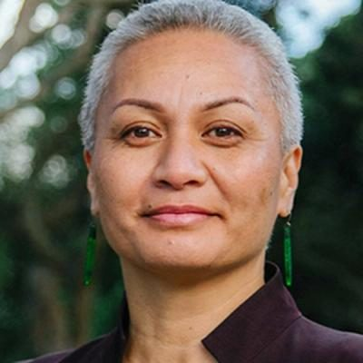

# Marama Davidson

| | |
|---|---|
| **Party (current/most recent)** | Green Party |
| **Status** | MP (54th Parliament), standing in 2026 |
| **Party history** | Green Party (by 2013–present) |
| **Parliaments (50th–54th)** | 51, 52, 53, 54 |
| **First elected** | 2015 |
| **Key roles** | Green Party co-leader (2018–) Minister for the Prevention of Family and Sexual Violence (2020–2023) Associate Minister of Housing (Homelessness) (2020–2023) Member, Epidemic Response Committee (2020) |
| **Born** | 1973-12-29, Auckland |
| **2026 election** | list #1 |
| **Wikipedia** | [Marama Davidson](https://en.wikipedia.org/wiki/Marama_Davidson) |

Photo: Supplied to policy.nz by the candidate/party — [source](https://cdn.sanity.io/images/ubdwo62y/production/2f5672aacb81e1901e4596dbbe038c838ec746f4-1024x1024.jpg)

## Current status

Green Party co-leader and list MP. Ranked **#1** on the Green Party list for the 7 November 2026 election and is not contesting an electorate. Returned to Parliament in February 2025 after treatment for breast cancer (diagnosed June 2024).

## Biography

Marama Mere-Ana Davidson (née Paratene), born in Auckland on 29 December 1973, is of Ngāti Porou, Te Rarawa and Ngāpuhi descent; her father is actor Rawiri Paratene and both parents were te reo Māori campaigners. She grew up partly in Whirinaki, Hokianga, graduated BA from Auckland and holds a graduate diploma in international diplomacy for Indigenous studies (Te Whare Wānanga o Awanuiārangi). She worked at the Human Rights Commission (2003–2012), was a "think tank" member of the Glenn Inquiry into child abuse and domestic violence, and co-founded Te Wharepora Hou Māori women's collective. Married to Paul Davidson; six children.

## Political career

- Fourth in the 2013 Ikaroa-Rāwhiti by-election (11.15%); stood in Tāmaki Makaurau in 2014 and 2020.
- Entered Parliament on 4 November 2015 when Russel Norman resigned; re-elected 2017 (list #2), 2020 and 2023.
- Won the female co-leadership on 8 April 2018, defeating Julie Anne Genter.
- Minister for the Prevention of Family and Sexual Violence and Associate Minister of Housing (Homelessness) outside Cabinet under the 2020 Labour–Green cooperation agreement.
- In opposition from 2023 (Greens' best-ever result, 15 seats); spokesperson on conservation, child poverty reduction and family and sexual violence.

## Record & notable actions

- As minister, led Te Aorerekura, the national strategy to eliminate family and sexual violence (launched 2021), and the cross-agency joint venture.
- Consumer Guarantees (Right to Repair) Amendment Bill (2024) passed first reading in February 2025 with Green, Labour, Te Pāti Māori and NZ First support; NZ First later withdrew support, and on 22 October 2025 the bill was discharged after she arrived about 20 seconds late for its second reading. She apologised to supporters.
- Took part in the 2016 Women's Boat to Gaza (intercepted by the Israeli Navy); in September 2025 called the situation in Gaza a genocide.
- Advocates abortion law liberalisation, and a Te Tiriti-based constitutional approach.

## Controversies

- **"White cis men" remark (March 2023):** after being struck by a motorcyclist from a Destiny Church-linked group at a counter-protest, she told a Counterspin Media host that "white cis men" cause violence in the world. National, ACT and NZ First leaders criticised her (Winston Peters called for her resignation as minister); PM Chris Hipkins disagreed with her wording but cited the context.
- **Mongrel Mob gathering (May 2021):** criticised by National and ACT for attending and speaking at a Mongrel Mob Waikato event on human rights and racism; she defended engaging with communities subject to systemic racism.
- **Ejected from the House (20 June 2023)** after accusing ACT MPs of intending to "raise racist opinions" in questions about Te Whatu Ora's Equity Adjustor Score; Speaker Adrian Rurawhe judged her apology insufficient.
- In 2018 she received rape and death threats online; at a subsequent rally she said New Zealand should "reclaim" the word "cunt", which drew criticism.

<!-- GENERATED:2026-candidacy START -->
## 2026 candidacy

- **List ranking:** 1
- **Before politics:** Community Development
- **Age:** 52
- **Public email:** Marama.Davidson@parliament.govt.nz
- **Website:** https://www.greens.org.nz/maramadavidson_2026
- **Facebook:** https://www.facebook.com/maramadavidsonmp/
- **Instagram:** https://www.instagram.com/maramadavidson

### Why I'm standing

In Aotearoa people care about each other and our environment. There is enough resource in Aotearoa for everyone to live with dignity, and to protect our environment. The Green Party has consistently put up solutions to ensure everyone has what they need to live good lives, and to ensure we leave a healthy, thriving planet behind for all of our mokopuna. I am standing to be an uncompromising voice for people and planet.

### About me

I have almost 11 years' experience as a Member of Parliament, nearly 9 years' experience as a co-leader, and 3 years' experience as a Minister of the Crown. Throughout that experience I have consistently stayed connected to the very people and communities on the front-lines of injustice. I have deep long-earned relationships across communities and groups who provide the expertise and the solutions that our communities deserve.

_Source: candidate questionnaire answers published on [policy.nz](https://policy.nz/2026/party-vote/parties/green-party), retrieved Oct 2026._
<!-- GENERATED:2026-candidacy END -->

## Sources

- https://en.wikipedia.org/w/index.php?title=Marama_Davidson&oldid=1378434797
- https://en.wikipedia.org/wiki/Party_lists_in_the_2026_New_Zealand_general_election
- https://www.gazette.govt.nz/notice/id/2015-au6409
- https://www.newshub.co.nz/home/politics/2018/04/marama-davidson-elected-new-greens-co-leader.html
- https://www.beehive.govt.nz/sites/default/files/2020-11/Ministerial%20List%20announcement%202%20November%202020.pdf
- https://www.stuff.co.nz/national/politics/105323849/greens-coleader-marama-davidson-receives-violent-threats-on-social-media
- https://policy.nz/2026/party-vote/parties/green-party
