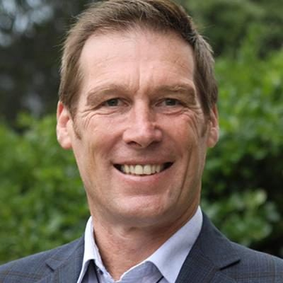

# Mike Davidson

| | |
|---|---|
| **Party (current/most recent)** | Green Party |
| **Status** | MP (54th Parliament), standing in 2026 |
| **Party history** | Green Party (by 2023–present) |
| **Parliaments (50th–54th)** | 54 |
| **First elected** | 2025 |
| **Key roles** | Christchurch City Councillor, Papanui ward (2016–2022) Chair, CCC Urban Development and Transport Committee Shirley-Papanui Community Board (2013–2016) |
| **Born** | 1976-01-29, Kaikōura |
| **2026 election** | contesting Ilam, list #20 |
| **Wikipedia** | [Mike Davidson (politician)](https://en.wikipedia.org/wiki/Mike_Davidson_(politician)) |

Photo: Supplied to policy.nz by the candidate/party — [source](https://cdn.sanity.io/images/ubdwo62y/production/6a307c7bba9c832ef0cdfaf59a03542bf1ee839a-1024x1024.jpg)

## Current status

Green list MP since 6 October 2025 (replacing Benjamin Doyle). Standing in **Ilam** and ranked **#20** on the Green list for 2026.

## Biography

Michael John Davidson was born in Kaikōura on 29 January 1976 and is of Ngāi Tahu descent; his late father Rob Davidson was married to former Christchurch mayor Lianne Dalziel. An environmental scientist, he worked for the Earthquake Commission for seven years and as an operations manager at the Whitiora skills and employment centre.

## Political career

- Shirley-Papanui Community Board from 2013; Christchurch City Councillor for Papanui 2016–2022 (chaired the Urban Development and Transport Committee); lost the seat in 2022.
- Green candidate for Ilam in 2023 (fourth; list #19).
- Stood for the Waipapa Papanui-Innes-Central community board (The People's Choice) in October 2025 while entering Parliament, saying he would donate any board salary to the mayor's welfare fund.

## Record & notable actions

- Advocate for cycleways and urban public transport; supported reopening Edgeware Pool.

## Controversies

None of significance found in the sources consulted.

<!-- GENERATED:2026-candidacy START -->
## 2026 candidacy

- **Electorate:** Ilam
- **List ranking:** 20
- **Before politics:** Kaiwhakahaere, Whitiora Centre
- **Residence:** Papanui
- **Age:** 50
- **Public email:** votemikedavidson@gmail.com
- **Website:** https://www.greens.org.nz/mikedavidson_2026
- **Facebook:** https://www.facebook.com/OtautahiMike
- **Instagram:** https://www.instagram.com/otautahimike

_Source: candidate questionnaire answers published on [policy.nz](https://policy.nz/2026/party-vote/parties/green-party), retrieved Oct 2026._
<!-- GENERATED:2026-candidacy END -->

## Sources

- https://en.wikipedia.org/w/index.php?title=Mike_Davidson_(politician)&oldid=1381240379
- https://en.wikipedia.org/wiki/Party_lists_in_the_2026_New_Zealand_general_election
- https://gazette.govt.nz/notice/id/2025-au5644
- https://www.thepress.co.nz/nz-news/360815871/christchurch-gains-mp-mike-davidson-confirmed-benjamin-doyle-replacement
- https://www.stuff.co.nz/the-press/news/85307289/new-christchurch-city-councillor-mike-davidson-breaks-family-curse
- https://policy.nz/2026/party-vote/parties/green-party
