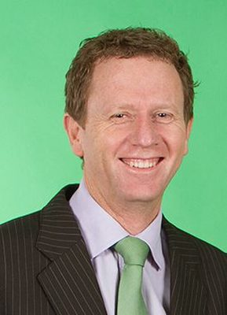

# Russel Norman

| | |
|---|---|
| **Party (current/most recent)** | Green Party |
| **Status** | Former MP |
| **Party history** | Green Party (c. 1999–2015) |
| **Parliaments (50th–54th)** | 50, 51 |
| **First elected** | 2008 |
| **Key roles** | Green Party co-leader (2006–2015) Member of the Intelligence and Security Committee (as co-leader) |
| **Born** | 1967-06-02, Brisbane, Australia |
| **Wikipedia** | [Russel Norman](https://en.wikipedia.org/wiki/Russel_Norman) |

Photo: Metiria_Turei_and_Russel_Norman.png : contract photographer derivative work: Schwede66 — CC BY-SA 3.0 — [source](https://commons.wikimedia.org/wiki/File:Russel_Norman2.jpg)

## Current status

Former MP. Norman resigned from Parliament (and from the Green Party) in October 2015 to become Executive Director of Greenpeace Aotearoa New Zealand. He is not a 2026 candidate. His role as of October 2026 was not confirmed in the sources consulted.

## Biography

Born in Brisbane, Australia, on 2 June 1967. Norman dropped out of medical school and worked a number of unskilled jobs; while in Australia he was involved with the Democratic Socialist Party and stood for it in the seat of Griffith at the 1990 federal election. He moved to New Zealand in 1997, wrote a political science PhD thesis on the Alliance party, and later became involved in organic farming and the Green Party's Auckland branch. He worked as an assistant to Green MPs Sue Kedgley, Nándor Tánczos and Keith Locke, as a party researcher (2002–2004) and as national campaign manager for the 2005 election. His partner is Katya Paquin; they have three children.

## Political career

- Elected male co-leader of the Green Party on 3 June 2006 following the death of Rod Donald, defeating Nándor Tánczos, David Clendon and Mike Ward.
- Entered Parliament as a list MP on 27 June 2008 when Tánczos resigned (higher-ranked Mike Ward and Catherine Delahunty stood aside). Re-elected on the list in 2008, 2011 and 2014; contested Rongotai (2008) and the 2009 Mount Albert by-election (third, 12.09%).
- In 2013 a challenge to his co-leadership from David Hay did not proceed after Hay's membership was suspended for breaching party rules.
- Announced in January 2015 he would step down as co-leader; succeeded by James Shaw on 30 May 2015. Resigned from Parliament on 30 October 2015 and was replaced by Marama Davidson.

## Record & notable actions

- Named as his key achievements as co-leader forcing the National-led government to reverse its plan to allow mining on Schedule 4 conservation land, and leading the campaign and citizens-initiated referendum against the government's partial asset sales programme.
- Described himself in 2012 as supporting "a market economy with an important role for the state", "not radically different from an old-style social democrat".
- Critical of oversight arrangements for New Zealand's intelligence agencies while sitting on the Intelligence and Security Committee.
- As Greenpeace head (2016) he welcomed the visit of a US warship as being on New Zealand's nuclear-free terms.

## Controversies

- In June 2010 Norman said he was assaulted by Chinese security staff while protesting with a Tibetan flag during a visit by Chinese Vice-President Xi Jinping; police did not find enough evidence to substantiate the complaint.

## Sources

- https://en.wikipedia.org/w/index.php?title=Russel_Norman&oldid=1381408875
- https://www.radionz.co.nz/news/political/288456/goodbye-greens,-hello-greenpeace
- http://www.nzherald.co.nz/nz/news/article.cfm?c_id=1&objectid=11511403
- http://www.stuff.co.nz/national/politics/65583217/green-party-coleader-russel-norman-resigns
- https://www.radionz.co.nz/news/political/287745/russel-norman-gives-final-speech-to-parliament
- http://www.stuff.co.nz/national/politics/3825646/MPs-Tibet-protest-flag-removed
- https://www.stuff.co.nz/national/9757083/Greens-suspend-leadership-challenger
