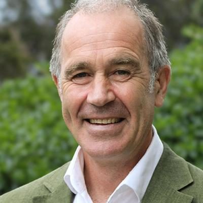

# Scott Willis

| | |
|---|---|
| **Party (current/most recent)** | Green Party |
| **Status** | MP (54th Parliament), standing in 2026 |
| **Party history** | Green Party (by 2020–present) |
| **Parliaments (50th–54th)** | 54 |
| **First elected** | 2023 |
| **Key roles** | Green spokesperson on energy, regional development, rural communities, Dunedin issues General manager, Blueskin Energy Ltd |
| **Born** | c. 1970, Dunedin |
| **2026 election** | contesting Taieri, list #15 |
| **Wikipedia** | [Scott Willis (politician)](https://en.wikipedia.org/wiki/Scott_Willis_(politician)) |

Photo: Supplied to policy.nz by the candidate/party — [source](https://cdn.sanity.io/images/ubdwo62y/production/6b767d786fb881a03c75d11c01b81f8025e4839d-1024x1024.jpg)

## Current status

Green list MP since 2023. Standing in **Taieri** and ranked **#15** on the Green list for 2026.

## Biography

Born in Dunedin and raised on an Otago farm; went to the University of Otago at 17 (1987), worked on farms and orchards in the Cévennes, France, and interned at the European Parliament. An energy analyst and energy-resilience consultant, he was general manager of community-owned Blueskin Energy (Blueskin Bay wind-turbine project) and involved in building New Zealand's first "climate-safe house" (2020) and in home-insulation and peer-to-peer energy-sharing trusts.

## Political career

- Green candidate for Taieri in 2020 (third, 2,207 votes) and 2023 (third, 3,898 votes; list #12, elected).
- Green spokesperson for energy, regional development, rural communities and Dunedin issues from November 2023.

## Record & notable actions

- Advocates a low-carbon economy, "blue-green" urban design (avoiding flood-prone land), organic and regenerative agriculture, and the return of South Island passenger rail; advocated degrowth in the 2022 Dunedin local elections.

## Controversies

None of significance found in the sources consulted.

<!-- GENERATED:2026-candidacy START -->
## 2026 candidacy

- **Electorate:** Taieri
- **List ranking:** 15
- **Before politics:** Consultant & Project Manager
- **Age:** 57
- **Public email:** scott.willis@parliament.govt.nz
- **Website:** https://www.greens.org.nz/scott_willis
- **Facebook:** https://facebook.com/ScottWillisforTaieri
- **Instagram:** https://www.instagram.com/scottwillisnz
- **Twitter:** https://x.com/@ScottWillis50

_Source: candidate questionnaire answers published on [policy.nz](https://policy.nz/2026/party-vote/parties/green-party), retrieved Oct 2026._
<!-- GENERATED:2026-candidacy END -->

## Sources

- https://en.wikipedia.org/w/index.php?title=Scott_Willis_(politician)&oldid=1380684852
- https://en.wikipedia.org/wiki/Party_lists_in_the_2026_New_Zealand_general_election
- https://www.odt.co.nz/news/dunedin/exhausted-excited-willis-list-mp-greens
- https://www.parliament.nz/en/pb/hansard-debates/rhr/document/HansS_20240201_053340000/willis-scott
- https://www.odt.co.nz/opinion/why-green-party-wants-passenger-rail-south
- https://policy.nz/2026/party-vote/parties/green-party
