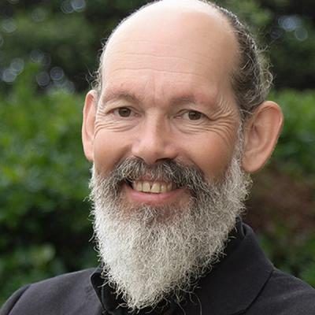

# Steve Abel

| | |
|---|---|
| **Party (current/most recent)** | Green Party |
| **Status** | MP (54th Parliament), standing in 2026 |
| **Party history** | Green Party (by 1999–present) |
| **Parliaments (50th–54th)** | 54 |
| **First elected** | 2023 |
| **Key roles** | Green spokesperson on agriculture, animal welfare, food safety, Māori-Crown relations, just transitions, resources Greenpeace campaigner (2002–2006, 2010–2023) |
| **2026 election** | contesting Waitākere, list #12 |
| **Wikipedia** | [Steve Abel](https://en.wikipedia.org/wiki/Steve_Abel) |

Photo: Supplied to policy.nz by the candidate/party — [source](https://cdn.sanity.io/images/ubdwo62y/production/826432de5b0ff32bd4e42dfaf8e5f3b79cea15b8-1024x1024.jpg)

## Current status

Green list MP since 2023. Standing in **Waitākere** and ranked **#12** on the Green list for 2026.

## Biography

Stephen George Bremner Abel is an environmental activist and musician. He campaigned with Native Forest Action against West Coast native logging (1998–2000) and for Greenpeace (2002–2006 and from 2010), including against GE food crops, the proposed Marsden B coal power station (abandoned), the 2010 March Against Mining in Auckland (described as the "biggest protest in a generation", which contributed to the government dropping plans to mine Schedule 4 land), and Petrobras's deep-sea oil exploration in the Raukumara Basin with Te Whānau-a-Apanui (Petrobras gave up its permits in 2012). In 2021–22 he led Greenpeace's nitrate drinking-water testing campaign. As a musician he released *Little Death* (2006), *Flax Happy* (2008) and *Luck/Hope* (2016), and won Berlin's "Saddest Song in the World" competition in 2009.

## Political career

- Green candidate in Titirangi (1999), Māngere (2002) and New Lynn (2020, 2023); narrowly missed a list seat in 2020.
- Elected a list MP in 2023.

## Record & notable actions

- Member's bill (May 2025) to apply New Zealand animal-welfare standards (e.g. bans on battery cages and sow crates) to imported agricultural products.
- Advocates civil disobedience against fossil-fuel expansion.

## Controversies

- Arrested on 21 July 2020 during the Canal Road, Avondale tree protest (which lasted 245 days).
- Joined other Green MPs in chanting "From the river to the sea, Palestine will be free" at a Gaza solidarity rally, a slogan criticised by Jewish community groups.

<!-- GENERATED:2026-candidacy START -->
## 2026 candidacy

- **Electorate:** Waitākere
- **List ranking:** 12
- **Before politics:** Greenpeace Campaigner
- **Residence:** Green Bay in West Auckland
- **Age:** 56
- **Public email:** steve.abel@parliament.govt.nz
- **Facebook:** https://www.facebook.com/SteveAbelGreens/
- **Instagram:** https://www.instagram.com/steveabelthereal/
- **Twitter:** https://x.com/abelsteve

_Source: candidate questionnaire answers published on [policy.nz](https://policy.nz/2026/party-vote/parties/green-party), retrieved Oct 2026._
<!-- GENERATED:2026-candidacy END -->

## Sources

- https://en.wikipedia.org/w/index.php?title=Steve_Abel&oldid=1352284951
- https://en.wikipedia.org/wiki/Party_lists_in_the_2026_New_Zealand_general_election
- http://www.nzherald.co.nz/nz/news/article.cfm?c_id=1&objectid=10642231
- https://www.rnz.co.nz/news/national/421702/green-party-candidate-steve-abel-arrested-during-tree-felling-protest-in-avondale
- https://www.1news.co.nz/2022/03/17/nitrate-levels-in-nz-water-breaching-human-rights-greenpeace/
- https://www.stuff.co.nz/national/politics/119635623/veteran-climate-activist-to-stand-for-greens
- https://policy.nz/2026/party-vote/parties/green-party
