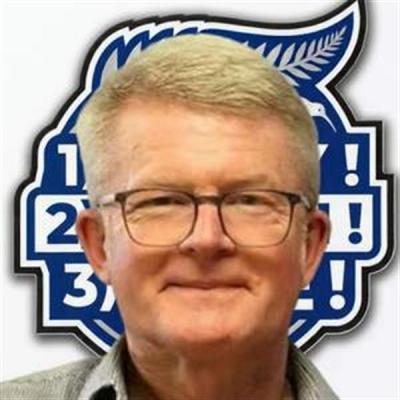
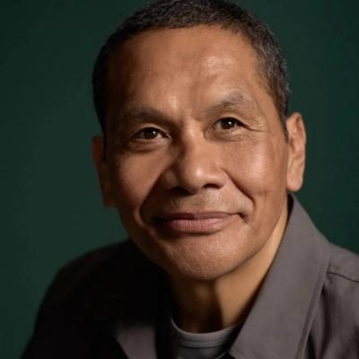
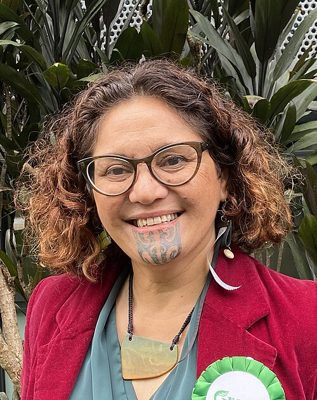

# Independent — people

Profiles of 48 people associated with Independent: MPs who served in the 50th–54th Parliaments (2011–2026) and every 2026 candidate listed on policy.nz. Status is as of 23 October 2026 (election day 7 November 2026). Each person sits under their current or most recent party. Click a name for the full profile.

## Current MPs (54th Parliament) (1)

| | Name | Status | 2026 electorate | 2026 list # | Roles / notes |
|---|---|---|---|---|---|
|  | [Tākuta Ferris](takuta-ferris/README.md) | MP (54th Parliament), standing in 2026 | Te Tai Tonga |  | MP for Te Tai Tonga (2023–); TPM spokesperson on education, Te Tiriti, justice, police, corrections, drug law reform, water, fisheries (2023–2025); Member, Justice Committee |

## 2026 candidates (45)

| | Name | Status | 2026 electorate | 2026 list # | Roles / notes |
|---|---|---|---|---|---|
|  | [Adrian Daegal Graamans](adrian-daegal-graamans/README.md) | 2026 candidate | Waitaki |  |  |
|  | [Allister David Tosh](allister-david-tosh/README.md) | 2026 candidate | Tukituki |  |  |
|  | [Benedict Ong](benedict-ong/README.md) | 2026 candidate | Dunedin |  | Dunedin City Councillor (2025–) |
|  | [Bianca O'Keefe](bianca-okeefe/README.md) | 2026 candidate | Waitākere |  |  |
|  | [Brendan Richard Whyte](brendan-richard-whyte/README.md) | 2026 candidate | Waikato |  |  |
|  | [Bronwyn Judge](bronwyn-judge/README.md) | 2026 candidate | Waitaki |  |  |
|  | [Bruce Welsh](bruce-welsh/README.md) | 2026 candidate | Wellington Bays |  |  |
|  | [Daniel Shand](daniel-shand/README.md) | 2026 candidate | Waitaki |  |  |
|  | [Daryl Warren Clotworthy](daryl-warren-clotworthy/README.md) | 2026 candidate | Whangārei |  |  |
|  | [David L F Smith](david-l-f-smith/README.md) | 2026 candidate | Hutt South |  |  |
|  | [Donald DS McDonald](donald-ds-mcdonald/README.md) | 2026 candidate | Wellington Bays |  |  |
|  | [Finlay Smith](finlay-smith/README.md) | 2026 candidate | Tāmaki |  |  |
|  | [Geoff McTague](geoff-mctague/README.md) | 2026 candidate | Wigram |  |  |
|  | [Gordon John Dickson](gordon-john-dickson/README.md) | 2026 candidate | East Cape |  |  |
|  | [Graham Wainwright](graham-wainwright/README.md) | 2026 candidate | Napier |  |  |
|  | [Grant Seton](grant-seton/README.md) | 2026 candidate | Tukituki |  |  |
|  | [Hayden John Seager](hayden-john-seager/README.md) | 2026 candidate | Invercargill |  |  |
|  | [Hayden Laurie](hayden-laurie/README.md) | 2026 candidate | Christchurch Central |  | Before politics: Full time Student |
|  | [Iain Britton](iain-britton/README.md) | 2026 candidate | Kaikōura |  |  |
|  | [Itania Nikolao](itania-nikolao/README.md) | 2026 candidate | Taupō |  |  |
|  | [Ivan Wagstaff](ivan-wagstaff/README.md) | 2026 candidate | Kaipara ki Mahurangi |  | Before politics: Business Owner |
|  | [Jacobus Gielen](jacobus-gielen/README.md) | 2026 candidate | Hamilton East |  |  |
|  | [James Gordon Robb](james-gordon-robb/README.md) | 2026 candidate | Ōtāhuhu |  |  |
|  | [John Divine Paola Talagi](john-divine-paola-talagi/README.md) | 2026 candidate | Henderson |  |  |
|  | [Jon Twyman](jon-twyman/README.md) | 2026 candidate | Whangārei |  |  |
|  | [Jonathon Griffiths](jonathon-griffiths/README.md) | 2026 candidate | Upper Harbour |  |  |
|  | [Kay LUV](kay-luv/README.md) | 2026 candidate | Henderson |  |  |
|  | [Luke Bones](luke-bones/README.md) | 2026 candidate | Mt Albert |  |  |
|  | [Malcolm Dick](malcolm-dick/README.md) | 2026 candidate | Hutt South |  |  |
|  | [Mark Dennis](mark-dennis/README.md) | 2026 candidate | Kaipara ki Mahurangi |  |  |
|  | [Neil Denby](neil-denby/README.md) | 2026 candidate | Hauraki-Waikato |  |  |
|  | [Oliver Hill Hughes](oliver-hill-hughes/README.md) | 2026 candidate | Kaikōura |  |  |
|  | [Phillip Harry Faleu](phillip-harry-faleu/README.md) | 2026 candidate | Ōtāhuhu |  |  |
|  | [Ryan Earl Pausina](ryan-earl-pausina/README.md) | 2026 candidate | Tāmaki |  |  |
|  | [Steve Phelps](steve-phelps/README.md) | 2026 candidate | Hamilton West |  |  |
|  | [Steven Hart](steven-hart/README.md) | 2026 candidate | Coromandel |  |  |
|  | [Ted Howard](ted-howard/README.md) | 2026 candidate | Kaikōura |  | Before politics: business owner, consultant |
|  | [Tim Maltby](tim-maltby/README.md) | 2026 candidate | Tauranga |  |  |
|  | [Timoti Te Moke](timoti-te-moke/README.md) | 2026 candidate | Māngere |  |  |
|  | [Tua Schuster](tua-schuster/README.md) | 2026 candidate | Glendene |  |  |
|  | [Turi Te Kamonga Robinson](turi-te-kamonga-robinson/README.md) | 2026 candidate | Waikato |  |  |
|  | [Victor Edward Dench](victor-edward-dench/README.md) | 2026 candidate | Remutaka |  |  |
|  | [Vikramjit Singh](vikramjit-singh/README.md) | 2026 candidate | Christchurch East |  |  |
|  | [Wiremu Thomson](wiremu-thomson/README.md) | 2026 candidate | Hamilton West |  |  |
|  | [Zoran Rakovic](zoran-rakovic/README.md) | 2026 candidate | Selwyn |  | Before politics: Structural engineer |

## Former MPs (2)

| | Name | Status | 2026 electorate | 2026 list # | Roles / notes |
|---|---|---|---|---|---|
|  | [Darleen Tana](darleen-tana/README.md) | Former MP |  |  | Green spokesperson on oceans and fisheries, science, small business, media, internal affairs (Nov 2023 – Mar 2024) — Expelled from Parliament on 22 October 2024 under the Electoral (Integrity) Amendment Act 2018 ('waka-jumping' law) after resigning from the Green Party |
|  | [Elizabeth Kerekere](elizabeth-kerekere/README.md) | Former MP |  |  | Green deputy musterer (whip) (2020–2023); Green spokesperson on health (until March 2022), arts, Māori development, rainbow communities, Whānau Ora; Founder, Tīwhanawhana Trust (2001) — Left Parliament at the 2023 election (did not stand) |

_Built by `tools/people_others_index.py` from each profile's `person.json`. Candidate details come from policy.nz; MP histories from Wikipedia and the sources cited in each profile._
