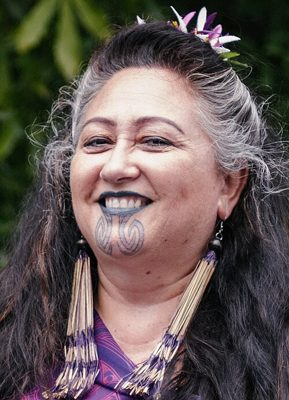

# Elizabeth Kerekere

| | |
|---|---|
| **Party (current/most recent)** | Independent |
| **Status** | Former MP |
| **Party history** | Green Party (by 2017–2023-05-05); Independent (2023-05-05–2023-10-14) |
| **Parliaments (50th–54th)** | 53 |
| **First elected** | 2020 |
| **Key roles** | Green deputy musterer (whip) (2020–2023) Green spokesperson on health (until March 2022), arts, Māori development, rainbow communities, Whānau Ora Founder, Tīwhanawhana Trust (2001) |
| **Born** | 1965 or 1966, Gisborne |
| **Wikipedia** | [Elizabeth Kerekere](https://en.wikipedia.org/wiki/Elizabeth_Kerekere) |

Photo: GreenPartyNZ — CC BY-SA 4.0 — [source](https://commons.wikimedia.org/wiki/File:Elizabeth_Kerekere.jpg)

## Current status

Former MP (2020–2023). Elected as a Green, she left the party on 5 May 2023 and sat as an independent until the October 2023 election, at which she did not stand. She stood unsuccessfully for the Tairāwhiti Māori ward of Gisborne District Council in 2025. Not a 2026 candidate.

## Biography

Born in Gisborne (1965 or 1966); her father, master carver Karauria "Bison" Kerekere, was of Te Whānau a Kai, Te Aitanga-a-Māhaki, Rongowhakaata, Ngāi Tāmanuhiri and Ngāti Oneone descent, and her mother is Irish. Identifies as takatāpui; married to Alofa Aiono. A lifelong activist (Māori Women's Welfare League from 15, nuclear-free and homosexual law reform campaigns), she founded the Tīwhanawhana Trust in 2001 and worked in queer youth development. Artist and curator (bachelor of Māori visual arts, EIT); her 2017 Victoria University PhD was the first major study of takatāpui identity.

## Political career

- Green candidate in Ikaroa-Rāwhiti in 2017 (third; list #19) and 2020.
- Elected a list MP in 2020 (list #9); deputy musterer and spokesperson for a range of portfolios; member of the Health Committee and the Pae Ora legislation committee.
- Resigned from the Green Party on 5 May 2023, sat as an independent; the party said it would not use the waka-jumping law to remove her. Ruled out joining Te Pāti Māori.

## Record & notable actions

- Advocate for rainbow and takatāpui rights; involved in the 2019 ILGA World conference in Wellington hosted partly by Tīwhanawhana.

## Controversies

- **COVID-19 isolation breach (March 2022):** flew from Gisborne to Wellington while a household contact of a COVID case; resigned as health and COVID-19 response spokesperson, was temporarily removed from the Health Committee, and apologised.
- **Bullying allegations (April–May 2023):** a leaked group-chat message appeared to call Chlöe Swarbrick a "crybaby" (Kerekere later said it referred to herself and was meant for her wife); RNZ reported at least seven current and former staff alleging bullying. Some Māori, Pasifika and Rainbow Green members defended her and alleged "dirty politics". She resigned before the party's process concluded, and in her August 2023 valedictory accused co-leaders Shaw and Davidson of "unfounded and increasingly elaborate allegations" and an "epic failure of leadership", which they disputed.

## Sources

- https://en.wikipedia.org/w/index.php?title=Elizabeth_Kerekere&oldid=1379483264
- https://www.parliament.nz/en/mps-and-electorates/members-of-parliament/kerekere-elizabeth/
- https://www.rnz.co.nz/news/political/463342/green-party-mp-elizabeth-kerekere-breaks-self-isolation-rules
- https://www.rnz.co.nz/news/political/488141/green-party-sources-accuse-mp-elizabeth-kerekere-of-bullying
- https://www.newshub.co.nz/home/politics/2023/05/elizabeth-kerekere-resigns-from-green-party-to-sit-as-independent-mp.html
- https://www.rnz.co.nz/news/political/495943/elizabeth-kerekere-blames-epic-failure-of-leadership-for-departure-from-politics
- https://www.1news.co.nz/2025/08/08/former-green-mp-elizabeth-kerekere-runs-for-maori-ward/
- http://researcharchive.vuw.ac.nz/handle/10063/6369
