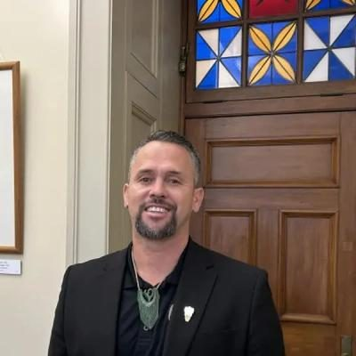

# Tākuta Ferris

| | |
|---|---|
| **Party (current/most recent)** | Independent |
| **Status** | MP (54th Parliament), standing in 2026 |
| **Party history** | Te Pāti Māori (2020–2025-11-09); Independent (2025-11-10–present) |
| **Parliaments (50th–54th)** | 54 |
| **First elected** | 2023 |
| **Electorates held** | Te Tai Tonga (2023–) |
| **Key roles** | MP for Te Tai Tonga (2023–) TPM spokesperson on education, Te Tiriti, justice, police, corrections, drug law reform, water, fisheries (2023–2025) Member, Justice Committee |
| **Born** | 1978 |
| **2026 election** | contesting Te Tai Tonga |
| **Wikipedia** | [Tākuta Ferris](https://en.wikipedia.org/wiki/T%C4%81kuta_Ferris) |

Photo: Supplied to policy.nz by the candidate/party — [source](https://cdn.sanity.io/images/ubdwo62y/production/de7c05f073dea0b1bb005d4f964a17dd8ed35a09-1024x1024.jpg)

## Current status

Independent MP for **Te Tai Tonga** (the South Island and Wellington Māori seat). Elected for Te Pāti Māori in 2023, he was expelled by the party's national council on 9 November 2025, a decision he called "plainly unconstitutional". He announced on 21 March 2026 that he would stand as an independent in Te Tai Tonga, and is on the 2026 ballot there.

## Biography

Tākuta "Doc" Ferris (born 1978; Ngāi Tahu, Ngāti Kuia, Ngāti Kahungunu, Ngāti Porou) holds degrees in Māori design and art and in mātauranga Māori from Te Wānanga o Raukawa, and was a lecturer and Māori adviser at Massey University's Manawatū campus. Describes himself as "a fisherman, a diver, and an artist". Nephew of Piri Sciascia.

## Political career

- TPM candidate for Te Tai Tonga in 2020 (lost to Rino Tirikatene by 6,800+).
- In 2023 stood in for the co-leaders in *The Press* leaders' debate and then unseated Tirikatene by about 2,800 votes, ending the Tirikatene family's long hold on the seat.
- Expelled from TPM in November 2025 amid the party's leadership dispute; sits as an independent and shares an office with Mariameno Kapa-Kingi.

## Record & notable actions

- Said in his maiden speech (December 2023) that he was in Parliament "to contest it" rather than serve it.

## Controversies

- **Privileges finding (2024–25):** referred to the Privileges Committee after accusing MPs of lying and then denying he had said so; in February 2025 the committee found he had deliberately misled the House and should apologise.
- **Posts about Labour volunteers (September 2025):** criticised the ethnicity of non-Māori Labour campaigners in the Tāmaki Makaurau by-election and defended it in a midnight video, saying it reflected attempts to treat Māori "as just another minority". TPM apologised and asked him to remove the post; leaders across Parliament condemned it; he refused to apologise. The Electoral Commission investigated a separate election-day post.
- **MACA law burning (October 2025):** filmed with Debbie Ngarewa-Packer burning a copy of the Marine and Coastal Area amendment law; rebuked by the Speaker.
- **Expulsion (November 2025):** party president John Tamihere accused him and Kapa-Kingi of "greed, avarice, and entitlement" and of plotting to replace the co-leaders; Ferris rejected the "illegal resolutions" and later alleged the leadership had tried to unseat the late Takutai Tarsh Kemp.

<!-- GENERATED:2026-candidacy START -->
## 2026 candidacy

- **Electorate:** Te Tai Tonga
- **Before politics:** Massey Principal Māori Advisor
- **Residence:** Wellington Region
- **Age:** 48
- **Public email:** Takuta.Ferris@parliament.govt.nz
- **Website:** www.takuta.co.nz
- **Facebook:** https://www.facebook.com/takutataitonga
- **Instagram:** https://www.instagram.com/takuta_ferris

_Source: candidate questionnaire answers published on [policy.nz](https://policy.nz/2026/party-vote/parties/independent), retrieved Oct 2026._
<!-- GENERATED:2026-candidacy END -->

## Sources

- https://en.wikipedia.org/w/index.php?title=T%C4%81kuta_Ferris&oldid=1379105095
- https://en.wikipedia.org/wiki/Te_P%C4%81ti_M%C4%81ori
- https://archive.electionresults.govt.nz/electionresults_2023/electorate-details-71.html
- https://www.nzherald.co.nz/nz/politics/te-pati-maori-mp-takuta-ferris-deliberately-misled-house-required-to-apologise-committee/4IQFUUXH5ZH3JDYZH2WYJPILN4/
- https://www.rnz.co.nz/news/political/572068/te-pati-maori-apologises-over-takuta-ferris-social-media-post
- https://www.stuff.co.nz/politics/360821333/takuta-ferris-breaks-silence-refuses-apologise-over-racist-posts
- https://www.rnz.co.nz/news/te-manu-korihi/577653/greed-avarice-and-entitlement-te-pati-maori-president-urges-mps-to-quit
- https://policy.nz/2026/party-vote/parties/independent
