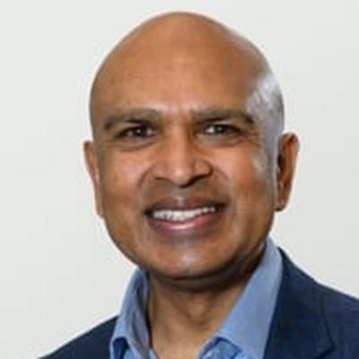
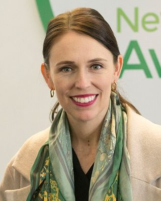
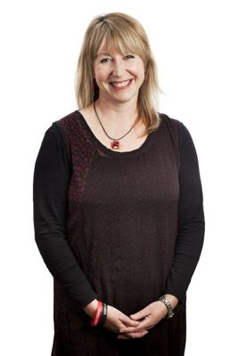
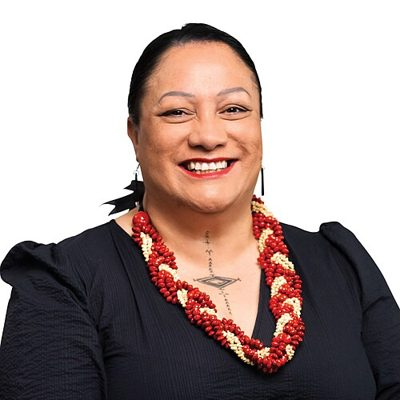

# Labour people

Profiles of everyone who sat as a Labour MP in the 50th–54th Parliaments (2011–2026), and of every Labour candidate at the 7 November 2026 election. MPs who later left Labour stay in this folder, and their party history records the move. Status is as of 23 October 2026; the 54th Parliament was dissolved on 1 October 2026.

**133 profiles:** 35 MPs at dissolution (34 Labour MPs plus Shane Jones, now an NZ First MP), 48 2026 candidates who are not sitting MPs, and 50 former or deceased MPs. Each folder holds `README.md`, `person.json` (see [docs/SCHEMA.md](../../../docs/SCHEMA.md)) and `photo.jpg`, with the photo source, credit and licence recorded in `person.json`.

List ranks and 2026 electorates come from Labour candidate data published on [policy.nz](https://policy.nz/2026/party-vote/parties/labour-party). Opposition portfolios are taken from [Shadow Cabinet of Chris Hipkins](https://en.wikipedia.org/wiki/Shadow_Cabinet_of_Chris_Hipkins) as of 11 March 2026.

## Current MPs (54th Parliament, at dissolution)

| | Name | Status | Electorate(s) held | 2026 candidacy | Roles |
|---|---|---|---|---|---|
|  | [Chris Hipkins](chris-hipkins/) | MP, standing 2026 | Rimutaka, Remutaka | Remutaka · #1 | Labour shadow cabinet #1: Leader of the Opposition; Spokesperson for Ministerial Services; Spokesperson for National Security and Intelligence 41st Leader of the Opposition (2023–) |
|  | [Carmel Sepuloni](carmel-sepuloni/) | MP, standing 2026 | Kelston | Glendene · #2 | Labour shadow cabinet #2: Deputy Leader of the Opposition; Spokesperson for Auckland Issues; Spokesperson for Pacific Peoples Deputy Leader of the Opposition (2023–) |
|  | [Barbara Edmonds](barbara-edmonds/) | MP, standing 2026 | Mana | Kenepuru · #3 | Labour shadow cabinet #3: Spokesperson for Finance; Spokesperson for the Economy, Savings and Investment 37th Minister of Internal Affairs (2023) |
|  | [Willie Jackson](willie-jackson/) | MP, standing 2026 | List | List only · #4 | Labour shadow cabinet #5: Spokesperson for Māori Development; Spokesperson for Māori Crown Relations; Associate Spokesperson for Health (Māori) 27th Minister of Broadcasting and Media (2022–2023) |
|  | [Megan Woods](megan-woods/) | MP, standing 2026 | Wigram | List only · #5 | Labour shadow cabinet #4: Spokesperson for Manufacturing and Industry; Spokesperson for Energy and Resources; Associate Spokesperson for Finance 17th Minister of Energy and Resources (2017–2023) |
|  | [Ayesha Verrall](ayesha-verrall/) | MP, standing 2026 | List | Wellington North · #6 | Labour shadow cabinet #6: Spokesperson for Health; Spokesperson for Wellington Issues 43rd Minister of Health (2023) |
|  | [Willow-Jean Prime](willow-jean-prime/) | MP, standing 2026 | Northland | Te Tai Tokerau · #7 | Labour shadow cabinet #8: Spokesperson for Social Development; Spokesperson for Children; Associate Spokesperson for Education (Māori) 16th Minister of Conservation (2023) |
|  | [Vanushi Walters](vanushi-walters/) | MP, standing 2026 | Upper Harbour | Waitākere · #8 | Labour shadow cabinet #12: Shadow Attorney-General; Spokesperson for Foreign Affairs; Spokesperson for the NZSIS |
|  | [Cushla Tangaere-Manuel](cushla-tangaere-manuel/) | MP, standing 2026 | Ikaroa-Rāwhiti | Ikaroa-Rāwhiti · #9 | Labour shadow cabinet #20: Assistant Whip; Spokesperson for Emergency Management and Recovery; Spokesperson for the Natural Hazards Commission |
|  | [Kieran McAnulty](kieran-mcanulty/) | MP, standing 2026 | Wairarapa | Wairarapa · #10 | Labour shadow cabinet #7: Shadow Leader of the House; Spokesperson for Housing; Spokesperson for Infrastructure 20th Minister of Local Government (2023) |
|  | [Rachel Brooking](rachel-brooking/) | MP, standing 2026 | Dunedin | Dunedin · #11 | Labour shadow cabinet #17: Spokesperson for the Environment; Spokesperson for Food Safety; Spokesperson for Space 13th Minister for Oceans and Fisheries (2023) |
|  | [Ginny Andersen](ginny-andersen/) | MP, standing 2026 | Hutt South | Hutt South · #12 | Labour shadow cabinet #9: Spokesperson for Education; Spokesperson for Police; Spokesperson for Jobs and Income 52nd Minister of Justice (2023) |
|  | [Tangi Utikere](tangi-utikere/) | MP, standing 2026 | Palmerston North | Palmerston North · #14 | Labour shadow cabinet #11: Deputy Shadow Leader of the House; Spokesperson for Transport; Spokesperson for Local Government Deputy Mayor of Palmerston North (2016–2020) |
|  | [Jan Tinetti](jan-tinetti/) | MP, standing 2026 | List | Tauranga · #15 | Labour shadow cabinet #10: Spokesperson for Workplace Relations and Safety; Spokesperson for Social Investment; Spokesperson for Early Childhood Education 48th Minister of Education (2023) |
|  | [Damien O'Connor](damien-oconnor/) | MP, standing 2026 | West Coast, West Coast-Tasman | Waitaki · #16 | Labour shadow cabinet #18: Spokesperson for Trade and Export Growth; Spokesperson for Defence; Spokesperson for Land Information 34th Minister of Agriculture (2017–2023) |
|  | [Jo Luxton](jo-luxton/) | MP, standing 2026 | Rangitata | East Cape · #17 | Labour shadow cabinet #15: Spokesperson for Agriculture; Spokesperson for Biosecurity; Spokesperson for Customs 66th Minister of Customs (2023) |
|  | [Priyanca Radhakrishnan](priyanca-radhakrishnan/) | MP, standing 2026 | Maungakiekie | Maungakiekie · #18 | Labour shadow cabinet #14: Spokesperson for Conservation; Spokesperson for Disability Issues; Spokesperson for ACC Minister for Disability Issues (2023) |
|  | [Shanan Halbert](shanan-halbert/) | MP, standing 2026 | Northcote | Northcote · #19 | Labour shadow cabinet #28: Spokesperson for Tertiary Education; Spokesperson for Whānau Ora |
|  | [Reuben Davidson](reuben-davidson/) | MP, standing 2026 | Christchurch East | Christchurch East · #21 | Labour shadow cabinet #13: Spokesperson for Economic Development; Spokesperson for Science, Technology and Innovation; Spokesperson for Broadcasting, Media and Creative Economy |
|  | [Camilla Belich](camilla-belich/) | MP, standing 2026 | List | Epsom · #23 | Labour shadow cabinet #19: Spokesperson for Justice; Spokesperson for Public Service |
|  | [Jenny Salesa](jenny-salesa/) | MP, standing 2026 | Manukau East, Panmure-Ōtāhuhu | Ōtāhuhu · #24 | Labour shadow cabinet #23: Spokesperson for Ethnic Communities; Spokesperson for Customs; Associate Spokesperson for Pacific Peoples First Assistant Speaker of the House of Representatives (2020–2023) |
|  | [Glen Bennett](glen-bennett/) | MP, standing 2026 | New Plymouth | Coromandel · #25 | Labour shadow cabinet #21: Chief Whip; Spokesperson for Tourism and Hospitality |
|  | [Deborah Russell](deborah-russell/) | MP, standing 2026 | New Lynn | List only · #27 | Labour shadow cabinet #16: Spokesperson for Revenue; Spokesperson for Climate Change; Associate Spokesperson for Finance 32nd Minister of Statistics (2023) |
|  | [Tracey McLellan](tracey-mclellan/) | MP, standing 2026 | Banks Peninsula | Banks Peninsula · #28 | Labour shadow cabinet #22: Junior Whip; Spokesperson for Corrections; Spokesperson for Christchurch Issues Vice-president of the New Zealand Labour Party (2019–2021) |
|  | [Georgie Dansey](georgie-dansey/) | MP, standing 2026 | List | Hamilton East · #33 | Labour shadow cabinet #32: Spokesperson for Rainbow Issues; Spokesperson for Regulation |
|  | [Dan Rosewarne](dan-rosewarne/) | MP, standing 2026 | List | Waimakariri · #36 | Labour shadow cabinet #33: Spokesperson for Rural Communities; Spokesperson for Small Business |
|  | [Rachel Boyack](rachel-boyack/) | MP, standing 2026 | Nelson | Nelson · #37 | Labour shadow cabinet #27: Spokesperson for Oceans and Fisheries; Spokesperson for Arts, Culture and Heritage; Spokesperson for Animal Welfare |
|  | [Helen White](helen-white/) | MP, standing 2026 | Mount Albert | Mt Albert · #38 | Labour shadow cabinet #29: Spokesperson for the Community and Voluntary Sector; Spokesperson for Prevention of Family and Sexual Violence |
|  | [Ingrid Leary](ingrid-leary/) | MP, standing 2026 | Taieri | Taieri · #39 | Labour shadow cabinet #30: Spokesperson for Seniors; Spokesperson for Mental Health |
|  | [Phil Twyford](phil-twyford/) | MP, standing 2026 | Te Atatū | Henderson · #40 | Labour shadow cabinet #25: Spokesperson for Immigration; Spokesperson for Disarmament and Arms Control; Associate Spokesperson for Foreign Affairs 10th Minister of Disarmament and Arms Control (2020–2023) |
|  | [Arena Williams](arena-williams/) | MP, standing 2026 | Manurewa | Manurewa · #41 | Labour shadow cabinet #24: Spokesperson for Commerce and Consumer Affairs; Spokesperson for Building and Construction; Spokesperson for Youth |
|  | [Lemauga Lydia Sosene](lemauga-lydia-sosene/) | MP, standing 2026 | Māngere | Māngere · #42 | Labour shadow cabinet #31: Spokesperson for Internal Affairs; Spokesperson for Statistics |
|  | [Duncan Webb](duncan-webb/) | MP, retiring | Christchurch Central | — | 17th Minister for State Owned Enterprises (2023) 15th Minister of Commerce and Consumer Affairs (2023) |
|  | [Greg O'Connor](greg-oconnor/) | MP, retiring | Ōhāriu | — | Labour shadow cabinet #26: Assistant Speaker of the House of Representatives; Spokesperson for Courts; Spokesperson for Veterans Wellington City Councillor for the Takapū/Northern general ward (2026–) |
|  | [Shane Jones](shane-jones/) | MP, standing 2026 (NZ First) | List | — | 14th Minister for Oceans and Fisheries (2023–) 6th Deputy Leader of New Zealand First (2025–) |

## 2026 candidates (not sitting MPs), by list rank

Candidates without a rank are standing in an electorate only. Kerrin Leoni (Tāmaki Makaurau, #43) resigned as a Labour candidate on 23 October 2026. Her name stays on the ballot, but without Labour's endorsement (see [her profile](kerrin-leoni/)).

| List # | | Name | 2026 electorate | Background | Occupation (policy.nz) |
|---|---|---|---|---|---|
| 13 |  | [Rakesh Naidoo](rakesh-naidoo/) | List only | New |  |
| 20 |  | [Chris Flatt](chris-flatt/) | Taupō | New |  |
| 22 |  | [Kingi Kiriona](kingi-kiriona/) | Hauraki-Waikato | New |  |
| 26 |  | [Sophie Handford](sophie-handford/) | Kapiti | New | NZ Nature Fund |
| 29 |  | [Max Harris](max-harris/) | Tāmaki | New | Lawyer, campaigner, and writer |
| 30 |  | [Warrick Cleine](warrick-cleine/) | List only | New |  |
| 31 |  | [Ibrahim Omer](ibrahim-omer/) | List only | Former MP (53) |  |
| 32 |  | [Anae Neru LEAVASA](anae-neru-leavasa/) | Botany | Former MP (53) | Specialist GP |
| 34 |  | [Te Pūoho Kātene](te-puoho-katene/) | Te Tai Hauāuru | New | Chief Executive Officer |
| 35 |  | [Naisi Chen](naisi-chen/) | Auckland Central | Former MP (53) | HR/Employment Consultant |
| 43 |  | [Kerrin Leoni](kerrin-leoni/) | Tāmaki Makaurau | New |  |
| 44 |  | [Toni Boynton](toni-boynton/) | Waiariki | New |  |
| 45 |  | [Hannah Pia Baral](hannah-pia-baral/) | Upper Harbour | New | CEO |
| 46 |  | [Angela Roberts](angela-roberts/) | Whanganui | Former MP (53) |  |
| 47 |  | [Estefania Muller-Pallarès](estefania-muller-pallares/) | Whangaparāoa | New | Environmental educator |
| 48 |  | [Anahila Kanongata'a](anahila-kanongataa/) | Papakura | Former MP (52, 53) |  |
| 49 |  | [Gary Payinda](gary-payinda/) | Whangārei | New |  |
| 50 |  | [Alex Hedley](alex-hedley/) | Napier | New | Public Health Medicine Doctor |
| 51 |  | [Craig Renney](craig-renney/) | Wellington Bays | New |  |
| 52 |  | [George Hampton](george-hampton/) | Christchurch Central | New | Diplomat/Small Business Owner |
| 53 |  | [Dominik Yanzick](dominik-yanzick/) | Wigram | New | Technology Project Manager |
| 54 |  | [Rory Paterson](rory-paterson/) | West Coast-Tasman | New |  |
| 55 |  | [Ashleigh Latimer](ashleigh-latimer/) | Northland | New | Community Health Leader |
| 56 |  | [Rata Jamieson](rata-jamieson/) | Ilam | New | Student with part-time jobs |
| 57 |  | [Naresh Perinpanayagam](naresh-perinpanayagam/) | List only | New |  |
| 58 |  | [Peter McDonald](peter-mcdonald/) | Southland | New | Farmer, this is still my job |
| 59 |  | [Amanda Clinton-Gohdes](amanda-clinton-gohdes/) | New Plymouth | New | Councillor |
| 60 |  | [Myra Williamson](myra-williamson/) | Hamilton West | New |  |
| 61 |  | [Kharag Singh](kharag-singh/) | Takanini | New | Business Owner |
| 62 |  | [Janice Lee](janice-lee/) | Invercargill | New | Business Entrepreneur |
| 63 |  | [Sam Collins](sam-collins/) | North Shore | New | Small Business Owner (Media) |
| 64 |  | [Sange Malama](sange-malama/) | Rangitata | New |  |
| 65 |  | [Rhieve Grey](rhieve-grey/) | Mt Maunganui | New | Policy Researcher |
| 66 |  | [Karl Severinsen](karl-severinsen/) | Rangitīkei | New | General Mananger Mental Health |
| 67 |  | [Henrietta Hunkin-Tagaloa](henrietta-hunkin-tagaloa/) | List only | New |  |
| 68 |  | [Fisher Wang](fisher-wang/) | Rotorua | New |  |
| 69 |  | [Brendan McEnroe](brendan-mcenroe/) | East Coast Bays | New | Technologist Innovator |
| 70 |  | [Campbell Matthews](campbell-matthews/) | Pakuranga | New | Social Worker |
| 71 |  | [David Pattemore](david-pattemore/) | Taranaki-King Country | New |  |
| 72 |  | [Nathaniel Howe](nathaniel-howe/) | List only | New |  |
| — |  | [Matt FLIGHT](matt-flight/) | Kaikōura | New |  |
| — |  | [Jolyon SWINBURN](jolyon-swinburn/) | Kaipara ki Mahurangi | New | Principal Policy Advisor |
| — |  | [Michael Wood](michael-wood/) | Mt Roskill | Former MP (51, 52, 53) | Union leader. |
| — |  | [Matt Brachi](matt-brachi/) | Port Waikato | New | High School Educator |
| — |  | [Sunita Gautam](sunita-gautam/) | Selwyn | New | Senior Business Lecturer |
| — |  | [Mananui Ramsden](mananui-ramsden/) | Te Tai Tonga | New |  |
| — |  | [Dan Scott](dan-scott/) | Tukituki | New | Meteorologist |
| — |  | [Jamie Toko](jamie-toko/) | Waikato | New | Senior Advisor: Business Owner |

## Former MPs (served 2011–2026)

| | Name | Status | Electorate(s) held | Parliaments | 2026 candidacy | Roles |
|---|---|---|---|---|---|---|
|  | [Kiri Allan](kiri-allan/) | Former MP | East Coast | 52, 53 | — | 51st Minister of Justice (2022–2023) Minister for Regional Development (2023) |
|  | [Jacinda Ardern](jacinda-ardern/) | Former MP | Mount Albert | 49, 50, 51, 52, 53 | — | 40th Prime Minister of New Zealand (2017–2023) 17th Leader of the Labour Party (2017–2023) |
|  | [Carol Beaumont](carol-beaumont/) | Former MP | List | 49, 50 | — | Vice-President of the New Zealand Labour Party (2021–) |
|  | [Charles Chauvel](charles-chauvel/) | Former MP | List | 50 | — |  |
|  | [David Clark](david-clark/) | Former MP | Dunedin North, Dunedin | 50, 51, 52, 53 | — | 14th Minister of Commerce and Consumer Affairs (2020–2023) 20th Minister Responsible for the Earthquake Commission (2020–2023) |
|  | [Tāmati Coffey](tamati-coffey/) | Former MP | Waiariki | 52, 53 | — |  |
|  | [Clayton Cosgrove](clayton-cosgrove/) | Former MP | Waimakariri | 46, 47, 48, 49, 50, 51 | — | 52nd Minister of Immigration (2007–2008) 3rd Minister for Building Issues (2005–2007) |
|  | [Liz Craig](liz-craig/) | Former MP | List | 52, 53 | — | Parliamentary Private Secretary to the Minister of Health (2022–2023) |
|  | [David Cunliffe](david-cunliffe/) | Former MP | Titirangi, New Lynn | 46, 47, 48, 49, 50, 51 | — | 34th Leader of the Opposition (2013–2014) 15th Leader of the Labour Party (2013–2014) |
|  | [Clare Curran](clare-curran/) | Former MP | Dunedin South | 49, 50, 51, 52 | — | 25th Minister of Broadcasting, Communications and Digital Media (2017–2018) Minister for Government Digital Services (2017–2018) |
|  | [Lianne Dalziel](lianne-dalziel/) | Former MP | Christchurch Central, Christchurch East | 43, 44, 45, 46, 47, 48, 49, 50 | — | 46th Mayor of Christchurch (2013–2022) 6th Minister of Commerce (2002–2004) |
|  | [Kelvin Davis](kelvin-davis/) | Former MP | Te Tai Tokerau | 49, 50, 51, 52, 53, 54 | — | 18th Deputy Leader of the Labour Party (2017–2023) 14th Minister of Corrections (2017–2023) |
|  | [Ruth Dyson](ruth-dyson/) | Former MP | Lyttelton, Banks Peninsula, Port Hills | 44, 45, 46, 47, 48, 49, 50, 51, 52 | — | Assistant Speaker of the House of Representatives (2019–2020) Chief Government Whip in the House of Representatives (2017–2019) |
|  | [Paul Eagle](paul-eagle/) | Former MP | Rongotai | 52, 53 | — | 24th Deputy Mayor of Wellington (2016–2017) Wellington City Councillor for the Southern Ward (2010–2017) |
|  | [Kris Faafoi](kris-faafoi/) | Former MP | Mana | 49, 50, 51, 52, 53 | — | 50th Minister of Justice (2020–2022) 26th Minister for Broadcasting and Media (2018–2022) |
|  | [Darien Fenton](darien-fenton/) | Former MP | List | 48, 49, 50 | — |  |
|  | [Phil Goff](phil-goff/) | Former MP | Roskill, New Lynn, Mount Roskill | 40, 41, 42, 44, 45, 46, 47, 48, 49, 50, 51 | — | 33rd High Commissioner of New Zealand to the United Kingdom (2023–2025) 2nd Mayor of Auckland (2016–2022) |
|  | [Peeni Henare](peeni-henare/) | Former MP | Tāmaki Makaurau | 51, 52, 53, 54 | — | 41st Minister of Defence (2020–2023) 38th Minister of Tourism (2023) |
|  | [Emily Henderson](emily-henderson/) | Former MP | Whangārei | 53 | — |  |
|  | [Parekura Horomia](parekura-horomia/) | Deceased | Ikaroa-Rāwhiti | 46, 47, 48, 49, 50 | — | 40th Minister of Māori Affairs (2000–2008) |
|  | [Raymond Huo](raymond-huo/) | Former MP | List | 49, 50, 51, 52 | — |  |
|  | [Dame Annette King](annette-king/) | Former MP | Horowhenua, Miramar, Rongotai | 41, 42, 44, 45, 46, 47, 48, 49, 50, 51 | — | 19th High Commissioner of New Zealand to Australia (2018–2023) 14th Deputy Leader of the New Zealand Labour Party (2014–2017) |
|  | [Iain Lees-Galloway](iain-lees-galloway/) | Former MP (The Opportunity Party) | Palmerston North | 49, 50, 51, 52 | — | 2nd Minister for Workplace Relations and Safety (2017–2020) 56th Minister of Immigration (2017–2020) |
|  | [Steph Lewis](steph-lewis/) | Former MP | Whanganui | 53 | — |  |
|  | [Andrew Little](andrew-little/) | Former MP | List | 50, 51, 52, 53 | — | 38th Mayor of Wellington (2025–) 35th Leader of the Opposition and 16th Leader of the Labour Party (2014–2017) |
|  | [Anna Lorck](anna-lorck/) | Former MP | Tukituki | 53 | — |  |
|  | [Marja Lubeck](marja-lubeck/) | Former MP | List | 52, 53 | — |  |
|  | [Moana Mackey](moana-mackey/) | Former MP | List | 47, 48, 49, 50 | — |  |
|  | [Nanaia Mahuta](nanaia-mahuta/) | Former MP | Te Tai Hauāuru, Tainui, Hauraki-Waikato | 45, 46, 47, 48, 49, 50, 51, 52, 53 | — | 28th Minister of Foreign Affairs (2020–2023) 11th Minister of Disarmament and Arms Control (2023) |
|  | [Sir Trevor Mallard](trevor-mallard/) | Former MP | Hamilton West, Pencarrow, Hutt South | 41, 42, 44, 45, 46, 47, 48, 49, 50, 51, 52, 53 | — | 2nd Ambassador of New Zealand to Ireland (2023–2025) 30th Speaker of the New Zealand House of Representatives (2017–2022) |
|  | [Sue Moroney](sue-moroney/) | Former MP | List | 48, 49, 50, 51 | — | Junior Government Whip (2007–2008) |
|  | [Stuart Nash](stuart-nash/) | Former MP (NZ First) | Napier | 49, 51, 52, 53 | — | 9th Minister for Economic Development (2023) 32nd Minister of Forestry (2020–2023) |
|  | [Terisa Ngobi](terisa-ngobi/) | Former MP | Ōtaki | 53 | — |  |
|  | [Sarah Pallett](sarah-pallett/) | Former MP | Ilam | 53 | — |  |
|  | [David Parker](david-parker/) | Former MP | Otago | 47, 48, 49, 50, 51, 52, 53, 54 | — | 32nd Attorney-General of New Zealand (2017–2023) 16th Minister for the Environment (2017–2023) |
|  | [Soraya Peke-Mason](soraya-peke-mason/) | Former MP | List | 53 | — | Rangitikei District Councillor for the Turakina ward (2007–2019) |
|  | [Rajen Prasad](rajen-prasad/) | Former MP | List | 49, 50 | — |  |
|  | [Grant Robertson](grant-robertson/) | Former MP | Wellington Central | 49, 50, 51, 52, 53, 54 | — | 10th Vice-Chancellor of the University of Otago (2024–) 19th Deputy Prime Minister of New Zealand (2020–2023) |
|  | [Ross Robertson](ross-robertson/) | Former MP | Manukau East | 50 | — |  |
|  | [Adrian Rurawhe](adrian-rurawhe/) | Deceased | Te Tai Hauāuru | 51, 52, 53, 54 | — | 31st Speaker of the New Zealand House of Representatives (2022–2023) Deputy Speaker of the House of Representatives (2020–2022) |
|  | [Gaurav Sharma](gaurav-sharma/) | Former MP (Independent) | Hamilton West | 53 | — |  |
|  | [David Shearer](david-shearer/) | Former MP | Mount Albert | 49, 50, 51 | — | Special Representative of the Secretary-General for South Sudan (2017–2021) 33rd Leader of the Opposition (2011–2013) |
|  | [Aupito William Sio](william-sio/) | Former MP | Māngere | 48, 49, 50, 51, 52, 53 | — | 10th Minister for Courts (2020–2023) 13th Minister for Pacific Peoples (2017–2023) |
|  | [Jamie Strange](jamie-strange/) | Former MP | Hamilton East | 52, 53 | — |  |
|  | [Maryan Street](maryan-street/) | Former MP | List | 48, 49, 50 | — | 22nd Minister of Housing (2007–2008) 8th Minister for ACC (2007–2008) |
|  | [Rino Tirikatene](rino-tirikatene/) | Former MP (NZ First) | Te Tai Tonga | 50, 51, 52, 53, 54 | — | 11th Minister for Courts (2023) Minister of State for Trade and Export Growth (2023) |
|  | [Louisa Wall](louisa-wall/) | Former MP | Manurewa | 48, 49, 50, 51, 52, 53 | — |  |
|  | [Angie Warren-Clark](angie-warren-clark/) | Former MP | List | 52, 53 | — |  |
|  | [Meka Whaitiri](meka-whaitiri/) | Former MP (Te Pāti Māori) | Ikaroa-Rāwhiti | 50, 51, 52, 53 | — | 63rd Minister of Customs (2020–2023) |
|  | [Poto Williams](poto-williams/) | Former MP | Christchurch East | 50, 51, 52, 53 | — | 14th Minister of Conservation (2022–2023) 8th Minister for Building and Construction (2020–2022) |

_Generated by `tools/people_labour_index.py` from each `person.json`; profiles built by `tools/people_labour_build.py` from Wikipedia and the cited sources, plus hand-written notes in `tools/people_labour_notes/`._
