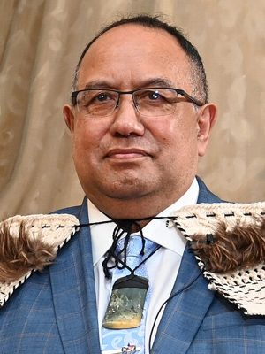

# Adrian Rurawhe

| | |
|---|---|
| **Party** | Labour |
| **Status (Oct 2026)** | Former MP |
| **Born** | {{Birth year|1961}} — Taihape, New Zealand |
| **Died** | {{Death date and given age|2026|9|30|65|df=y}} |
| **Electorate(s) held** | Te Tai Hauāuru |
| **Parliaments** | 51, 52, 53, 54 |
| **First elected** | 2014 |
| **Key roles** | Deputy Speaker of the House of Representatives (2020–2022) Second Assistant Speaker of the House of Representatives (2017–2020) |
| **Wikipedia** | [Adrian Rurawhe](https://en.wikipedia.org/wiki/Adrian_Rurawhe) |

## Current status

Former MP

## Political career

### Parliamentary terms

| Parliament | Years | Electorate | List position | Party |
|---|---|---|---|---|
| 51st | 2014–2017 | Te Tai Hauāuru | none | Labour |
| 52nd | 2017–2020 | Te Tai Hauāuru | none | Labour |
| 53rd | 2020–2023 | Te Tai Hauāuru | 24 | Labour |
| 54th | 2023–2026 | List | 11 | Labour |

_Source: Wikipedia parliamentary-term table._

### Offices held

| Office | From | To | Prime Minister at the time |
|---|---|---|---|
| Deputy Speaker of the House of Representatives | 26 November 2020 | 24 August 2022 |  |
| Second Assistant Speaker of the House of Representatives | 8 November 2017 | 26 November 2020 |  |

_Source: Wikipedia infobox._

## 2026 candidacy

Not listed as a Labour candidate for the 2026 election on policy.nz (Oct 2026).

## Sources

- https://en.wikipedia.org/wiki/Adrian_Rurawhe

_Profile compiled 2026-10-23 from the sources above; Wikipedia tables parsed by tools/people_labour_build.py._
