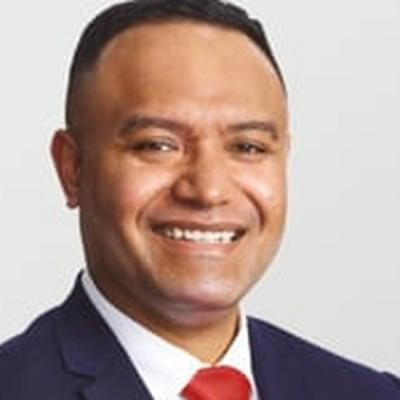

# Anae Neru LEAVASA

| | |
|---|---|
| **Party** | Labour |
| **Status (Oct 2026)** | 2026 candidate (not previously an MP) |
| **Born** | 1983 or 1984 — Auckland, New Zealand |
| **Electorate(s) held** | Takanini |
| **Parliaments** | 53 |
| **First elected** | 2020 |
| **2026 candidacy** | Botany · list #32 |
| **Wikipedia** | [Neru Leavasa](https://en.wikipedia.org/wiki/Neru_Leavasa) |

## Current status

Leavasa is Labour's 2026 candidate for Botany ([Indian Weekender](https://www.indianweekender.co.nz/features/labour-selects-dr-anae-neru-leavasa-for-botany)), ranked 32.

## Biography

Born in Auckland to Samoan parents, Leavasa survived bone cancer as a teenager. He trained in medicine at the University of Auckland, became a Fellow of the RNZ College of GPs in 2014 and practised for 12 years as a GP and sports doctor in Māngere ([NZ Doctor](https://www.nzdoctor.co.nz/article/print-archive/few-words-fromneru-leavasa)). He was elected to the Māngere-Ōtāhuhu Local Board in 2019.

## Political career

### Parliamentary terms

| Parliament | Years | Electorate | List position | Party |
|---|---|---|---|---|
| 53rd | 2020–2023 | Takanini | 52 | Labour |

_Source: Wikipedia parliamentary-term table._

### Career summary

- **MP for Takanini 2020–2023**, winning the new seat by 7,724 votes over National's Rima Nakhle, then losing to her by 8,775 votes in 2023 ([Electoral Commission](https://archive.electionresults.govt.nz/electionresults_2023/electorate-details-48.html)).
- Deputy chair of the Health Committee; member of the Pae Ora Legislation Committee.

## Record & notable actions

- Describes himself as a social conservative; said in 2020 he would have voted against abortion decriminalisation ([The Spinoff](https://thespinoff.co.nz/politics/07-08-2020/abortion-became-legal-in-march-but-it-still-divides-labour-in-south-auckland/)).

<!-- GENERATED:2026-candidacy START -->
## 2026 candidacy

- **Electorate:** Botany
- **List ranking:** 32
- **Before politics:** Specialist GP
- **Public email:** dranae4botany@gmail.com
- **Website:** https://www.labour.org.nz/2026-campaign/our-candidates/dr-anae-neru-leavasa/
- **Facebook:** https://www.facebook.com/DrAnaeNeruLeavasa/
- **Instagram:** https://www.instagram.com/dr_anae_neru_leavasa/?hl=en

_Source: candidate questionnaire answers published on [policy.nz](https://policy.nz/2026/party-vote/parties/labour-party), retrieved Oct 2026._
<!-- GENERATED:2026-candidacy END -->

## Sources

- https://en.wikipedia.org/wiki/Neru_Leavasa
- https://policy.nz/2026/party-vote/parties/labour-party
- https://www.indianweekender.co.nz/features/labour-selects-dr-anae-neru-leavasa-for-botany
- https://www.nzdoctor.co.nz/article/print-archive/few-words-fromneru-leavasa
- https://archive.electionresults.govt.nz/electionresults_2023/electorate-details-48.html
- https://thespinoff.co.nz/politics/07-08-2020/abortion-became-legal-in-march-but-it-still-divides-labour-in-south-auckland/

_Profile compiled 2026-10-23 from the sources above; Wikipedia tables parsed by tools/people_labour_build.py._
