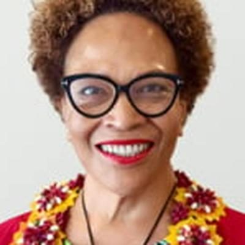

# Anahila Kanongata'a

| | |
|---|---|
| **Party** | Labour |
| **Status (Oct 2026)** | 2026 candidate (not previously an MP) |
| **Born** | 1969 — Tonga |
| **Parliaments** | 52, 53 |
| **First elected** | 2017 |
| **2026 candidacy** | Papakura · list #48 |
| **Wikipedia** | [Anahila Kanongata'a](https://en.wikipedia.org/wiki/Anahila_Kanongata%27a) |

## Current status

Kanongata'a is Labour's 2026 candidate for Papakura, ranked 48 (policy.nz candidate data).

## Biography

Born in Tonga in 1969, Kanongata'a came to New Zealand in 1980 without English and grew up in an Onehunga state house. After working as a bank teller, she studied social work at the University of Auckland at 30 and worked for the Ministry of Social Development and Oranga Tamariki ([Newshub](https://www.newshub.co.nz/home/shows/2023/05/newhsub-nation-backstory-labour-mp-anahila-kanongata-a-recounts-mother-s-funeral-under-covid-restrictions.html)).

## Political career

### Parliamentary terms

| Parliament | Years | Electorate | List position | Party |
|---|---|---|---|---|
| 52nd | 2017–2020 | List | 37 | Labour |
| 53rd | 2020–2023 | List | 44 | Labour |

_Source: Wikipedia parliamentary-term table._

### Career summary

- **List MP 2017–2023**; contested Papakura against Judith Collins in 2020 and 2023.
- Member of the Abortion Legislation Committee (2019).

## Record & notable actions

- Her District Court (Protection of Judgment Debtors with Disabilities) Amendment Bill passed unanimously on 30 June 2021 ([Hansard](https://www.parliament.nz/en/pb/hansard-debates/rhr/combined/HansDeb_20210630_20210630_16)); a bill allowing MPs to swear oaths in other languages failed 54–65.
- Co-founded the Aotearoa Tonga Relief Committee after the 2022 Hunga Tonga eruption.
- A social conservative who voted against the End of Life Choice, Abortion Legislation and abortion safe-areas bills.

<!-- GENERATED:2026-candidacy START -->
## 2026 candidacy

- **Electorate:** Papakura
- **List ranking:** 48

_Source: candidate questionnaire answers published on [policy.nz](https://policy.nz/2026/party-vote/parties/labour-party), retrieved Oct 2026._
<!-- GENERATED:2026-candidacy END -->

## Sources

- https://en.wikipedia.org/wiki/Anahila_Kanongata%27a
- https://policy.nz/2026/party-vote/parties/labour-party
- https://www.newshub.co.nz/home/shows/2023/05/newhsub-nation-backstory-labour-mp-anahila-kanongata-a-recounts-mother-s-funeral-under-covid-restrictions.html
- https://www.parliament.nz/en/pb/hansard-debates/rhr/combined/HansDeb_20210630_20210630_16

_Profile compiled 2026-10-23 from the sources above; Wikipedia tables parsed by tools/people_labour_build.py._
