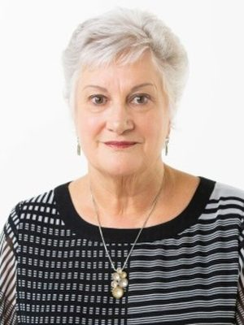

# Dame Annette King

| | |
|---|---|
| **Party** | Labour |
| **Status (Oct 2026)** | Former MP |
| **Born** | 1947-09-13 — Murchison, New Zealand |
| **Electorate(s) held** | Horowhenua, Miramar, Rongotai |
| **Parliaments** | 41, 42, 44, 45, 46, 47, 48, 49, 50, 51 |
| **First elected** | 1984 |
| **Key roles** | 19th High Commissioner of New Zealand to Australia (2018–2023) 14th Deputy Leader of the New Zealand Labour Party (2014–2017) 45th Minister of Justice (2007–2008) 23rd Minister of Transport (2006–2008) 34th Minister of Police (2005–2008) 35th Minister of Health (1999–2005) |
| **Wikipedia** | [Annette King](https://en.wikipedia.org/wiki/Annette_King) |

## Current status

King retired at the 2017 election and was appointed High Commissioner to Australia in November 2018 ([Beehive](https://www.beehive.govt.nz/release/new-high-commissioner-australia-announced)). She was made a Dame Companion of the NZ Order of Merit in 2018; an authorised biography appeared in 2019. No reliable source was found for her role in 2026.

## Biography

Born Annette Robinson on 13 September 1947 in Murchison, King trained and worked as a school dental nurse (1967–1981), gained a degree from the University of Waikato and tutored dental nursing ([Parliament profile](http://www.parliament.nz/en-NZ/MPP/MPs/MPs/7/d/f/50MP1341-King-Annette.htm)). She is married with a daughter and three stepsons; former National minister Chris Finlayson is a relative.

## Political career

### Parliamentary terms

| Parliament | Years | Electorate | List position | Party |
|---|---|---|---|---|
| 41st | 1984–1987 | Horowhenua |  | Labour |
| 42nd | 1987–1990 | Horowhenua |  | Labour |
| 44th | 1993–1996 | Miramar |  | Labour |
| 45th | 1996–1999 | Rongotai | 6 | Labour |
| 46th | 1999–2002 | Rongotai | 4 | Labour |
| 47th | 2002–2005 | Rongotai | 7 | Labour |
| 48th | 2005–2008 | Rongotai | 7 | Labour |
| 49th | 2008–2011 | Rongotai | 4 | Labour |
| 50th | 2011–2014 | Rongotai | 2 | Labour |
| 51st | 2014–2017 | Rongotai | 4 | Labour |

_Source: Wikipedia parliamentary-term table._

### Offices held

| Office | From | To | Prime Minister at the time |
|---|---|---|---|
| 19th High Commissioner of New Zealand to Australia | 7 December 2018 | 22 December 2023 | Jacinda Ardern; Chris Hipkins; Christopher Luxon |
| 14th Deputy Leader of the New Zealand Labour Party | 24 November 2014 | 1 March 2017 |  |
| 45th Minister of Justice | 31 October 2007 | 19 November 2008 | Helen Clark |
| 23rd Minister of Transport | 3 May 2006 | 19 November 2008 | Helen Clark |
| 34th Minister of Police | 19 October 2005 | 19 November 2008 | Helen Clark |
| 35th Minister of Health | 10 December 1999 | 19 October 2005 | Helen Clark |
| 44th Minister of Immigration | 9 February 1990 | 2 November 1990 | Geoffrey Palmer; Mike Moore |
| 10th Minister of Employment | 14 August 1989 | 2 November 1990 | Geoffrey Palmer; Mike Moore |
| Member of the New Zealand Parliament; for Rongotai; Miramar (1993–1996) | 6 November 1993 | 23 September 2017 |  |

_Source: Wikipedia infobox._

### Career summary

- **MP for Horowhenua (1984–1990), Miramar (1993–1996) and Rongotai (1996–2017).** Minister of Employment, Immigration and Youth Affairs (1989–1990).
- **Fifth Labour Government:** Minister of Health (1999–2005), then Police and Transport (2005–2007), and Justice (2007–2008).
- **Deputy Labour leader** under Phil Goff (2008–2011) and again from 2014 (interim, then confirmed by Andrew Little) until 1 March 2017, when she stood down and announced her retirement; Jacinda Ardern succeeded her as deputy ([NZ Herald](http://www.nzherald.co.nz/politics/news/article.cfm?c_id=280&objectid=11809793)).

## Record & notable actions

- Health Minister for Labour's first six years in government (1999–2005); in 2007 received a NZ Skeptics "Bravo" award for work on the Therapeutic Products and Medicines Bill ([NZ Skeptics](http://skeptics.nz/awards/bravo)).

## 2026 candidacy

Not listed as a Labour candidate for the 2026 election on policy.nz (Oct 2026).

## Sources

- https://en.wikipedia.org/wiki/Annette_King
- https://www.beehive.govt.nz/release/new-high-commissioner-australia-announced
- http://www.parliament.nz/en-NZ/MPP/MPs/MPs/7/d/f/50MP1341-King-Annette.htm
- http://www.nzherald.co.nz/politics/news/article.cfm?c_id=280&objectid=11809793
- http://skeptics.nz/awards/bravo

_Profile compiled 2026-10-23 from the sources above; Wikipedia tables parsed by tools/people_labour_build.py._
