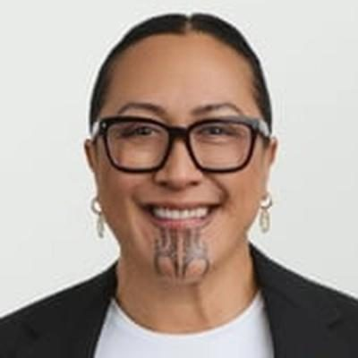

# Ashleigh Latimer

| | |
|---|---|
| **Party** | Labour |
| **Status (Oct 2026)** | 2026 candidate (not previously an MP) |
| **2026 candidacy** | Northland · list #55 |

## Current status

Labour candidate for Northland, ranked 55 on the party list at the 7 November 2026 election (policy.nz candidate data). Not previously an MP.

## Biography

Latimer was born and raised in Northland. Her Labour profile describes more than 25 years in health and social services, working with iwi and providers; she gives her occupation as community health leader. ([Labour candidate profile](https://labour.org.nz/AshleighLatimer), self-description; occupation also from the policy.nz questionnaire)

<!-- GENERATED:2026-candidacy START -->
## 2026 candidacy

- **Electorate:** Northland
- **List ranking:** 55
- **Before politics:** Community Health Leader
- **Residence:** Whangārei
- **Age:** 51
- **Public email:** Ashleigh.Latimer@labour.org.nz
- **Website:** https://labour.org.nz/AshleighLatimer
- **Facebook:** https://www.facebook.com/AshleighLatimer
- **Instagram:** https://www.instagram.com/ashleigh.latimer

_Source: candidate questionnaire answers published on [policy.nz](https://policy.nz/2026/party-vote/parties/labour-party), retrieved Oct 2026._
<!-- GENERATED:2026-candidacy END -->

## Sources

- https://policy.nz/2026/party-vote/parties/labour-party
- https://labour.org.nz/AshleighLatimer

_Profile compiled 2026-10-23 from the sources above; Wikipedia tables parsed by tools/people_labour_build.py._
