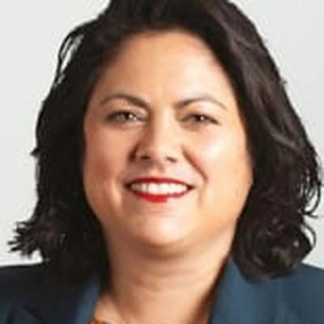

# Ayesha Verrall

| | |
|---|---|
| **Party** | Labour |
| **Status (Oct 2026)** | Current MP, standing in 2026 |
| **Born** | 1979 — Invercargill, New Zealand |
| **Parliaments** | 53, 54 |
| **First elected** | 2020 |
| **2026 candidacy** | Wellington North · list #6 |
| **Key roles** | Labour shadow cabinet #6 (as of 11 Mar 2026): Spokesperson for Health; Spokesperson for Wellington Issues 43rd Minister of Health (2023) 2nd Minister for COVID-19 Response (2022–2023) 27th Minister for Research, Science and Innovation (2022–2023) 14th Minister for Seniors (2020–2023) 8th Minister for Food Safety (2020–2022) |
| **Wikipedia** | [Ayesha Verrall](https://en.wikipedia.org/wiki/Ayesha_Verrall) |

## Current status

Verrall is Labour's health and Wellington issues spokesperson (No. 6 in the shadow cabinet) and was selected in November 2025 as Labour's candidate for the new Wellington North electorate; she is No. 6 on the 2026 list ([The Post](https://www.thepost.co.nz/politics/360896314/labour-confirms-ayesha-verrall-candidate-wellington-north-electorate); [policy.nz](https://policy.nz/2026/party-vote/parties/labour-party)). As spokesperson she has been a strong critic of Health New Zealand commissioner Lester Levy, including a heated select-committee clash for which she declined to apologise ([RNZ](https://www.rnz.co.nz/news/political/535783/no-apology-from-ayesha-verrall-after-clash-with-health-commissioner-lester-levy)).

## Biography

Born in 1979 in Invercargill and raised in Te Anau, Verrall is the daughter of Bill Verrall and Lathee, who came from the Maldives on a Colombo Plan scholarship; former Maldivian president Mohamed Nasheed is her cousin ([ODT](https://www.odt.co.nz/regions/southland/minister-reflects-journey-month-her-new-job)). She graduated MBChB from Otago (2004), was OUSA president (2001), trained in tropical medicine and international health (MSc, London School of Hygiene & Tropical Medicine) and completed a PhD on tuberculosis at Otago in 2018. She was an infectious-diseases physician at Capital & Coast DHB, a senior lecturer at the University of Otago, Wellington, and an elected (Labour) member and deputy chair of the Capital & Coast DHB from 2019 ([Otago profile](https://www.otago.ac.nz/healthsciences/expertise/Profile/index.html?id=1377)). In April 2020 her independent audit of COVID-19 contact tracing found the system under-staffed and slow to scale; the Ministry of Health accepted her recommendations ([Ministry of Health](https://www.health.govt.nz/publication/rapid-audit-contact-tracing-covid-19-new-zealand)). She has a daughter with her partner Alice.

## Political career

### Parliamentary terms

| Parliament | Years | Electorate | List position | Party |
|---|---|---|---|---|
| 53rd | 2020–2023 | List | 17 | Labour |
| 54th | 2023–present | List | 7 | Labour |

_Source: Wikipedia parliamentary-term table._

### Offices held

| Office | From | To | Prime Minister at the time |
|---|---|---|---|
| 43rd Minister of Health | 1 February 2023 | 27 November 2023 | Chris Hipkins |
| 2nd Minister for COVID-19 Response | 14 June 2022 | 1 February 2023 | Jacinda Ardern; Chris Hipkins |
| 27th Minister for Research, Science and Innovation | 14 June 2022 | 27 November 2023 | Jacinda Ardern; Chris Hipkins |
| 14th Minister for Seniors | 6 November 2020 | 1 February 2023 | Jacinda Ardern; Chris Hipkins |
| 8th Minister for Food Safety | 6 November 2020 | 14 June 2022 | Jacinda Ardern |

_Source: Wikipedia infobox._

### Opposition portfolios (as of 11 March 2026)

Rank 6 in Chris Hipkins' shadow cabinet:

- Spokesperson for Health
- Spokesperson for Wellington Issues

_Source: [Shadow Cabinet of Chris Hipkins](https://en.wikipedia.org/wiki/Shadow_Cabinet_of_Chris_Hipkins), list as of 11 March 2026._

### Career summary

- Entered Parliament in 2020 as a list-only candidate ranked 17 — the highest-ranked newcomer — and went straight into Cabinet ([Stuff](https://www.stuff.co.nz/national/300034942/labour-reveals-freshfaced-party-list-for-2020)). Re-elected on the list in 2023.
- **Minister, 2020–2023:** Minister for Seniors and Food Safety and Associate Minister of Health and of Research, Science and Innovation (Nov 2020); Minister for COVID-19 Response and Research, Science and Innovation (June 2022); Minister of Health (Feb–Nov 2023), saying her priorities were "workforce, wait lists and winter" ([The Post](https://www.thepost.co.nz/politics/360540648/its-worst-job-country-why-does-ayesha-verrall-want-second-go-it)).
- **Opposition:** health, public service and Wellington issues spokesperson (Nov 2023); kept health and Wellington after March 2025.

## Record & notable actions

- **Smokefree Generation law:** as associate health minister she led the Smokefree 2025 plan and the 2022 law banning tobacco sales to anyone born on or after 1 January 2009, cutting nicotine levels and retail outlets ([Guardian](https://www.theguardian.com/world/2022/dec/13/new-zealand-passes-world-first-tobacco-law-to-ban-smoking-by-2025)). The National-led government repealed it in 2024 before it took effect ([RNZ](https://www.rnz.co.nz/news/political/510439/smokefree-generation-law-scrapped-by-coalition-government)).
- Oversaw the final phase of COVID-19 restrictions as COVID-19 Response Minister (2022–2023).

<!-- GENERATED:2026-candidacy START -->
## 2026 candidacy

- **Electorate:** Wellington North
- **List ranking:** 6
- **Before politics:** Specialist doctor
- **Age:** 47
- **Public email:** ayesha.verrall@labour.org.nz
- **Website:** https://www.labour.org.nz/2026-campaign/our-candidates/dr-ayesha-verrall/
- **Facebook:** https://www.facebook.com/drayeshaverrall/
- **Instagram:** https://www.instagram.com/drayeshaverrallmp
- **Twitter:** https://x.com/drayeshaverrall

_Source: candidate questionnaire answers published on [policy.nz](https://policy.nz/2026/party-vote/parties/labour-party), retrieved Oct 2026._
<!-- GENERATED:2026-candidacy END -->

## Sources

- https://en.wikipedia.org/wiki/Ayesha_Verrall
- https://policy.nz/2026/party-vote/parties/labour-party
- https://en.wikipedia.org/wiki/Shadow_Cabinet_of_Chris_Hipkins
- https://www.thepost.co.nz/politics/360896314/labour-confirms-ayesha-verrall-candidate-wellington-north-electorate
- https://www.rnz.co.nz/news/political/535783/no-apology-from-ayesha-verrall-after-clash-with-health-commissioner-lester-levy
- https://www.odt.co.nz/regions/southland/minister-reflects-journey-month-her-new-job
- https://www.otago.ac.nz/healthsciences/expertise/Profile/index.html?id=1377
- https://www.health.govt.nz/publication/rapid-audit-contact-tracing-covid-19-new-zealand
- https://www.stuff.co.nz/national/300034942/labour-reveals-freshfaced-party-list-for-2020
- https://www.thepost.co.nz/politics/360540648/its-worst-job-country-why-does-ayesha-verrall-want-second-go-it
- https://www.theguardian.com/world/2022/dec/13/new-zealand-passes-world-first-tobacco-law-to-ban-smoking-by-2025
- https://www.rnz.co.nz/news/political/510439/smokefree-generation-law-scrapped-by-coalition-government

_Profile compiled 2026-10-23 from the sources above; Wikipedia tables parsed by tools/people_labour_build.py._
