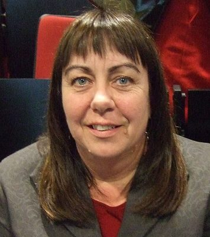

# Carol Beaumont

| | |
|---|---|
| **Party** | Labour |
| **Status (Oct 2026)** | Former MP |
| **Born** | 1960-10-06 — Hamilton, New Zealand |
| **Parliaments** | 49, 50 |
| **First elected** | 2008 |
| **Key roles** | Vice-President of the New Zealand Labour Party (2021–) |
| **Wikipedia** | [Carol Beaumont](https://en.wikipedia.org/wiki/Carol_Beaumont) |

## Current status

Former MP

## Political career

### Parliamentary terms

| Parliament | Years | Electorate | List position | Party |
|---|---|---|---|---|
| 49th | 2008–2011 | List | 28 | Labour |
| 50th | 2013–2014 | List | 22 | Labour |

_Source: Wikipedia parliamentary-term table._

### Offices held

| Office | From | To | Prime Minister at the time |
|---|---|---|---|
| Vice-President of the New Zealand Labour Party | 7 May 2021 | present |  |

_Source: Wikipedia infobox._

## 2026 candidacy

Not listed as a Labour candidate for the 2026 election on policy.nz (Oct 2026).

## Sources

- https://en.wikipedia.org/wiki/Carol_Beaumont

_Profile compiled 2026-10-23 from the sources above; Wikipedia tables parsed by tools/people_labour_build.py._
