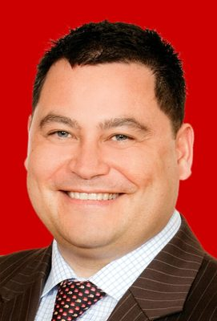

# Charles Chauvel

| | |
|---|---|
| **Party** | Labour |
| **Status (Oct 2026)** | Former MP |
| **Born** | 1969-04-16 |
| **Parliaments** | 50 |
| **First elected** | 2008 |
| **Wikipedia** | [Charles Chauvel](https://en.wikipedia.org/wiki/Charles_Chauvel) |

## Current status

Chauvel left Parliament in March 2013 for a post with the UN Development Programme in New York and later worked as the United Nations Asia and Pacific regional ombudsman ([The Post](https://www.thepost.co.nz/nz-news/350156526/life-after-politics-finding-new-buzz-beyond-beehive)). Carol Beaumont replaced him from the list.

## Biography

Born 16 April 1969 and raised in Gisborne, Chauvel was the first New Zealand MP of Tahitian ancestry. An employment lawyer (LLB(Hons) Victoria, MJur Auckland), he was a partner in Minter Ellison Rudd Watts, chaired the NZ AIDS Foundation and was deputy chair of Meridian Energy and the Lotteries Commission.

## Political career

### Career summary

- **List MP 2006–2013**, entering on Jim Sutton's retirement ([Scoop](http://www.scoop.co.nz/stories/PA0607/S00121.htm)); lost to Peter Dunne in Ōhariu-Belmont/Ōhariu in 2005, 2008 and 2011.
- Chaired the Finance and Expenditure Committee (2007–2008); Labour spokesperson for energy, climate change and environment (2008–2011), then justice and arts and shadow attorney-general (2011–2013).

## Record & notable actions

- Drafted a member's bill (2009) to repeal the provocation defence to murder; a Government bill achieving this passed 116–5 in November 2009 ([NZ Herald](http://www.nzherald.co.nz/politics/news/article.cfm?c_id=280&objectid=10612028&pnum=1)).
- Member of the UN Global Commission on HIV and the Law (2010).

## Controversies

- His 2007 appointment as a parliamentary private secretary was delayed after he announced it before it was confirmed, angering Prime Minister Helen Clark ([Stuff](https://www.stuff.co.nz/national/politics/733/Ambitious-Chauvel-angers-PM-in-reshuffle)).

## 2026 candidacy

Not listed as a Labour candidate for the 2026 election on policy.nz (Oct 2026).

## Sources

- https://en.wikipedia.org/wiki/Charles_Chauvel
- https://en.wikipedia.org/wiki/Charles_Chauvel_%28politician%29
- https://www.thepost.co.nz/nz-news/350156526/life-after-politics-finding-new-buzz-beyond-beehive
- http://www.scoop.co.nz/stories/PA0607/S00121.htm
- http://www.nzherald.co.nz/politics/news/article.cfm?c_id=280&objectid=10612028&pnum=1
- https://www.stuff.co.nz/national/politics/733/Ambitious-Chauvel-angers-PM-in-reshuffle

_Profile compiled 2026-10-23 from the sources above; Wikipedia tables parsed by tools/people_labour_build.py._
