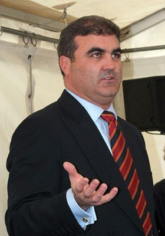

# Clayton Cosgrove

| | |
|---|---|
| **Party** | Labour |
| **Status (Oct 2026)** | Former MP |
| **Born** | 1969-10-31 — Nelson, New Zealand |
| **Electorate(s) held** | Waimakariri |
| **Parliaments** | 49, 50, 51 |
| **First elected** | 2008 |
| **Wikipedia** | [Clayton Cosgrove](https://en.wikipedia.org/wiki/Clayton_Cosgrove) |

## Current status

Former MP

## Political career

### Parliamentary terms

| Parliament | Years | Electorate | List position | Party |
|---|---|---|---|---|
| 49th | 2008–2011 | Waimakariri | 18 | Labour |
| 50th | 2011–2014 | List | 8 | Labour |
| 51st | 2014–2017 | List | 8 | Labour |

_Source: Wikipedia parliamentary-term table._

## 2026 candidacy

Not listed as a Labour candidate for the 2026 election on policy.nz (Oct 2026).

## Sources

- https://en.wikipedia.org/wiki/Clayton_Cosgrove

_Profile compiled 2026-10-23 from the sources above; Wikipedia tables parsed by tools/people_labour_build.py._
