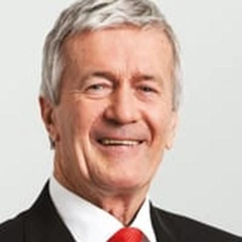

# Damien O'Connor

| | |
|---|---|
| **Party** | Labour |
| **Status (Oct 2026)** | 2026 candidate (not previously an MP) |
| **Born** | 1958-01-16 — Westport, New Zealand |
| **Electorate(s) held** | West Coast-Tasman |
| **Parliaments** | 49, 50, 51, 52, 53, 54 |
| **First elected** | 2009 |
| **2026 candidacy** | Waitaki · list #16 |
| **Key roles** | Labour shadow cabinet #18 (as of 11 Mar 2026): Spokesperson for Trade and Export Growth; Spokesperson for Defence; Spokesperson for Land Information; Spokesperson for Regional Development 34th Minister of Agriculture (2017–2023) Minister for Biosecurity (2017–2023) 13th Minister for Trade and Export Growth (2020–2023) 17th Minister for Land Information (2020–2023) 1st Minister for Rural Communities (2017–2023) |
| **Wikipedia** | [Damien O'Connor](https://en.wikipedia.org/wiki/Damien_O%27Connor) |

## Current status

2026 candidate (not previously an MP)

## Political career

### Parliamentary terms

| Parliament | Years | Electorate | List position | Party |
|---|---|---|---|---|
| 49th | 2009–2011 | List | 37 | Labour |
| 50th | 2011–2014 | West Coast-Tasman | none | Labour |
| 51st | 2014–2017 | West Coast-Tasman | 22 | Labour |
| 52nd | 2017–2020 | West Coast-Tasman | 18 | Labour |
| 53rd | 2020–2023 | West Coast-Tasman | 14 | Labour |
| 54th | 2023–present | List | 10 | Labour |

_Source: Wikipedia parliamentary-term table._

### Offices held

| Office | From | To | Prime Minister at the time |
|---|---|---|---|
| 34th Minister of Agriculture | 26 October 2017 | 27 November 2023 | Jacinda Ardern; Chris Hipkins |
| Minister for Biosecurity | 26 October 2017 | 27 November 2023 | Jacinda Ardern; Chris Hipkins |
| 13th Minister for Trade and Export Growth | 6 November 2020 | 27 November 2023 | Jacinda Ardern; Chris Hipkins |
| 17th Minister for Land Information | 6 November 2020 | 27 November 2023 | Jacinda Ardern; Chris Hipkins |
| 1st Minister for Rural Communities | 26 October 2017 | 1 February 2023 | Jacinda Ardern; Chris Hipkins |
| Minister for Food Safety | 26 October 2017 | 6 November 2020 | Jacinda Ardern |
| 33rd Minister of Tourism | 19 October 2005 | 19 November 2008 | Helen Clark |

_Source: Wikipedia infobox._

### Opposition portfolios (as of 11 March 2026)

Rank 18 in Chris Hipkins' shadow cabinet:

- Spokesperson for Trade and Export Growth
- Spokesperson for Defence
- Spokesperson for Land Information
- Spokesperson for Regional Development

_Source: [Shadow Cabinet of Chris Hipkins](https://en.wikipedia.org/wiki/Shadow_Cabinet_of_Chris_Hipkins), list as of 11 March 2026._

<!-- GENERATED:2026-candidacy START -->
## 2026 candidacy

- **Electorate:** Waitaki
- **List ranking:** 16

_Source: candidate questionnaire answers published on [policy.nz](https://policy.nz/2026/party-vote/parties/labour-party), retrieved Oct 2026._
<!-- GENERATED:2026-candidacy END -->

## Sources

- https://en.wikipedia.org/wiki/Damien_O%27Connor
- https://policy.nz/2026/party-vote/parties/labour-party
- https://en.wikipedia.org/wiki/Shadow_Cabinet_of_Chris_Hipkins

_Profile compiled 2026-10-23 from the sources above; Wikipedia tables parsed by tools/people_labour_build.py._
