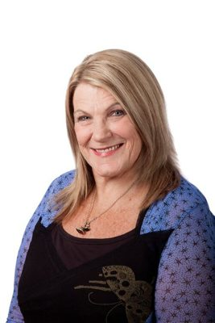

# Darien Fenton

| | |
|---|---|
| **Party** | Labour |
| **Status (Oct 2026)** | Former MP |
| **Born** | 1954-02-25 |
| **Parliaments** | 48, 49, 50 |
| **First elected** | 2005 |
| **Wikipedia** | [Darien Fenton](https://en.wikipedia.org/wiki/Darien_Fenton) |

## Current status

Fenton retired in 2014 ([3 News](http://www.3news.co.nz/Darien-Fenton-not-seeking-re-election/tabid/1607/articleID/344481/Default.aspx)) and afterwards worked as national campaign director for the Meat Workers Union ([RNZ](http://www.radionz.co.nz/news/national/260408/call-to-strengthen-workplace-safety-bill)). No reliable source was found for her activities in 2026.

## Biography

Born 25 February 1954 and raised in a Palmerston North state house, Fenton is the granddaughter of Labour MP Fred Frost. She was national secretary of the Service & Food Workers Union and vice-president of the CTU. In 2014 she spoke publicly about a past heroin addiction and said the methadone programme "saved my life".

## Political career

### Parliamentary terms

| Parliament | Years | Electorate | List position | Party |
|---|---|---|---|---|
| 48th | 2005–2008 | List | 43 | Labour |
| 49th | 2008–2011 | List | 33 | Labour |
| 50th | 2011–2014 | List | 18 | Labour |

_Source: Wikipedia parliamentary-term table._

### Career summary

- **List MP 2005–2014**; contested Helensville against John Key in 2008.
- Labour spokesperson on labour issues in opposition.

## Record & notable actions

- Member's bills to extend the minimum wage to contractors (voted down after 2008) and to set statutory minimum redundancy (defeated at first reading, May 2010) ([TVNZ](http://tvnz.co.nz/politics-news/labour-s-redundancy-bill-defeated-3520061)).
- Backed a bill to stop libraries charging for access; it failed 61–60 in 2012.

## Controversies

- In 2011 said she would boycott Sir Peter Leitch's butcheries after he endorsed John Key; she apologised ([NZ Herald](http://www.nzherald.co.nz/opinion/news/article.cfm?c_id=466&objectid=10755720)).

## 2026 candidacy

Not listed as a Labour candidate for the 2026 election on policy.nz (Oct 2026).

## Sources

- https://en.wikipedia.org/wiki/Darien_Fenton
- http://www.3news.co.nz/Darien-Fenton-not-seeking-re-election/tabid/1607/articleID/344481/Default.aspx
- http://www.radionz.co.nz/news/national/260408/call-to-strengthen-workplace-safety-bill
- http://tvnz.co.nz/politics-news/labour-s-redundancy-bill-defeated-3520061
- http://www.nzherald.co.nz/opinion/news/article.cfm?c_id=466&objectid=10755720

_Profile compiled 2026-10-23 from the sources above; Wikipedia tables parsed by tools/people_labour_build.py._
