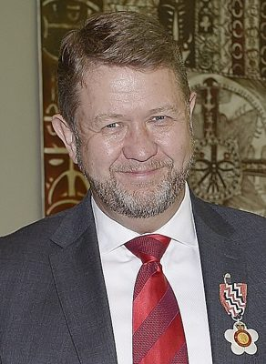

# David Cunliffe

| | |
|---|---|
| **Party** | Labour |
| **Status (Oct 2026)** | Former MP |
| **Born** | 1963-04-30 — Te Aroha, New Zealand |
| **Electorate(s) held** | Titirangi, New Lynn |
| **Parliaments** | 46, 47, 48, 49, 50, 51 |
| **First elected** | 1999 |
| **Key roles** | 34th Leader of the Opposition (2013–2014) 15th Leader of the Labour Party (2013–2014) 37th Minister of Health (2007–2008) 51st Minister of Immigration (2005–2007) Minister of Communications and Information Technology (2002–2008) Member of Parliament; for New Lynn; Titirangi (1999–2002) (1999–2017) |
| **Wikipedia** | [David Cunliffe](https://en.wikipedia.org/wiki/David_Cunliffe) |

## Current status

Cunliffe left Parliament in April 2017 and works as a consultant (director of Polis Consulting Group since 2020) ([BusinessDesk](https://businessdesk.co.nz/people/david-cunliffe)); he chairs the Selwyn Foundation, an aged-care charity, and in December 2025 Associate Health Minister Casey Costello appointed him chair of the Aged Care Ministerial Advisory Group ([Inside Government](https://insidegovernment.co.nz/former-health-minister-to-chair-aged-care-advisory-group/)). He was made a Companion of the Queen's Service Order in 2018. He is not a 2026 candidate.

## Biography

Born 30 April 1963 in Te Aroha, the son of an Anglican minister, Cunliffe attended Atlantic College in Wales on scholarship, graduated BA (Hons) in politics from Otago, served as a diplomat (1987–1994), and gained an MPA at Harvard's Kennedy School as a Fulbright scholar before working at Boston Consulting Group (1995–1999) ([Parliament profile](http://www.parliament.nz/en-NZ/MPP/MPs/MPs/1/6/b/50MP30551-Cunliffe-David.htm)). His partner is Anna Kominik; he has two sons.

## Political career

### Parliamentary terms

| Parliament | Years | Electorate | List position | Party |
|---|---|---|---|---|
| 46th | 1999–2002 | Titirangi | 52 | Labour |
| 47th | 2002–2005 | New Lynn | 37 | Labour |
| 48th | 2005–2008 | New Lynn | 31 | Labour |
| 49th | 2008–2011 | New Lynn | 8 | Labour |
| 50th | 2011–2014 | New Lynn | 3 | Labour |
| 51st | 2014–2017 | New Lynn | 1 | Labour |

_Source: Wikipedia parliamentary-term table._

### Offices held

| Office | From | To | Prime Minister at the time |
|---|---|---|---|
| 34th Leader of the Opposition | 15 September 2013 | 27 September 2014 | John Key |
| 15th Leader of the Labour Party | 15 September 2013 | 27 September 2014 |  |
| 37th Minister of Health | 31 October 2007 | 19 November 2008 | Helen Clark |
| 51st Minister of Immigration | 19 October 2005 | 11 November 2007 | Helen Clark |
| Minister of Communications and Information Technology | 15 August 2002 | 19 November 2008 | Helen Clark |
| Member of Parliament; for New Lynn; Titirangi (1999–2002) | 27 November 1999 | 23 April 2017 |  |

_Source: Wikipedia infobox._

### Career summary

- **MP for Titirangi (1999–2002) and New Lynn (2002–2017).**
- **Fifth Labour Government:** minister outside Cabinet from 2003; in Cabinet from 2005 as Minister of Immigration and of Communications and IT; Minister of Health (2007–2008).
- **Opposition:** finance spokesperson (2008–2011); lost the December 2011 leadership vote to David Shearer; demoted in 2012 amid accusations of disloyalty ([NZ Herald](https://www.nzherald.co.nz/nz/labour-mps-vote-for-shearer-cunliffe-demoted/YNU3B526K323OPRNSOW7227ZTM/?c_id=1&objectid=10848698)).
- **Labour leader and Leader of the Opposition, 15 Sep 2013 – 27 Sep 2014:** won Labour's first membership-wide leadership ballot with 60% of members and 70% of affiliates but only a third of caucus ([Stuff](http://www.stuff.co.nz/national/politics/9166765/Cunliffe-wins-Labour-leadership)). At the 2014 election Labour won 25.1% and 32 seats — its lowest vote share since 1922; he resigned and withdrew from the subsequent leadership contest ([NZ Herald](http://www.nzherald.co.nz/nz/news/article.cfm?c_id=1&objectid=11341685)).

## Record & notable actions

- As Communications Minister (2006) introduced local-loop unbundling and the operational separation of Telecom ([Scoop](http://www.scoop.co.nz/stories/PA0606/S00543.htm)); began the review leading to the Immigration Act 2009.
- As Health Minister sacked the Hawke's Bay DHB board (2008).
- **Conscience votes:** for prostitution law reform, civil unions, the anti-smacking law and marriage equality (2013).

## Controversies

- **"Sorry for being a man" (2014):** his remark at a Women's Refuge symposium was widely criticised, including by John Key ([Stuff](http://www.stuff.co.nz/national/10232457/David-Cunliffe-I-m-sorry-for-being-a-man)); he also apologised for a ski holiday at the start of the 2014 campaign ([RNZ](https://www.rnz.co.nz/news/political/250362/cunliffe-%27regrets%27-taking-ski-holiday)).
- Called the dismissed Hawke's Bay DHB a "nasty little nest of self-perpetuating provincial elites" (2008).
- Referred by the NZX to the Securities Commission in 2006 over comments on Telecom's dividends; no breach was found ([NZ Herald](http://www.nzherald.co.nz/nz/news/article.cfm?c_id=1&objectid=10382932)).

## 2026 candidacy

Not listed as a Labour candidate for the 2026 election on policy.nz (Oct 2026).

## Sources

- https://en.wikipedia.org/wiki/David_Cunliffe
- https://businessdesk.co.nz/people/david-cunliffe
- https://insidegovernment.co.nz/former-health-minister-to-chair-aged-care-advisory-group/
- http://www.parliament.nz/en-NZ/MPP/MPs/MPs/1/6/b/50MP30551-Cunliffe-David.htm
- https://www.nzherald.co.nz/nz/labour-mps-vote-for-shearer-cunliffe-demoted/YNU3B526K323OPRNSOW7227ZTM/?c_id=1&objectid=10848698
- http://www.stuff.co.nz/national/politics/9166765/Cunliffe-wins-Labour-leadership
- http://www.nzherald.co.nz/nz/news/article.cfm?c_id=1&objectid=11341685
- http://www.scoop.co.nz/stories/PA0606/S00543.htm
- http://www.stuff.co.nz/national/10232457/David-Cunliffe-I-m-sorry-for-being-a-man
- https://www.rnz.co.nz/news/political/250362/cunliffe-%27regrets%27-taking-ski-holiday
- http://www.nzherald.co.nz/nz/news/article.cfm?c_id=1&objectid=10382932

_Profile compiled 2026-10-23 from the sources above; Wikipedia tables parsed by tools/people_labour_build.py._
