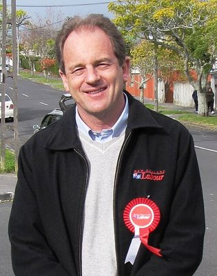

# David Shearer

| | |
|---|---|
| **Party** | Labour |
| **Status (Oct 2026)** | Former MP |
| **Born** | 1957-07-28 — Auckland, New Zealand |
| **Electorate(s) held** | Mount Albert |
| **Parliaments** | 49, 50, 51 |
| **First elected** | 2009 |
| **Key roles** | Special Representative of the Secretary-General for South Sudan (2017–2021) |
| **Wikipedia** | [David Shearer](https://en.wikipedia.org/wiki/David_Shearer) |

## Current status

Former MP

## Political career

### Parliamentary terms

| Parliament | Years | Electorate | List position | Party |
|---|---|---|---|---|
| 49th | 2009–2011 | Mount Albert |  | Labour |
| 50th | 2011–2014 | Mount Albert | 31 | Labour |
| 51st | 2014–2016 | Mount Albert | 13 | Labour |

_Source: Wikipedia parliamentary-term table._

### Offices held

| Office | From | To | Prime Minister at the time |
|---|---|---|---|
| Special Representative of the Secretary-General for South Sudan | 1 January 2017 | 15 January 2021 |  |

_Source: Wikipedia infobox._

## 2026 candidacy

Not listed as a Labour candidate for the 2026 election on policy.nz (Oct 2026).

## Sources

- https://en.wikipedia.org/wiki/David_Shearer

_Profile compiled 2026-10-23 from the sources above; Wikipedia tables parsed by tools/people_labour_build.py._
