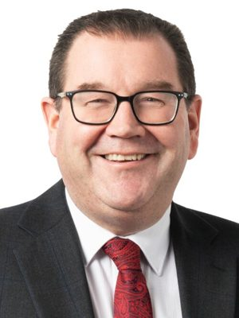

# Grant Robertson

| | |
|---|---|
| **Party** | Labour |
| **Status (Oct 2026)** | Former MP |
| **Born** | 1971-10-30 — Palmerston North, New Zealand |
| **Electorate(s) held** | Wellington Central |
| **Parliaments** | 49, 50, 51, 52, 53, 54 |
| **First elected** | 2008 |
| **Key roles** | 10th Vice-Chancellor of the University of Otago (2024–) 19th Deputy Prime Minister of New Zealand (2020–2023) 29th Minister of Foreign Affairs (2023) 12th Minister of Disarmament and Arms Control (2023) 42nd Minister of Finance (2017–2023) 12th Leader of the House (2023) |
| **Wikipedia** | [Grant Robertson](https://en.wikipedia.org/wiki/Grant_Robertson) |

## Current status

Robertson resigned from Parliament on 22 March 2024 and has been Vice-Chancellor of the University of Otago since 1 July 2024 ([University of Otago](https://www.otago.ac.nz/news/newsroom/university-of-otago-announces-appointment-of-new-vice-chancellor)); Glen Bennett replaced him as a list MP. His appointment drew a mixed response, with some donors and alumni objecting to a former politician without an academic background ([Stuff](https://www.stuff.co.nz/nz-news/350251587/shame-you-emails-show-not-everyone-happy-grant-robertsons-appointment-otago-unis)). In August 2025 he apologised for how cuts to Otago's doctoral scholarships were communicated ([ODT](https://www.odt.co.nz/news/dunedin/robertson-sorry-way-slashed-scholarships-communicated)), and in March 2026 announced a new Otago campus in Queenstown ([RNZ](https://www.rnz.co.nz/news/national/588625/university-of-otago-to-offer-new-qualifications-in-queenstown-as-part-of-campus-plans)). He is not a 2026 candidate.

## Biography

Grant Murray Robertson was born on 30 October 1971 in Palmerston North and grew up in South Dunedin, where he was head boy of King's High School. He graduated BA (Hons) in political studies from the University of Otago (1995), was Otago University Students' Association president (1993) and co-president of the national students' association (1996) ([NZ Listener](http://www.listener.co.nz/current-affairs/politics/interview-labour-deputy-grant-robertson/)). He was a diplomat with MFAT from 1997 to 2001 (including a UN posting and managing the Samoa aid programme), then an adviser to minister Marian Hobbs and to Prime Minister Helen Clark, and later worked for the University of Otago in Wellington. He lives in Wellington with his partner Alf Kaiwai (civil union 2009) and was New Zealand's first openly gay deputy prime minister ([AP](https://apnews.com/article/cabinets-grant-robertson-new-zealand-c840239beabda3fd6f3fbdd81fd5ea4f)).

## Political career

### Parliamentary terms

| Parliament | Years | Electorate | List position | Party |
|---|---|---|---|---|
| 49th | 2008–2011 | Wellington Central | 46 | Labour |
| 50th | 2011–2014 | Wellington Central | 14 | Labour |
| 51st | 2014–2017 | Wellington Central | 3 | Labour |
| 52nd | 2017–2020 | Wellington Central | 4 | Labour |
| 53rd | 2020–2023 | Wellington Central | 3 | Labour |
| 54th | 2023–2024 | List | 4 | Labour |

_Source: Wikipedia parliamentary-term table._

### Offices held

| Office | From | To | Prime Minister at the time |
|---|---|---|---|
| 10th Vice-Chancellor of the University of Otago | 1 July 2024 | present |  |
| 19th Deputy Prime Minister of New Zealand | 6 November 2020 | 25 January 2023 | Jacinda Ardern |
| 29th Minister of Foreign Affairs | 11 November 2023 | 27 November 2023 | Chris Hipkins |
| 12th Minister of Disarmament and Arms Control | 11 November 2023 | 27 November 2023 | Chris Hipkins |
| 42nd Minister of Finance | 26 October 2017 | 27 November 2023 | Jacinda Ardern; Chris Hipkins |
| 12th Leader of the House | 1 February 2023 | 27 November 2023 ; Acting: 25 January 2023 – 1 February 2023 | Chris Hipkins |
| 11th Minister for Sport and Recreation | 26 October 2017 | 27 November 2023 | Jacinda Ardern; Chris Hipkins |
| 4th Minister for Infrastructure | 6 November 2020 | 1 February 2023 | Jacinda Ardern; Chris Hipkins |
| 13th Minister for Racing | 6 November 2020 | 14 June 2022 | Jacinda Ardern |
| 19th Minister Responsible for the Earthquake Commission | 27 June 2019 | 6 November 2020 | Jacinda Ardern |
| Deputy Leader of the Opposition | 13 December 2011 | 17 September 2013 |  |
| Deputy Leader of the Labour Party | 13 December 2011 | 17 September 2013 |  |

_Source: Wikipedia infobox._

### Career summary

- **Wellington Central, 2008–2023.** Won the seat in 2008 (majority 1,904 over Stephen Franks), then held it with majorities of 6,376 (2011), 8,267 (2014), 9,963 (2017, over Nicola Willis) and 18,878 (2020, over Willis) ([2008](https://www.electionresults.govt.nz/electionresults_2008/electorate-59.html), [2011](http://www.electionresults.govt.nz/electionresults_2011/electorate-59.html), [2014](https://electionresults.govt.nz/electionresults_2014/electorate-60.html), [2017](https://electionresults.govt.nz/electionresults_2017/electorate-details-60.html), [2020](https://www.electionresults.govt.nz/electionresults_2020/electorate-details-60.html)). In 2023 he stood list-only and returned as a list MP ([RNZ](https://www.rnz.co.nz/news/political/483193/grant-robertson-goes-list-only-will-not-contest-wellington-central)).
- **Opposition, 2008–2017.** Spokesperson for state services, tertiary education and (from 2011) health; deputy leader under David Shearer (13 Dec 2011 – 17 Sep 2013). Ran for leader in 2013 (won most caucus votes but lost to David Cunliffe on members' and affiliates' votes) and 2014 (lost to Andrew Little 50.52%–49.48% after preferences) ([Stuff 2013](http://www.stuff.co.nz/national/politics/9166765/Cunliffe-wins-Labour-leadership); [Stuff 2014](http://www.stuff.co.nz/national/politics/63305825/Andrew-Little-new-Labour-Party-leader-by-a-whisker)). Finance spokesperson from November 2014; chaired Labour's Future of Work Commission (report 2016).
- **Minister of Finance, 26 Oct 2017 – 27 Nov 2023,** throughout the Ardern and Hipkins governments; also Minister for Sport and Recreation (2017–2023), Earthquake Commission (2019–2020), Infrastructure (2020–2023), Racing (2020–2022), Deputy Prime Minister (6 Nov 2020 – 25 Jan 2023, after Kelvin Davis declined the role), Leader of the House and Minister for Cyclone Recovery under Hipkins (2023), and briefly Minister of Foreign Affairs in the caretaker period (Nov 2023) ([DPMC ministerial list 2020](https://dpmc.govt.nz/sites/default/files/2020-11/ministerial-list-2-nov-2020.pdf); [Stuff](https://www.stuff.co.nz/national/politics/131290992/pm-chris-hipkins-announces-ministers-to-lead-regional-cyclone-recovery-efforts)).
- **After January 2023:** declined to seek the leadership when Ardern resigned ([1News](https://www.1news.co.nz/2023/01/19/grant-robertson-says-he-will-not-stand-as-next-labour-leader/)). Finance and racing spokesperson in opposition until he announced his retirement on 20 February 2024.

## Record & notable actions

- Delivered six Budgets (2018–2023) as finance minister, including the pandemic-era budgets; he was the government's lead on the economic response to COVID-19 and often deputised for Ardern at pandemic briefings ([Stuff](https://www.stuff.co.nz/national/politics/opinion/123133786/election-2020-why-kelvin-davis-will-probably-be-the-next-deputy-prime-minister)).
- Member's bill: Ethical Investment (Crown Financial Institutions) Bill (2010), defeated at first reading ([RNZ](http://www.radionz.co.nz/news/stories/2010/08/05/d20e2514bc14)).
- Retained the title "The Honourable" on retirement from the Executive Council (December 2023) ([NZ Gazette](https://gazette.govt.nz/notice/id/2023-vr5732)).

## Controversies

- In February 2021 he withdrew from a weekly slot on Magic Talk after host Peter Williams asked him about the World Economic Forum's "Great Reset", saying he did not want to keep shooting down conspiracy theories ([Stuff](https://www.stuff.co.nz/entertainment/tv-radio/124301816/grant-robertson-axes-weekly-interview-on-magic-talk-radio-show)).
- His record as Finance Minister divides opinion: commentator Morgan Godfery called him a top-performing minister ([Stuff](https://www.stuff.co.nz/opinion/130872334/morgan-godfery-topperforming-minister-but-you-wouldnt-know-it)), while some Otago donors and alumni cited that record when objecting to his appointment as vice-chancellor ([Stuff](https://www.stuff.co.nz/nz-news/350251587/shame-you-emails-show-not-everyone-happy-grant-robertsons-appointment-otago-unis)).

## 2026 candidacy

Not listed as a Labour candidate for the 2026 election on policy.nz (Oct 2026).

## Sources

- https://en.wikipedia.org/wiki/Grant_Robertson
- https://www.otago.ac.nz/news/newsroom/university-of-otago-announces-appointment-of-new-vice-chancellor
- https://www.stuff.co.nz/nz-news/350251587/shame-you-emails-show-not-everyone-happy-grant-robertsons-appointment-otago-unis
- https://www.odt.co.nz/news/dunedin/robertson-sorry-way-slashed-scholarships-communicated
- https://www.rnz.co.nz/news/national/588625/university-of-otago-to-offer-new-qualifications-in-queenstown-as-part-of-campus-plans
- http://www.listener.co.nz/current-affairs/politics/interview-labour-deputy-grant-robertson/
- https://apnews.com/article/cabinets-grant-robertson-new-zealand-c840239beabda3fd6f3fbdd81fd5ea4f
- https://www.electionresults.govt.nz/electionresults_2008/electorate-59.html
- http://www.electionresults.govt.nz/electionresults_2011/electorate-59.html
- https://electionresults.govt.nz/electionresults_2014/electorate-60.html
- https://electionresults.govt.nz/electionresults_2017/electorate-details-60.html
- https://www.electionresults.govt.nz/electionresults_2020/electorate-details-60.html
- https://www.rnz.co.nz/news/political/483193/grant-robertson-goes-list-only-will-not-contest-wellington-central
- http://www.stuff.co.nz/national/politics/9166765/Cunliffe-wins-Labour-leadership
- http://www.stuff.co.nz/national/politics/63305825/Andrew-Little-new-Labour-Party-leader-by-a-whisker
- https://dpmc.govt.nz/sites/default/files/2020-11/ministerial-list-2-nov-2020.pdf
- https://www.stuff.co.nz/national/politics/131290992/pm-chris-hipkins-announces-ministers-to-lead-regional-cyclone-recovery-efforts
- https://www.1news.co.nz/2023/01/19/grant-robertson-says-he-will-not-stand-as-next-labour-leader/
- https://www.stuff.co.nz/national/politics/opinion/123133786/election-2020-why-kelvin-davis-will-probably-be-the-next-deputy-prime-minister
- http://www.radionz.co.nz/news/stories/2010/08/05/d20e2514bc14
- https://gazette.govt.nz/notice/id/2023-vr5732
- https://www.stuff.co.nz/entertainment/tv-radio/124301816/grant-robertson-axes-weekly-interview-on-magic-talk-radio-show
- https://www.stuff.co.nz/opinion/130872334/morgan-godfery-topperforming-minister-but-you-wouldnt-know-it

_Profile compiled 2026-10-23 from the sources above; Wikipedia tables parsed by tools/people_labour_build.py._
