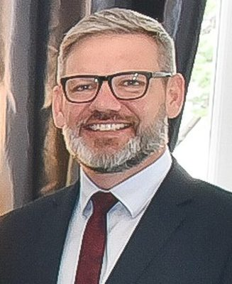

# Iain Lees-Galloway

| | |
|---|---|
| **Party** | Labour |
| **Status (Oct 2026)** | Former MP |
| **Born** | 1978-09-18 — Auckland, New Zealand |
| **Electorate(s) held** | Palmerston North |
| **Parliaments** | 49, 50, 51, 52 |
| **First elected** | 2008 |
| **Key roles** | 2nd Minister for Workplace Relations and Safety (2017–2020) 56th Minister of Immigration (2017–2020) 13th Minister for ACC (2017–2020) Deputy Leader of the House (2017–2020) |
| **Wikipedia** | [Iain Lees-Galloway](https://en.wikipedia.org/wiki/Iain_Lees-Galloway) |

## Current status

Former MP

## Political career

### Parliamentary terms

| Parliament | Years | Electorate | List position | Party |
|---|---|---|---|---|
| 49th | 2008–2011 | Palmerston North | 48 | Labour |
| 50th | 2011–2014 | Palmerston North | 37 | Labour |
| 51st | 2014–2017 | Palmerston North | 24 | Labour |
| 52nd | 2017–2020 | Palmerston North | 14 | Labour |

_Source: Wikipedia parliamentary-term table._

### Offices held

| Office | From | To | Prime Minister at the time |
|---|---|---|---|
| 2nd Minister for Workplace Relations and Safety | 26 October 2017 | 22 July 2020 | Jacinda Ardern |
| 56th Minister of Immigration | 26 October 2017 | 22 July 2020 | Jacinda Ardern |
| 13th Minister for ACC | 26 October 2017 | 22 July 2020 | Jacinda Ardern |
| Deputy Leader of the House | 26 October 2017 | 22 July 2020 | Jacinda Ardern |

_Source: Wikipedia infobox._

## 2026 candidacy

Not listed as a Labour candidate for the 2026 election on policy.nz (Oct 2026).

## Sources

- https://en.wikipedia.org/wiki/Iain_Lees-Galloway

_Profile compiled 2026-10-23 from the sources above; Wikipedia tables parsed by tools/people_labour_build.py._
