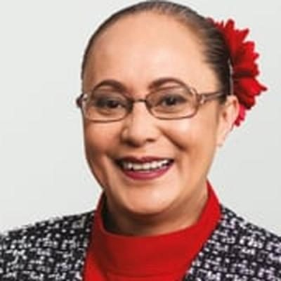

# Jenny Salesa

| | |
|---|---|
| **Party** | Labour |
| **Status (Oct 2026)** | Current MP, standing in 2026 |
| **Born** | c. 1968 — Tonga |
| **Electorate(s) held** | Manukau East, Panmure-Ōtāhuhu |
| **Parliaments** | 51, 52, 53, 54 |
| **First elected** | 2014 |
| **2026 candidacy** | Ōtāhuhu · list #24 |
| **Key roles** | Labour shadow cabinet #23 (as of 11 Mar 2026): Spokesperson for Ethnic Communities; Spokesperson for Customs; Associate Spokesperson for Pacific Peoples First Assistant Speaker of the House of Representatives (2020–2023) 7th Minister for Building and Construction (2017–2020) Minister for Ethnic Communities (2017–2020) 65th Minister of Customs (2019–2020) |
| **Wikipedia** | [Jenny Salesa](https://en.wikipedia.org/wiki/Jenny_Salesa) |

## Current status

Salesa is No. 23 in the shadow cabinet (ethnic communities; associate Pacific peoples from March 2026) and is contesting Ōtāhuhu at No. 24 on the list ([policy.nz](https://policy.nz/2026/party-vote/parties/labour-party)).

## Biography

Of Tongan heritage, Salesa worked in the public sector and in the United States before entering Parliament; she is married to academic Damon Salesa ([Newstalk ZB](http://www.newstalkzb.co.nz/auckland/news/nbpol/2089605172-jenny-salesa-named-as-labour-candidate-for-the-manukau-east-electorate)).

## Political career

### Parliamentary terms

| Parliament | Years | Electorate | List position | Party |
|---|---|---|---|---|
| 51st | 2014–2017 | Manukau East | 31 | Labour |
| 52nd | 2017–2020 | Manukau East | 19 | Labour |
| 53rd | 2020–2023 | Panmure-Ōtāhuhu | 13 | Labour |
| 54th | 2023–present | Panmure-Ōtāhuhu | 24 | Labour |

_Source: Wikipedia parliamentary-term table._

### Offices held

| Office | From | To | Prime Minister at the time |
|---|---|---|---|
| First Assistant Speaker of the House of Representatives | 26 November 2020 | 6 December 2023 |  |
| 7th Minister for Building and Construction | 26 October 2017 | 6 November 2020 | Jacinda Ardern |
| Minister for Ethnic Communities | 26 October 2017 | 6 November 2020 | Jacinda Ardern |
| 65th Minister of Customs | 27 June 2019 | 6 November 2020 | Jacinda Ardern |

_Source: Wikipedia infobox._

### Opposition portfolios (as of 11 March 2026)

Rank 23 in Chris Hipkins' shadow cabinet:

- Spokesperson for Ethnic Communities
- Spokesperson for Customs
- Associate Spokesperson for Pacific Peoples

_Source: [Shadow Cabinet of Chris Hipkins](https://en.wikipedia.org/wiki/Shadow_Cabinet_of_Chris_Hipkins), list as of 11 March 2026._

### Career summary

- **Manukau East MP 2014–2020** (succeeding Ross Robertson; majorities 13,254 and 12,589); **Panmure-Ōtāhuhu MP since 2020** (majorities 18,626 in 2020 and 7,970 in 2023) ([2020](https://www.electionresults.govt.nz/electionresults_2020/electorate-details-37.html); [2023](https://archive.electionresults.govt.nz/electionresults_2023/electorate-details-37.html)).
- **Minister 2017–2020:** Building and Construction and Ethnic Communities (Cabinet), associate education, health and housing; Customs from June 2019. Dropped from the ministry after the 2020 election and became an Assistant Speaker ([Stuff](https://www.stuff.co.nz/national/politics/300148079/cabinet-reshuffle-the-winners-and-losers-from-jacinda-arderns-new-lineup)).

<!-- GENERATED:2026-candidacy START -->
## 2026 candidacy

- **Electorate:** Ōtāhuhu
- **List ranking:** 24
- **Before politics:** Contracts Lawyer, Policy Analyst
- **Residence:** Panmure
- **Age:** 58
- **Public email:** jenny4otahuhu@gmail.com
- **Facebook:** https://www.facebook.com/jenny.salesa.labour/
- **Instagram:** https://www.instagram.com/jennysalesamp

_Source: candidate questionnaire answers published on [policy.nz](https://policy.nz/2026/party-vote/parties/labour-party), retrieved Oct 2026._
<!-- GENERATED:2026-candidacy END -->

## Sources

- https://en.wikipedia.org/wiki/Jenny_Salesa
- https://policy.nz/2026/party-vote/parties/labour-party
- https://en.wikipedia.org/wiki/Shadow_Cabinet_of_Chris_Hipkins
- http://www.newstalkzb.co.nz/auckland/news/nbpol/2089605172-jenny-salesa-named-as-labour-candidate-for-the-manukau-east-electorate
- https://www.electionresults.govt.nz/electionresults_2020/electorate-details-37.html
- https://archive.electionresults.govt.nz/electionresults_2023/electorate-details-37.html
- https://www.stuff.co.nz/national/politics/300148079/cabinet-reshuffle-the-winners-and-losers-from-jacinda-arderns-new-lineup

_Profile compiled 2026-10-23 from the sources above; Wikipedia tables parsed by tools/people_labour_build.py._
