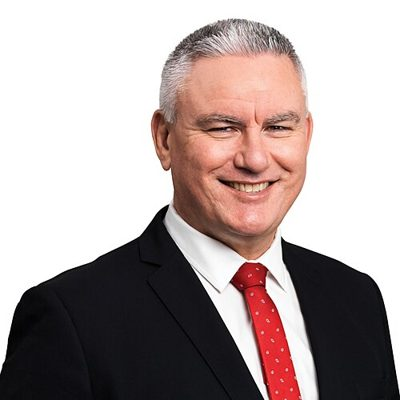

# Kelvin Davis

| | |
|---|---|
| **Party** | Labour |
| **Status (Oct 2026)** | Former MP |
| **Born** | 1967-03-02 — Kawakawa, New Zealand |
| **Electorate(s) held** | Te Tai Tokerau |
| **Parliaments** | 49, 50, 51, 52, 53, 54 |
| **First elected** | 2008 |
| **Key roles** | 18th Deputy Leader of the Labour Party (2017–2023) 14th Minister of Corrections (2017–2023) 1st Minister for Māori–Crown Relations (2017–2023) 3rd Minister for Children (2020–2023) 36th Minister of Tourism (2017–2020) Deputy Leader of the Opposition (2017) |
| **Wikipedia** | [Kelvin Davis (politician)](https://en.wikipedia.org/wiki/Kelvin_Davis_%28politician%29) |

## Current status

Davis left Parliament on Waitangi Day, 6 February 2024, having said during the campaign that he would not stay on as a list MP if he lost Te Tai Tokerau ([Stuff](https://www.stuff.co.nz/national/politics/301027449/kelvin-davis-calls-time-on-politics-career-will-end-at-waitangi)); Shanan Halbert replaced him. He indicated he would work as an Indigenous-relations consultant in Australia ([RNZ](https://www.rnz.co.nz/news/political/504804/labour-mp-kelvin-davis-message-to-national-as-he-leaves-politics-back-to-the-bad-old-times)). In 2026 the National-led government appointed him to the Māori Education Ministerial Advisory Group for two years from May 2026 ([NZ Herald](https://www.nzherald.co.nz/nz/politics/former-labour-deputy-kelvin-davis-joins-erica-stanfords-maori-advisory-education-group/SQXBBGJK3VBKZCCFKHFBI2BIZU/)). He is not a 2026 candidate.

## Biography

Born 2 March 1967 in Kawakawa and raised at Karetu in the Bay of Islands (Ngāpuhi, Ngāti Manu), Davis trained at Auckland College of Education and spent 20 years in education, including as principal of Karetu School (1994–1998) and Kaitaia Intermediate (2001–2007), which he was credited with turning around ([Stuff](https://www.stuff.co.nz/national/politics/99182567/national-portrait-kelvin-davis--minister-of-sunshine)). He is married to Moira; they have three children.

## Political career

### Parliamentary terms

| Parliament | Years | Electorate | List position | Party |
|---|---|---|---|---|
| 49th | 2008–2011 | List | 33 | Labour |
| 50th | 2014– | List | 23 | Labour |
| 51st | 2014–2017 | Te Tai Tokerau | 18 | Labour |
| 52nd | 2017–2020 | Te Tai Tokerau | 2 | Labour |
| 53rd | 2020–2023 | Te Tai Tokerau | 2 | Labour |
| 54th | 2023–2024 | List | 2 | Labour |

_Source: Wikipedia parliamentary-term table._

### Offices held

| Office | From | To | Prime Minister at the time |
|---|---|---|---|
| 18th Deputy Leader of the Labour Party | 1 August 2017 | 7 November 2023 |  |
| 14th Minister of Corrections | 26 October 2017 | 27 November 2023 | Jacinda Ardern; Chris Hipkins |
| 1st Minister for Māori–Crown Relations | 26 October 2017 | 27 November 2023 | Jacinda Ardern; Chris Hipkins |
| 3rd Minister for Children | 6 November 2020 | 27 November 2023 | Jacinda Ardern; Chris Hipkins |
| 36th Minister of Tourism | 26 October 2017 | 6 November 2020 | Jacinda Ardern |
| Deputy Leader of the Opposition | 1 August 2017 | 26 October 2017 |  |

_Source: Wikipedia infobox._

### Career summary

- **List MP 2008–2011;** lost Te Tai Tokerau to Hone Harawira in 2008, the 2011 by-election and the 2011 general election, and left Parliament.
- **Returned May 2014** as a list MP when Shane Jones resigned, then won Te Tai Tokerau from Harawira in September 2014 — ending Internet-Mana's parliamentary presence — after endorsements from John Key and Winston Peters ([Stuff](http://www.stuff.co.nz/national/politics/10524510/Davis-win-a-critical-blow-for-Harawira-Internet-Mana)). Held it in 2017 (majority 4,807 over Harawira) and 2020; lost it in 2023 to Te Pāti Māori's Mariameno Kapa-Kingi by 517 votes ([2017](http://www.electionresults.govt.nz/electionresults_2017/electorate-details-69.html), [2023](https://archive.electionresults.govt.nz/electionresults_2023/electorate-details-70.html)).
- **Deputy Labour leader, 1 Aug 2017 – Nov 2023** under Ardern and Hipkins. Declined to be deputy prime minister in 2020; Grant Robertson took the role ([Stuff](https://www.stuff.co.nz/national/politics/300147451/kelvin-davis-wont-seek-the-role-of-deputy-prime-minister-but-wants-to-stay-on-deputy-labour-leader)).
- **Minister, 2017–2023:** No. 3 in Cabinet; first Minister for Māori–Crown Relations: Te Arawhiti, Minister of Corrections (2017–2023), Tourism (2017–2020), Children (2020–2023), Associate Education (Māori). Acting prime minister on several occasions.

## Record & notable actions

- **Prison population:** as Corrections Minister he set out to reduce Māori imprisonment; the imprisonment rate fell from about 213 to 149 per 100,000 during his tenure, helped by bail support and earlier parole-readiness programmes — National's Mark Mitchell argued the focus should have been on reducing crime ([NZ Herald](https://www.nzherald.co.nz/nz/election-2023-labour-dumps-prison-population-reduction-target/AAL2EXLUGBFNHJ27VJSRS2EPHY/); [The Spinoff](https://thespinoff.co.nz/politics/02-11-2018/kelvin-davis-has-a-cunning-plan-to-cut-the-prison-population-and-its-working)).
- **Te Arawhiti:** established the Office for Māori Crown Relations in 2018 ([Beehive](https://www.beehive.govt.nz/release/te-arawhiti-%E2%80%98bridge%E2%80%99-better-m%C4%81ori-crown-relations-launched-parliament)).
- **Oranga Tamariki:** declined to back chief executive Grainne Moss (who resigned in January 2021), set up a ministerial advisory board, and began devolving services to iwi and community providers ([RNZ](https://www.rnz.co.nz/news/national/435242/new-four-person-board-to-oversee-oranga-tamariki-overhaul)).
- **In opposition (2014–2017):** exposed problems at Serco-run Mount Eden prison, after which Serco lost the contract ([Stuff](http://www.stuff.co.nz/national/politics/70619419/labours-kelvin-davis-says-mt-eden-prison-guard-revelations-are-corruption)); his KiwiBuild member's bill (10,000 homes a year) was defeated in 2017.
- **Conscience votes:** voted for the End of Life Choice Act 2019 and the Abortion Legislation Act 2020. Broke with Labour policy to support the two charter schools in his electorate, which became state-integrated ([RNZ](https://www.rnz.co.nz/news/political/335647/davis-threatens-to-resign-if-two-charter-schools-closed-down)).

## Controversies

- **Parliamentary performance:** his performances as acting PM in the House were widely criticised (one Stuff columnist called a 2017 appearance a "trainwreck") ([Stuff](https://www.stuff.co.nz/national/politics/opinion/98982731/labour-has-a-problem--we-need-to-talk-about-acting-prime-minister-kelvin-davis)).
- **Waikeria Prison riot (2020–21):** criticised by National and Te Pāti Māori for staying silent during the six-day standoff; he pushed back on parts of the Chief Ombudsman's later report on Corrections ([NZ Herald](https://www.nzherald.co.nz/kahu/kelvin-davis-pushes-back-on-the-ombudsmans-damming-corrections-report/CYJFPMX3IFBJNEHR3STID6VNV4/)).
- **"Vanilla lens" remark (2022):** told ACT's Karen Chhour (who is Ngāpuhi) to stop looking through a "vanilla lens"; ACT called it racist and he apologised to her by phone ([RNZ](https://www.rnz.co.nz/news/political/475720/minister-davis-apologises-over-comments-to-act-s-karen-chhour)).

## 2026 candidacy

Not listed as a Labour candidate for the 2026 election on policy.nz (Oct 2026).

## Sources

- https://en.wikipedia.org/wiki/Kelvin_Davis_%28politician%29
- https://www.stuff.co.nz/national/politics/301027449/kelvin-davis-calls-time-on-politics-career-will-end-at-waitangi
- https://www.rnz.co.nz/news/political/504804/labour-mp-kelvin-davis-message-to-national-as-he-leaves-politics-back-to-the-bad-old-times
- https://www.nzherald.co.nz/nz/politics/former-labour-deputy-kelvin-davis-joins-erica-stanfords-maori-advisory-education-group/SQXBBGJK3VBKZCCFKHFBI2BIZU/
- https://www.stuff.co.nz/national/politics/99182567/national-portrait-kelvin-davis--minister-of-sunshine
- http://www.stuff.co.nz/national/politics/10524510/Davis-win-a-critical-blow-for-Harawira-Internet-Mana
- http://www.electionresults.govt.nz/electionresults_2017/electorate-details-69.html
- https://archive.electionresults.govt.nz/electionresults_2023/electorate-details-70.html
- https://www.stuff.co.nz/national/politics/300147451/kelvin-davis-wont-seek-the-role-of-deputy-prime-minister-but-wants-to-stay-on-deputy-labour-leader
- https://www.nzherald.co.nz/nz/election-2023-labour-dumps-prison-population-reduction-target/AAL2EXLUGBFNHJ27VJSRS2EPHY/
- https://thespinoff.co.nz/politics/02-11-2018/kelvin-davis-has-a-cunning-plan-to-cut-the-prison-population-and-its-working
- https://www.beehive.govt.nz/release/te-arawhiti-%E2%80%98bridge%E2%80%99-better-m%C4%81ori-crown-relations-launched-parliament
- https://www.rnz.co.nz/news/national/435242/new-four-person-board-to-oversee-oranga-tamariki-overhaul
- http://www.stuff.co.nz/national/politics/70619419/labours-kelvin-davis-says-mt-eden-prison-guard-revelations-are-corruption
- https://www.rnz.co.nz/news/political/335647/davis-threatens-to-resign-if-two-charter-schools-closed-down
- https://www.stuff.co.nz/national/politics/opinion/98982731/labour-has-a-problem--we-need-to-talk-about-acting-prime-minister-kelvin-davis
- https://www.nzherald.co.nz/kahu/kelvin-davis-pushes-back-on-the-ombudsmans-damming-corrections-report/CYJFPMX3IFBJNEHR3STID6VNV4/
- https://www.rnz.co.nz/news/political/475720/minister-davis-apologises-over-comments-to-act-s-karen-chhour

_Profile compiled 2026-10-23 from the sources above; Wikipedia tables parsed by tools/people_labour_build.py._
