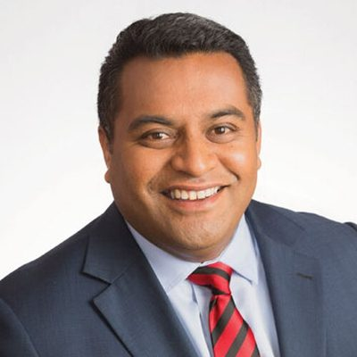

# Kris Faafoi

| | |
|---|---|
| **Party** | Labour |
| **Status (Oct 2026)** | Former MP |
| **Born** | 1976-06-23 |
| **Electorate(s) held** | Mana |
| **Parliaments** | 49, 50, 51, 52, 53 |
| **First elected** | 2010 |
| **Key roles** | 50th Minister of Justice (2020–2022) 26th Minister for Broadcasting and Media (2018–2022) 57th Minister of Immigration (2020–2022) 13th Minister of Commerce and Consumer Affairs (2017–2020) Minister for Government Digital Services (2019–2020) 25th Minister of Civil Defence (2017–2019) |
| **Wikipedia** | [Kris Faafoi](https://en.wikipedia.org/wiki/Kris_Faafoi) |

## Current status

Faafoi left Parliament in July 2022, set up the lobbying and PR firm Dialogue22 ([NZ Herald](https://www.nzherald.co.nz/nz/exclusive-former-cabinet-minister-kris-faafoi-to-head-new-lobbying-and-pr-firm/MVTOAEY6MNWG5T5MFPS62IBDZA/)), and in April 2024 became chief executive of the Insurance Council of New Zealand ([Stuff](https://www.stuff.co.nz/business/133550835/former-cabinet-minister-kris-faafoi-to-head-insurance-council)). He is not a 2026 candidate.

## Biography

Born 23 June 1976 to parents from Fakaofo, Tokelau, and raised in Christchurch, Faafoi trained at the New Zealand Broadcasting School and reported for TVNZ and the BBC before becoming Labour leader Phil Goff's chief press secretary in 2008 ([E-Tangata](https://e-tangata.co.nz/korero/kris-faafoi-a-minister-on-the-rise/)). He lives in Wellington with his wife Mae and three sons; his brother is broadcaster Jason Faafoi.

## Political career

### Parliamentary terms

| Parliament | Years | Electorate | List position | Party |
|---|---|---|---|---|
| 49th | 2010–2011 | Mana |  | Labour |
| 50th | 2011–2014 | Mana | 41 | Labour |
| 51st | 2014–2017 | Mana | none | Labour |
| 52nd | 2017–2020 | Mana | 20 | Labour |
| 53rd | 2020–2022 | List | 15 | Labour |

_Source: Wikipedia parliamentary-term table._

### Offices held

| Office | From | To | Prime Minister at the time |
|---|---|---|---|
| 50th Minister of Justice | 6 November 2020 | 14 June 2022 | Jacinda Ardern |
| 26th Minister for Broadcasting and Media | 7 September 2018 | 14 June 2022 | Jacinda Ardern |
| 57th Minister of Immigration | 22 July 2020 | 14 June 2022 | Jacinda Ardern |
| 13th Minister of Commerce and Consumer Affairs | 26 October 2017 | 6 November 2020 | Jacinda Ardern |
| Minister for Government Digital Services | 27 June 2019 | 6 November 2020 | Jacinda Ardern |
| 25th Minister of Civil Defence | 26 October 2017 | 27 June 2019 | Jacinda Ardern |
| 64th Minister of Customs | 20 September 2018 | 27 June 2019 | Jacinda Ardern |

_Source: Wikipedia infobox._

### Career summary

- **Mana MP 2010–2020:** won the November 2010 by-election by 1,080 votes over National's Hekia Parata — the first MP of Tokelauan descent — and held the seat until standing list-only in 2020 ([NZ Herald](http://www.nzherald.co.nz/nz/news/article.cfm?c_id=1&objectid=10688998)).
- **Minister 2017–2022:** Civil Defence and Commerce and Consumer Affairs (2017), Customs (2018), Broadcasting, Communications and Digital Media (from September 2018, after Clare Curran), Government Digital Services (2019), Immigration (from July 2020), and in Cabinet as Minister of Justice from November 2020 ([DPMC 2020](https://dpmc.govt.nz/sites/default/files/2020-11/ministerial-list-2-nov-2020.pdf)).
- Announced on 13 June 2022 he would leave Parliament to spend more time with his family ([Stuff](https://www.stuff.co.nz/national/politics/128948673/kris-faafoi-trevor-mallard-to-quit-parliament-sparking-big-labour-reshuffle)).

## Record & notable actions

- **Conversion practices ban:** introduced the Conversion Practices Prohibition Legislation Bill (July 2021), which passed its third reading on 15 February 2022 ([RNZ](https://www.rnz.co.nz/news/national/461599/politicians-react-as-bill-to-ban-conversion-therapy-passes)).
- Introduced the bill to repeal the three-strikes sentencing law (November 2021), later passed under Kiri Allan ([RNZ](https://www.rnz.co.nz/news/political/455452/three-strikes-law-you-re-out-justice-minister-to-repeal)).
- As Immigration Minister extended visas for migrants stranded or needed during COVID-19 (2020) ([RNZ](https://www.rnz.co.nz/news/national/433279/migrant-worker-visas-extended-to-address-labour-uncertainties)).

## Controversies

- **Kerrison visa messages (2019):** apologised to Ardern after promising musician Jason Kerrison he would "speed things up" on his father's visa application; National called it a conflict of interest ([Stuff](https://www.stuff.co.nz/national/politics/118000681/minister-kris-faafoi-apologises-for-promising-to-speed-things-up-for-opshop-singer)).

## 2026 candidacy

Not listed as a Labour candidate for the 2026 election on policy.nz (Oct 2026).

## Sources

- https://en.wikipedia.org/wiki/Kris_Faafoi
- https://www.nzherald.co.nz/nz/exclusive-former-cabinet-minister-kris-faafoi-to-head-new-lobbying-and-pr-firm/MVTOAEY6MNWG5T5MFPS62IBDZA/
- https://www.stuff.co.nz/business/133550835/former-cabinet-minister-kris-faafoi-to-head-insurance-council
- https://e-tangata.co.nz/korero/kris-faafoi-a-minister-on-the-rise/
- http://www.nzherald.co.nz/nz/news/article.cfm?c_id=1&objectid=10688998
- https://dpmc.govt.nz/sites/default/files/2020-11/ministerial-list-2-nov-2020.pdf
- https://www.stuff.co.nz/national/politics/128948673/kris-faafoi-trevor-mallard-to-quit-parliament-sparking-big-labour-reshuffle
- https://www.rnz.co.nz/news/national/461599/politicians-react-as-bill-to-ban-conversion-therapy-passes
- https://www.rnz.co.nz/news/political/455452/three-strikes-law-you-re-out-justice-minister-to-repeal
- https://www.rnz.co.nz/news/national/433279/migrant-worker-visas-extended-to-address-labour-uncertainties
- https://www.stuff.co.nz/national/politics/118000681/minister-kris-faafoi-apologises-for-promising-to-speed-things-up-for-opshop-singer

_Profile compiled 2026-10-23 from the sources above; Wikipedia tables parsed by tools/people_labour_build.py._
