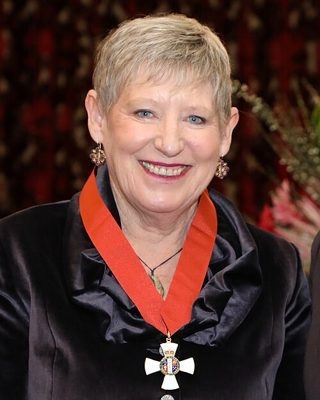

# Lianne Dalziel

| | |
|---|---|
| **Party** | Labour |
| **Status (Oct 2026)** | Former MP |
| **Born** | 1960-06-07 — Christchurch, New Zealand |
| **Electorate(s) held** | Christchurch Central, Christchurch East |
| **Parliaments** | 43, 44, 45, 46, 47, 48, 49, 50 |
| **First elected** | 1990 |
| **Key roles** | 46th Mayor of Christchurch (2013–2022) 6th Minister of Commerce (2002–2004) 6th Minister for ACC (2001–2002) 49th Minister of Immigration (1999–2004) |
| **Wikipedia** | [Lianne Dalziel](https://en.wikipedia.org/wiki/Lianne_Dalziel) |

## Current status

Dalziel left Parliament in October 2013 and served three terms as Mayor of Christchurch (2013–2022), not seeking re-election in 2022. She was appointed CNZM in 2023 and in 2025 sat on Marilyn Waring's unofficial People's Select Committee on pay equity ([LawNews](https://lawnews.nz/employment/former-mp-marilyn-waring-sets-up-select-committee-to-report-on-pay-equity/)). Her resignation triggered the 2013 Christchurch East by-election won by Poto Williams.

## Biography

Born 7 June 1960 and raised in Christchurch, Dalziel graduated in law from the University of Canterbury and was a lawyer and then secretary of the Canterbury Hotel and Hospital Workers' Union. Her husband Rob Davidson died in 2020.

## Political career

### Parliamentary terms

| Parliament | Years | Electorate | List position | Party |
|---|---|---|---|---|
| 43rd | 1990–1993 | Christchurch Central |  | Labour |
| 44th | 1993–1996 | Christchurch Central |  | Labour |
| 45th | 1996–1999 | List | 4 | Labour |
| 46th | 1999–2002 | Christchurch East | 8 | Labour |
| 47th | 2002–2005 | Christchurch East | 14 | Labour |
| 48th | 2005–2008 | Christchurch East | 26 | Labour |
| 49th | 2008–2011 | Christchurch East | 15 | Labour |
| 50th | 2011–2013 | Christchurch East | none | Labour |

_Source: Wikipedia parliamentary-term table._

### Offices held

| Office | From | To | Prime Minister at the time |
|---|---|---|---|
| 46th Mayor of Christchurch | 24 October 2013 | 8 October 2022 |  |
| 6th Minister of Commerce | 15 August 2002 | 21 February 2004 | Helen Clark |
| 6th Minister for ACC | 28 March 2001 | 15 August 2002 | Helen Clark |
| 49th Minister of Immigration | 10 December 1999 | 21 February 2004 | Helen Clark |

_Source: Wikipedia infobox._

### Career summary

- **MP 1990–2013:** Christchurch Central (1990–1996), list (1996–1999), Christchurch East (1999–2013).
- **Fifth Labour Government:** Minister of Immigration (1999–2004), Commerce, Senior Citizens, Disability Issues; resigned in February 2004 after admitting she had directed the leak of an asylum seeker's lawyer's notes to TV3 and had initially denied it; returned in 2005 as Minister of Commerce, Small Business and Women's Affairs ([NZ Herald](https://www.nzherald.co.nz/nz/dalziel-forced-to-quit/YKHNS6566R2NAYWK7ELZ7O63FU/)).
- Opposition justice, commerce and Canterbury earthquake recovery spokesperson (2008–2013).

## Controversies

- 2004 leak resignation (above).
- As mayor, a 2019 election-donations complaint was referred to the Serious Fraud Office, which found no evidence of criminal conduct (December 2020) ([TVNZ](https://www.tvnz.co.nz/one-news/new-zealand/sfo-clears-christchurch-mayor-over-election-donation-complaint)).

## 2026 candidacy

Not listed as a Labour candidate for the 2026 election on policy.nz (Oct 2026).

## Sources

- https://en.wikipedia.org/wiki/Lianne_Dalziel
- https://lawnews.nz/employment/former-mp-marilyn-waring-sets-up-select-committee-to-report-on-pay-equity/
- https://www.nzherald.co.nz/nz/dalziel-forced-to-quit/YKHNS6566R2NAYWK7ELZ7O63FU/
- https://www.tvnz.co.nz/one-news/new-zealand/sfo-clears-christchurch-mayor-over-election-donation-complaint

_Profile compiled 2026-10-23 from the sources above; Wikipedia tables parsed by tools/people_labour_build.py._
