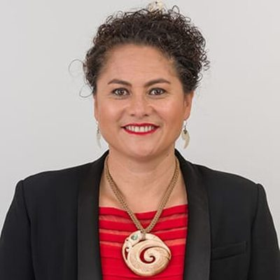

# Louisa Wall

| | |
|---|---|
| **Party** | Labour |
| **Status (Oct 2026)** | Former MP |
| **Born** | 1972-02-17 — Taupō, New Zealand |
| **Electorate(s) held** | Manurewa |
| **Parliaments** | 48, 49, 50, 51, 52, 53 |
| **First elected** | 2008 |
| **Wikipedia** | [Louisa Wall](https://en.wikipedia.org/wiki/Louisa_Wall) |

## Current status

Wall left Parliament on 1 May 2022, saying her departure was part of an agreement made during the disputed 2020 Manurewa selection and that it was "not entirely my choice" ([RNZ](https://www.rnz.co.nz/news/political/465300/departing-labour-mp-louisa-wall-this-was-not-entirely-my-choice)). She was then Ambassador for Gender Equality (Pacific), a newly created role that critics said was designed for her; it was disestablished after two years ([Newsroom](http://newsroom.co.nz/2022/05/31/inside-louisa-walls-diplomatic-sinecure/); [The Post](https://www.thepost.co.nz/politics/350212701/louisa-walls-ambassador-role-scrapped)). In 2023 RNZ reported she was considering standing for Te Pāti Māori, which did not happen ([RNZ](https://www.rnz.co.nz/news/political/488115/former-labour-mp-louisa-wall-could-stand-for-te-pati-maori-in-manurewa)).

## Biography

Born 17 February 1972 in Taupō (Ngāti Tūwharetoa, Ngāti Hineuru, Waikato), Wall is a double international: a Silver Fern (netball, 1989–1992) and a Black Fern (rugby, 1995–2001) who won the 1998 Women's Rugby World Cup ([NZ Herald](https://www.nzherald.co.nz/nz/news/article.cfm?c_id=1&objectid=11893700)). She holds social work and social policy degrees from Massey and worked in health research for the Health Research Council, the Children's Commissioner and Counties Manukau DHB. She married lawyer Prue Kapua in 2015.

## Political career

### Parliamentary terms

| Parliament | Years | Electorate | List position | Party |
|---|---|---|---|---|
| 48th | 2008– | List | 46 | Labour |
| 49th | 2011– | List | 43 | Labour |
| 50th | 2011–2014 | Manurewa | none | Labour |
| 51st | 2014–2017 | Manurewa | 12 | Labour |
| 52nd | 2017–2020 | Manurewa | 26 | Labour |
| 53rd | 2020–2022 | List | 27 | Labour |

_Source: Wikipedia parliamentary-term table._

### Career summary

- List MP Feb–Nov 2008 and Apr–Nov 2011; **Manurewa MP 2011–2020** (majority 8,610 in 2011) — the first Māori Labour candidate to win a general electorate; list MP 2020–2022 after withdrawing from a disputed Manurewa selection won by Arena Williams ([NZ Herald](https://www.nzherald.co.nz/nz/news/article.cfm?c_id=1&objectid=12335909)).
- Chaired the Health Committee (2017–2020); never a minister. Stuff's Henry Cooke judged she achieved more than any other Labour MP in opposition (2008–2017) ([Stuff](https://www.stuff.co.nz/national/politics/300553289/louisa-wall-achieved-a-lot-in-politics-but-sometimes-forgot-it-was-a-team-sport)).

## Record & notable actions

- **Marriage equality:** her Marriage (Definition of Marriage) Amendment Bill passed 77–44 on 17 April 2013, making New Zealand the 13th country to legalise same-sex marriage ([TVNZ](http://tvnz.co.nz/national-news/mps-vote-legalise-same-sex-marriage-5409720)).
- **Abortion safe areas:** her bill restoring safe zones around abortion services passed 108–12 on 16 March 2022 ([Stuff](https://www.stuff.co.nz/national/politics/128080358/safe-areas-abortion-law-passes-with-large-majority-in-parliament)).
- **Revenge porn:** her Harmful Digital Communications amendment passed unanimously on 2 March 2022.
- Supported the End of Life Choice Act at every stage; an outspoken critic of China's treatment of Uyghurs (Ardern said she spoke as IPAC co-chair, not for the government) ([Newshub](https://www.newshub.co.nz/home/politics/2021/07/jacinda-ardern-distances-herself-from-labour-mp-louisa-wall-who-accused-china-of-harvesting-organs.html)).

## Controversies

- **2020 Manurewa selection and exit:** she called her de-selection unconstitutional and alleged Ardern did not want her in caucus because she had backed David Cunliffe; Ardern did not attend her valedictory speech ([Stuff](https://www.stuff.co.nz/national/politics/300563234/pm-jacinda-ardern-will-not-attend-louisa-walls-valedictory-speech)).
- **Al Nisbet cartoons:** her complaint over 2013 cartoons about Māori and Pacific families was dismissed by the Human Rights Review Tribunal and on appeal, though the High Court called the cartoons objectively offensive ([NZ Herald](https://www.nzherald.co.nz/nz/labour-mps-racist-cartoon-appeal-against-fairfax-media-dismissed/K4QZ7ZJHBFEK5G3COO2DOTA4E4/)).

## 2026 candidacy

Not listed as a Labour candidate for the 2026 election on policy.nz (Oct 2026).

## Sources

- https://en.wikipedia.org/wiki/Louisa_Wall
- https://www.rnz.co.nz/news/political/465300/departing-labour-mp-louisa-wall-this-was-not-entirely-my-choice
- http://newsroom.co.nz/2022/05/31/inside-louisa-walls-diplomatic-sinecure/
- https://www.thepost.co.nz/politics/350212701/louisa-walls-ambassador-role-scrapped
- https://www.rnz.co.nz/news/political/488115/former-labour-mp-louisa-wall-could-stand-for-te-pati-maori-in-manurewa
- https://www.nzherald.co.nz/nz/news/article.cfm?c_id=1&objectid=11893700
- https://www.nzherald.co.nz/nz/news/article.cfm?c_id=1&objectid=12335909
- https://www.stuff.co.nz/national/politics/300553289/louisa-wall-achieved-a-lot-in-politics-but-sometimes-forgot-it-was-a-team-sport
- http://tvnz.co.nz/national-news/mps-vote-legalise-same-sex-marriage-5409720
- https://www.stuff.co.nz/national/politics/128080358/safe-areas-abortion-law-passes-with-large-majority-in-parliament
- https://www.newshub.co.nz/home/politics/2021/07/jacinda-ardern-distances-herself-from-labour-mp-louisa-wall-who-accused-china-of-harvesting-organs.html
- https://www.stuff.co.nz/national/politics/300563234/pm-jacinda-ardern-will-not-attend-louisa-walls-valedictory-speech
- https://www.nzherald.co.nz/nz/labour-mps-racist-cartoon-appeal-against-fairfax-media-dismissed/K4QZ7ZJHBFEK5G3COO2DOTA4E4/

_Profile compiled 2026-10-23 from the sources above; Wikipedia tables parsed by tools/people_labour_build.py._
