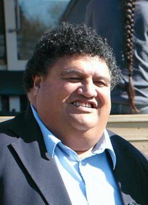

# Parekura Horomia

| | |
|---|---|
| **Party** | Labour |
| **Status (Oct 2026)** | Deceased |
| **Born** | 1950-11-09 — Tolaga Bay, New Zealand |
| **Died** | 2013-04-29 |
| **Electorate(s) held** | Ikaroa-Rāwhiti |
| **Parliaments** | 46, 47, 48, 49, 50 |
| **First elected** | 1999 |
| **Key roles** | 40th Minister of Māori Affairs (2000–2008) |
| **Wikipedia** | [Parekura Horomia](https://en.wikipedia.org/wiki/Parekura_Horomia) |

## Current status

Horomia died at his home on 29 April 2013 while MP for Ikaroa-Rāwhiti ([NZ Herald](http://www.nzherald.co.nz/nz/news/article.cfm?c_id=1&objectid=10880438)). The by-election on 29 June 2013 was won by Labour's Meka Whaitiri.

## Biography

Born 9 November 1950 in Tolaga Bay (Ngāti Porou, Te Aitanga a Hauiti, Ngāti Kahungunu, Ngāi Tahu), Horomia worked as a labourer and printer before rising to general manager of the Department of Labour's Community Employment Group by 1992.

## Political career

### Parliamentary terms

| Parliament | Years | Electorate | List position | Party |
|---|---|---|---|---|
| 46th | 1999–2002 | Ikaroa-Rāwhiti | 25 | Labour |
| 47th | 2002–2005 | Ikaroa-Rāwhiti | 5 | Labour |
| 48th | 2005–2008 | Ikaroa-Rāwhiti | 5 | Labour |
| 49th | 2008–2011 | Ikaroa-Rāwhiti | 5 | Labour |
| 50th | 2011–2013 | Ikaroa-Rāwhiti | 6 | Labour |

_Source: Wikipedia parliamentary-term table._

### Offices held

| Office | From | To | Prime Minister at the time |
|---|---|---|---|
| 40th Minister of Māori Affairs | 26 July 2000 | 19 November 2008 | Helen Clark |

_Source: Wikipedia infobox._

### Career summary

- **MP for Ikaroa-Rāwhiti 1999–2013**, first defeating broadcaster Derek Fox.
- **Minister of Māori Affairs 2000–2008**, replacing Dover Samuels, and associate minister of education, employment and economic development.

## Record & notable actions

- Played a significant role in establishing Māori Television and expanding iwi radio.
- Was Minister of Māori Affairs during the Foreshore and Seabed Act 2004, which led Tariana Turia to leave Labour and form the Māori Party; the Act was repealed in 2011.

## 2026 candidacy

Not listed as a Labour candidate for the 2026 election on policy.nz (Oct 2026).

## Sources

- https://en.wikipedia.org/wiki/Parekura_Horomia
- http://www.nzherald.co.nz/nz/news/article.cfm?c_id=1&objectid=10880438

_Profile compiled 2026-10-23 from the sources above; Wikipedia tables parsed by tools/people_labour_build.py._
