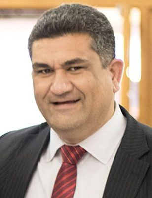

# Paul Eagle

| | |
|---|---|
| **Party** | Labour |
| **Status (Oct 2026)** | Former MP |
| **Born** | 1972-01-10 |
| **Electorate(s) held** | Rongotai |
| **Parliaments** | 52, 53 |
| **First elected** | 2017 |
| **Key roles** | 24th Deputy Mayor of Wellington (2016–2017) Wellington City Councillor for the Southern Ward (2010–2017) |
| **Wikipedia** | [Paul Eagle](https://en.wikipedia.org/wiki/Paul_Eagle) |

## Current status

Eagle became chief executive of the Chatham Islands Council in August 2023. After the Auditor-General began investigating the council's sensitive expenditure in December 2025, he left the role at the end of February 2026 ([The Post](https://www.thepost.co.nz/politics/360948020/paul-eagle-quit-chatham-islands-council-amid-auditor-general-probe)). The March 2026 report criticised about $500,000 of spending on renovating the council-owned house he lived in; Eagle apologised and admitted altering contracts ([RNZ](https://www.rnz.co.nz/news/political/589391/ex-chatham-islands-council-chief-executive-paul-eagle-apologises-as-audit-exposes-excessive-spending); [Newsroom](https://newsroom.co.nz/2026/03/12/i-panicked-ex-mp-paul-eagle-admits-altering-contracts-to-gold-plate-his-council-house/)).

## Biography

Born 10 January 1972 (Waikato-Tainui), Eagle was adopted and raised in Auckland and Wellington, studied fine arts at Elam, and worked in events for councils, SPARC and the Ministry of Economic Development, then as a Police civilian. He was a Wellington city councillor (2010–2017) and the city's first Māori deputy mayor (2016–2017).

## Political career

### Parliamentary terms

| Parliament | Years | Electorate | List position | Party |
|---|---|---|---|---|
| 52nd | 2017–2020 | Rongotai | 34 | Labour |
| 53rd | 2020–2023 | Rongotai | 47 | Labour |

_Source: Wikipedia parliamentary-term table._

### Offices held

| Office | From | To | Prime Minister at the time |
|---|---|---|---|
| 24th Deputy Mayor of Wellington | 26 October 2016 | 27 September 2017 |  |
| Wellington City Councillor for the Southern Ward | 9 October 2010 | 27 September 2017 |  |

_Source: Wikipedia infobox._

### Career summary

- **MP for Rongotai 2017–2023**: majority 10,900 (2017) and 19,207 (2020) ([Electoral Commission](https://www.electionresults.govt.nz/electionresults_2020/electorate-details-43.html)).
- Deputy chair of the Economic Development, Science and Innovation Committee (2017–2018).
- Took leave from July to October 2022 to run, Labour-endorsed, for Wellington mayor; he placed third behind Tory Whanau and Andy Foster, having ruled out a run in 2020 ([Stuff](https://www.stuff.co.nz/dominion-post/news/politics/122737497/mp-paul-eagle-rules-out-wellington-mayoral-run-as-rongotai-candidates-clash-over-commitment)).

## Controversies

- 2022 mayoral campaign issues: a taxpayer-funded constituent survey questioned as campaign research ([RNZ](https://www.rnz.co.nz/news/political/469134/mp-s-use-of-parliamentary-resources-questioned-amid-mayoralty-bid-speculation)), and resurfaced 2015 tweets likening council cycleway staff to the Gestapo, for which he apologised ([Stuff](https://www.stuff.co.nz/dominion-post/wellington-top-stories/300703493/wellington-mayoral-candidate-paul-eagle-sorry-for-likening-council-staff-to-gestapo)).
- The 2026 Auditor-General findings on the Chatham Islands Council (above).

## 2026 candidacy

Not listed as a Labour candidate for the 2026 election on policy.nz (Oct 2026).

## Sources

- https://en.wikipedia.org/wiki/Paul_Eagle
- https://www.thepost.co.nz/politics/360948020/paul-eagle-quit-chatham-islands-council-amid-auditor-general-probe
- https://www.rnz.co.nz/news/political/589391/ex-chatham-islands-council-chief-executive-paul-eagle-apologises-as-audit-exposes-excessive-spending
- https://newsroom.co.nz/2026/03/12/i-panicked-ex-mp-paul-eagle-admits-altering-contracts-to-gold-plate-his-council-house/
- https://www.electionresults.govt.nz/electionresults_2020/electorate-details-43.html
- https://www.stuff.co.nz/dominion-post/news/politics/122737497/mp-paul-eagle-rules-out-wellington-mayoral-run-as-rongotai-candidates-clash-over-commitment
- https://www.rnz.co.nz/news/political/469134/mp-s-use-of-parliamentary-resources-questioned-amid-mayoralty-bid-speculation
- https://www.stuff.co.nz/dominion-post/wellington-top-stories/300703493/wellington-mayoral-candidate-paul-eagle-sorry-for-likening-council-staff-to-gestapo

_Profile compiled 2026-10-23 from the sources above; Wikipedia tables parsed by tools/people_labour_build.py._
