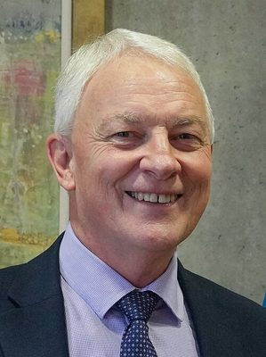

# Phil Goff

| | |
|---|---|
| **Party** | Labour |
| **Status (Oct 2026)** | Former MP |
| **Born** | 1953-06-22 — Auckland, New Zealand |
| **Electorate(s) held** | Mount Roskill |
| **Parliaments** | 49, 50, 51 |
| **First elected** | 2008 |
| **Key roles** | 2nd Mayor of Auckland (2016–2022) 32nd Leader of the Opposition (2008–2011) 13th Leader of the Labour Party (2008–2011) 35th Minister of Defence (2005–2008) 25th Minister of Foreign Affairs (1999–2005) 43rd Minister of Justice (1999–2005) |
| **Wikipedia** | [Phil Goff](https://en.wikipedia.org/wiki/Phil_Goff) |

## Current status

Former MP

## Political career

### Parliamentary terms

| Parliament | Years | Electorate | List position | Party |
|---|---|---|---|---|
| 49th | 2008–2011 | Mount Roskill | 3 | Labour |
| 50th | 2011–2014 | Mount Roskill | 1 | Labour |
| 51st | 2014–2016 | Mount Roskill | 16 | Labour |

_Source: Wikipedia parliamentary-term table._

### Offices held

| Office | From | To | Prime Minister at the time |
|---|---|---|---|
| 2nd Mayor of Auckland | 15 October 2016 | 15 October 2022 |  |
| 32nd Leader of the Opposition | 19 November 2008 | 13 December 2011 | John Key |
| 13th Leader of the Labour Party | 11 November 2008 | 13 December 2011 |  |
| 35th Minister of Defence | 19 October 2005 | 19 November 2008 | Helen Clark |
| 25th Minister of Foreign Affairs | 10 December 1999 | 19 October 2005 | Helen Clark |
| 43rd Minister of Justice | 10 December 1999 | 19 October 2005 | Helen Clark |
| 37th Minister of Education | 14 August 1989 | 2 November 1990 | Geoffrey Palmer ; Mike Moore |
| 9th Minister of Employment | 6 April 1987 | 14 August 1989 | David Lange |
| 14th Minister of Housing | 26 July 1984 | 26 August 1987 | David Lange |
| Member of the New Zealand Parliament | 6 November 1993 | 12 October 2016 |  |

_Source: Wikipedia infobox._

## 2026 candidacy

Not listed as a Labour candidate for the 2026 election on policy.nz (Oct 2026).

## Sources

- https://en.wikipedia.org/wiki/Phil_Goff

_Profile compiled 2026-10-23 from the sources above; Wikipedia tables parsed by tools/people_labour_build.py._
