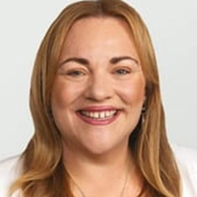

# Rachel Boyack

| | |
|---|---|
| **Party** | Labour |
| **Status (Oct 2026)** | Current MP, standing in 2026 |
| **Born** | 1979 or 1980 — Timaru, New Zealand |
| **Electorate(s) held** | Nelson |
| **Parliaments** | 53, 54 |
| **First elected** | 2020 |
| **2026 candidacy** | Nelson · list #37 |
| **Key roles** | Labour shadow cabinet #27 (as of 11 Mar 2026): Spokesperson for Oceans and Fisheries; Spokesperson for Arts, Culture and Heritage; Spokesperson for Animal Welfare |
| **Wikipedia** | [Rachel Boyack](https://en.wikipedia.org/wiki/Rachel_Boyack) |

## Current status

Boyack is No. 27 in the shadow cabinet and is defending Nelson — won by just 26 votes after a 2023 judicial recount — at No. 37 on the list ([RNZ](https://www.rnz.co.nz/news/political/502129/labour-s-rachel-boyack-confirms-26-vote-win-in-nelson-recount); [policy.nz](https://policy.nz/2026/party-vote/parties/labour-party)).

## Biography

Born in Timaru and raised in Palmerston North, Boyack has a Bachelor of Music from the University of Auckland, sang in the NZ Youth Choir, and was assistant director of music at Nelson's Christ Church Cathedral. She was president of the NMIT student union and from about 2012 Nelson organiser for FIRST Union ([Stuff](https://www.stuff.co.nz/national/politics/117332392/rachel-boyack-returns-as-labour-party-candidate-in-nelson-for-2020)). She is married to accountant Scott Mayer.

## Political career

### Parliamentary terms

| Parliament | Years | Electorate | List position | Party |
|---|---|---|---|---|
| 53rd | 2020–2023 | Nelson | 57 | Labour |
| 54th | 2023–present | Nelson | 42 | Labour |

_Source: Wikipedia parliamentary-term table._

### Opposition portfolios (as of 11 March 2026)

Rank 27 in Chris Hipkins' shadow cabinet:

- Spokesperson for Oceans and Fisheries
- Spokesperson for Arts, Culture and Heritage
- Spokesperson for Animal Welfare

_Source: [Shadow Cabinet of Chris Hipkins](https://en.wikipedia.org/wiki/Shadow_Cabinet_of_Chris_Hipkins), list as of 11 March 2026._

### Career summary

- Contested Nelson in 2017; **won it in 2020** by 4,525, unseating National's long-serving Nick Smith; held it in 2023 by 26 votes over Blair Cameron after a recount ([2020](https://www.electionresults.govt.nz/electionresults_2020/electorate-details-27.html)).

## Record & notable actions

- **Plain Language Act 2022:** her member's bill requiring public agencies to use plain language passed in October 2022 despite National opposition and a filibuster attempt ([Stuff](https://www.stuff.co.nz/national/politics/130259626/nelson-mp-rachel-boyacks-plain-language-bill-passes-into-law)).
- Steered a private bill modernising the Cawthron Institute's governance, including iwi board representation.

<!-- GENERATED:2026-candidacy START -->
## 2026 candidacy

- **Electorate:** Nelson
- **List ranking:** 37

_Source: candidate questionnaire answers published on [policy.nz](https://policy.nz/2026/party-vote/parties/labour-party), retrieved Oct 2026._
<!-- GENERATED:2026-candidacy END -->

## Sources

- https://en.wikipedia.org/wiki/Rachel_Boyack
- https://policy.nz/2026/party-vote/parties/labour-party
- https://en.wikipedia.org/wiki/Shadow_Cabinet_of_Chris_Hipkins
- https://www.rnz.co.nz/news/political/502129/labour-s-rachel-boyack-confirms-26-vote-win-in-nelson-recount
- https://www.stuff.co.nz/national/politics/117332392/rachel-boyack-returns-as-labour-party-candidate-in-nelson-for-2020
- https://www.electionresults.govt.nz/electionresults_2020/electorate-details-27.html
- https://www.stuff.co.nz/national/politics/130259626/nelson-mp-rachel-boyacks-plain-language-bill-passes-into-law

_Profile compiled 2026-10-23 from the sources above; Wikipedia tables parsed by tools/people_labour_build.py._
