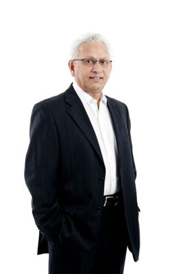

# Rajen Prasad

| | |
|---|---|
| **Party** | Labour |
| **Status (Oct 2026)** | Former MP |
| **Born** | 1947 — Suva, Fiji |
| **Parliaments** | 49, 50 |
| **First elected** | 2008 |
| **Wikipedia** | [Rajen Prasad](https://en.wikipedia.org/wiki/Rajen_Prasad) |

## Current status

Prasad retired at the 2014 election and was then appointed a Commonwealth Special Envoy for Lesotho ([Commonwealth](http://thecommonwealth.org/media/news/commonwealth-special-envoy-lesotho-releases-guidelines-coalition-formation)). No reliable source was found for his activities in 2026.

## Biography

Born in Suva, Fiji, in 1947, Prasad moved to Auckland in 1964. A social worker and Massey University academic (PhD 1986), he was Race Relations Conciliator (1996–2001) and the first Chief Commissioner of the Families Commission (2004–2008) ([Beehive](https://www.beehive.govt.nz/release/families-commissioners-appointed)). QSO (2003).

## Political career

### Parliamentary terms

| Parliament | Years | Electorate | List position | Party |
|---|---|---|---|---|
| 49th | 2008–2011 | List | 12 | Labour |
| 50th | 2011–2014 | List | 20 | Labour |

_Source: Wikipedia parliamentary-term table._

### Career summary

- **List MP 2008–2014** (list-only; ranked 12 in 2008).
- Spokesperson for the community and voluntary sector (2008–2011), ethnic affairs (2011–2013) and immigration (2013–2014).

## Record & notable actions

- Opposed the National Government's Families Commission reforms; voted for same-sex marriage (2013).

## Controversies

- As Families Commission chief commissioner, apologised for approving a confidential payout to the outgoing chief executive without telling the government ([NZ Herald](https://www.nzherald.co.nz/nz/families-commissioner-loses-pay-rise/5IKK43WSCWOMB7YYTRGOG7Q57I/)).
- Trans Tasman's annual roll call rated him 1/10 in 2011–2013 ([2013](https://publications.themainreport.nz/transtasman/wp-content/uploads/2013/12/Trans-Tasman-Roll-Call-2013.pdf)).

## 2026 candidacy

Not listed as a Labour candidate for the 2026 election on policy.nz (Oct 2026).

## Sources

- https://en.wikipedia.org/wiki/Rajen_Prasad
- http://thecommonwealth.org/media/news/commonwealth-special-envoy-lesotho-releases-guidelines-coalition-formation
- https://www.beehive.govt.nz/release/families-commissioners-appointed
- https://www.nzherald.co.nz/nz/families-commissioner-loses-pay-rise/5IKK43WSCWOMB7YYTRGOG7Q57I/
- https://publications.themainreport.nz/transtasman/wp-content/uploads/2013/12/Trans-Tasman-Roll-Call-2013.pdf

_Profile compiled 2026-10-23 from the sources above; Wikipedia tables parsed by tools/people_labour_build.py._
