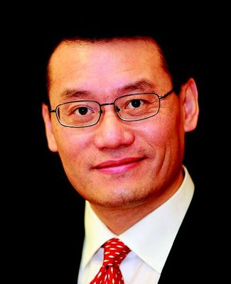

# Raymond Huo

| | |
|---|---|
| **Party** | Labour |
| **Status (Oct 2026)** | Former MP |
| **Born** | 1964 — Qianshan, Anhui, China |
| **Parliaments** | 49, 50, 51, 52 |
| **First elected** | 2008 |
| **Wikipedia** | [Raymond Huo](https://en.wikipedia.org/wiki/Raymond_Huo) |

## Current status

Huo did not stand in 2020, citing family reasons ([RNZ](https://www.rnz.co.nz/news/political/421677/labour-list-mp-raymond-huo-to-retire-from-politics-at-election)). No reliable source was found on his activities in 2026.

## Biography

Born in 1964 in Qianshan, China, Huo emigrated to New Zealand in 1994, was the NZ Herald's Asian affairs reporter and practised law at Brookfields and Hesketh Henry. He was Labour's first MP of Chinese descent.

## Political career

### Parliamentary terms

| Parliament | Years | Electorate | List position | Party |
|---|---|---|---|---|
| 49th | 2008–2011 | List | 21 | Labour |
| 50th | 2011–2014 | List | 21 | Labour |
| 51st | 2017– | List | 21 | Labour |
| 52nd | 2017–2020 | List | 13 | Labour |

_Source: Wikipedia parliamentary-term table._

### Career summary

- **List MP 2008–2014** and **2017–2020**; returned in March 2017 after Jacinda Ardern's Mount Albert by-election win ([NZ Herald](http://www.nzherald.co.nz/nz/news/article.cfm?c_id=1&objectid=11804547)).
- Chaired the Justice Committee from 2017, stepping aside from its inquiry into foreign interference in 2019 ([Newsroom](https://www.newsroom.co.nz/2019/04/30/559897?slug=raymond-huo-steps-down-as-chair)).

## Record & notable actions

- Instrumental in establishing New Zealand Chinese Language Week (2014).
- His Auckland Council Asian Advisory Board bill was defeated 64–58 in 2009, though the Government then set up an ethnic advisory panel.

## Controversies

- Academic Anne-Marie Brady (2017) described him as close to the Chinese Government's united-front networks; Huo rejected the allegations ([NZ Herald](https://www.nzherald.co.nz/nz/news/article.cfm?c_id=1&objectid=11954587)).
- In 2019 the Justice Committee, which he chaired, initially refused to hear Brady, before reversing ([RNZ](https://www.radionz.co.nz/news/political/384252/labour-mps-backtrack-on-anne-marie-brady-committee-decision)).
- Several outlets reported in 2021 that his and National MP Jian Yang's 2020 departures followed an arrangement between Jacinda Ardern and Todd Muller after intelligence concerns; both parties declined to comment ([RNZ](https://www.rnz.co.nz/news/political/443477/labour-national-tight-lipped-on-former-kiwi-chinese-mps-departure)).

## 2026 candidacy

Not listed as a Labour candidate for the 2026 election on policy.nz (Oct 2026).

## Sources

- https://en.wikipedia.org/wiki/Raymond_Huo
- https://www.rnz.co.nz/news/political/421677/labour-list-mp-raymond-huo-to-retire-from-politics-at-election
- http://www.nzherald.co.nz/nz/news/article.cfm?c_id=1&objectid=11804547
- https://www.newsroom.co.nz/2019/04/30/559897?slug=raymond-huo-steps-down-as-chair
- https://www.nzherald.co.nz/nz/news/article.cfm?c_id=1&objectid=11954587
- https://www.radionz.co.nz/news/political/384252/labour-mps-backtrack-on-anne-marie-brady-committee-decision
- https://www.rnz.co.nz/news/political/443477/labour-national-tight-lipped-on-former-kiwi-chinese-mps-departure

_Profile compiled 2026-10-23 from the sources above; Wikipedia tables parsed by tools/people_labour_build.py._
