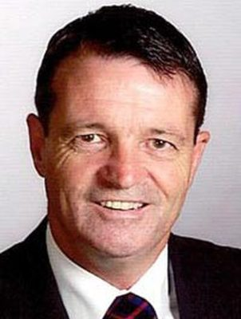

# Ross Robertson

| | |
|---|---|
| **Party** | Labour |
| **Status (Oct 2026)** | Former MP |
| **Born** | 1949-05-22 |
| **Electorate(s) held** | Manukau East |
| **Parliaments** | 50 |
| **First elected** | 2008 |
| **Wikipedia** | [Ross Robertson (politician)](https://en.wikipedia.org/wiki/Ross_Robertson_%28politician%29) |

## Current status

Robertson announced in June 2013 that he would retire to pursue local-body politics ([NZ Herald](http://www.nzherald.co.nz/politics/news/article.cfm?c_id=280&objectid=10888813)); he was elected to the Ōtara-Papatoetoe Local Board in 2013 and re-elected in 2016 and 2019. QSO (2015). His current roles were not confirmed from the sources consulted.

## Biography

Born in Wellington on 22 May 1949, Robertson was an industrial engineer before politics. He was president of Parliamentarians for Global Action.

## Political career

### Career summary

- **MP 1987–2014:** Papatoetoe (1987–1996) and Manukau East (1996–2014).
- Assistant Speaker during the Fifth Labour Government.

## Record & notable actions

- One of four Labour MPs (with William Sio, Rino Tirikatene and Damien O'Connor) to vote against same-sex marriage in 2013.

## 2026 candidacy

Not listed as a Labour candidate for the 2026 election on policy.nz (Oct 2026).

## Sources

- https://en.wikipedia.org/wiki/Ross_Robertson_%28politician%29
- https://en.wikipedia.org/wiki/Ross_Robertson
- http://www.nzherald.co.nz/politics/news/article.cfm?c_id=280&objectid=10888813

_Profile compiled 2026-10-23 from the sources above; Wikipedia tables parsed by tools/people_labour_build.py._
