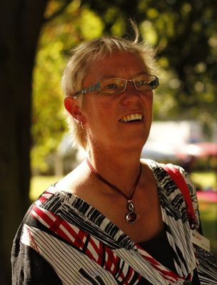

# Ruth Dyson

| | |
|---|---|
| **Party** | Labour |
| **Status (Oct 2026)** | Former MP |
| **Born** | 1957-08-11 — Wellington, New Zealand |
| **Electorate(s) held** | Port Hills |
| **Parliaments** | 49, 50, 51, 52 |
| **First elected** | 2008 |
| **Key roles** | Assistant Speaker of the House of Representatives (2019–2020) Chief Government Whip in the House of Representatives (2017–2019) Member of the New Zealand Parliament; for Port Hills; Banks Peninsula (1999–2008) (1999–2020) |
| **Wikipedia** | [Ruth Dyson](https://en.wikipedia.org/wiki/Ruth_Dyson) |

## Current status

Former MP

## Political career

### Parliamentary terms

| Parliament | Years | Electorate | List position | Party |
|---|---|---|---|---|
| 49th | 2008–2011 | Port Hills | 14 | Labour |
| 50th | 2011–2014 | Port Hills | 5 | Labour |
| 51st | 2014–2017 | Port Hills | none | Labour |
| 52nd | 2017–2020 | Port Hills | 24 | Labour |

_Source: Wikipedia parliamentary-term table._

### Offices held

| Office | From | To | Prime Minister at the time |
|---|---|---|---|
| Assistant Speaker of the House of Representatives | 3 July 2019 | 17 October 2020 |  |
| Chief Government Whip in the House of Representatives | 26 October 2017 | 27 June 2019 | Jacinda Ardern |
| Member of the New Zealand Parliament; for Port Hills; Banks Peninsula (1999–2008) | 27 November 1999 | 17 October 2020 |  |

_Source: Wikipedia infobox._

## 2026 candidacy

Not listed as a Labour candidate for the 2026 election on policy.nz (Oct 2026).

## Sources

- https://en.wikipedia.org/wiki/Ruth_Dyson

_Profile compiled 2026-10-23 from the sources above; Wikipedia tables parsed by tools/people_labour_build.py._
