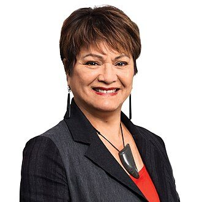

# Soraya Peke-Mason

| | |
|---|---|
| **Party** | Labour |
| **Status (Oct 2026)** | Former MP |
| **Born** | 1957 or 1958 — Tokoroa, New Zealand |
| **Parliaments** | 53 |
| **First elected** | 2022 |
| **Key roles** | Rangitikei District Councillor for the Turakina ward (2007–2019) |
| **Wikipedia** | [Soraya Peke-Mason](https://en.wikipedia.org/wiki/Soraya_Peke-Mason) |

## Current status

Peke-Mason was unsuccessful in the Raki Māori constituency of Horizons Regional Council in the 2025 local elections ([Te Ao Māori News](https://www.teaonews.co.nz/2025/09/15/raki-maori-soraya-peke-mason-seeks-horizons-seat-with-pledge-to-put-awa-at-centre/); [Horizons](https://www.horizons.govt.nz/about-our-region-and-council/your-councillors)).

## Biography

Born in Tokoroa and raised in Castlecliff, Whanganui (Ngāti Apa, Ngāti Rangi, Ngāti Tūwharetoa, Tainui), Peke-Mason is a Rātana-based businesswoman with an MBA from Massey. She served on the Rātana Community Board (2001–2007), was the Rangitīkei District Council's first Māori woman councillor (2007–2019), and chaired the Ngāti Rangi post-settlement entity. Her cousin is the late Speaker Adrian Rurawhe.

## Political career

### Parliamentary terms

| Parliament | Years | Electorate | List position | Party |
|---|---|---|---|---|
| 53rd | 2022–2023 | List | 60 | Labour |

_Source: Wikipedia parliamentary-term table._

### Offices held

| Office | From | To | Prime Minister at the time |
|---|---|---|---|
| Rangitikei District Councillor for the Turakina ward | 13 October 2007 | 12 October 2019 |  |

_Source: Wikipedia infobox._

### Career summary

- Contested Te Tai Hauāuru (2011, 2023) and Rangitīkei (2020).
- **List MP from 25 October 2022**, replacing Trevor Mallard; her swearing-in gave women a majority in Parliament for the first time ([RNZ](https://www.rnz.co.nz/news/political/476546/parliamentary-milestone-new-mp-s-swearing-in-will-make-political-history)).
- Lost Te Tai Hauāuru to Te Pāti Māori's Debbie Ngarewa-Packer by 9,162 votes in 2023.

## 2026 candidacy

Not listed as a Labour candidate for the 2026 election on policy.nz (Oct 2026).

## Sources

- https://en.wikipedia.org/wiki/Soraya_Peke-Mason
- https://www.teaonews.co.nz/2025/09/15/raki-maori-soraya-peke-mason-seeks-horizons-seat-with-pledge-to-put-awa-at-centre/
- https://www.horizons.govt.nz/about-our-region-and-council/your-councillors
- https://www.rnz.co.nz/news/political/476546/parliamentary-milestone-new-mp-s-swearing-in-will-make-political-history

_Profile compiled 2026-10-23 from the sources above; Wikipedia tables parsed by tools/people_labour_build.py._
